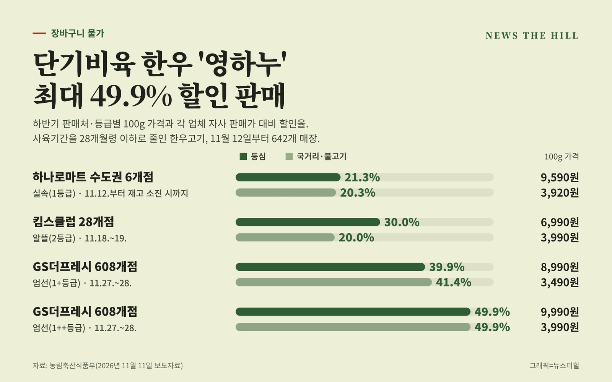

입력 2026-11-11

*그래픽=뉴스더힐(자료: 농림축산식품부)*

사육기간을 줄여 값을 낮춘 한우고기 '영하누'를 12일부터 하나로마트·킴스클럽·GS더프레시에서 살 수 있다. 판매업체 자사 판매가격과 비교해 최대 49.9% 싸다.

농림축산식품부는 11일 보도자료에서 한우 사육기간 단축으로 생산비를 줄이고 소비자의 합리적인 한우고기 소비를 유도하기 위해 11월 12일부터 단기비육 한우고기(브랜드명 영하누)를 판매한다고 밝혔다.

단기비육 한우고기는 사육기간을 28개월령 이하로 줄인 한우다. 농가는 생산비를 줄이고 소비자는 한우고기를 더 싸게 살 수 있도록 하자는 취지로, 올해 5월에 189두를 판매한 바 있다. 하반기에는 전국 642개 매장에서 판매한다.

## 어디서, 얼마에 파나

가격은 100g 기준이며, 할인율은 각 업체의 자사 판매가격 대비 기준이다.

- 하나로마트 수도권 6개점(농협, 실속·1등급): 11월 12일부터 재고 소진 시까지. 등심 9,590원(21.3% 할인), 국거리·불고기 3,920원(20.3% 할인)
- 킴스클럽 28개점(이랜드, 알뜰·2등급): 11월 18~19일. 등심 6,990원(30.0% 할인), 국거리·불고기 3,990원(20.0% 할인)
- GS더프레시 608개점(GS리테일, 엄선·1+등급): 11월 27~28일. 등심 8,990원(39.9% 할인), 국거리·불고기 3,490원(41.4% 할인)
- GS더프레시 608개점(GS리테일, 엄선·1++등급): 11월 27~28일. 등심 9,990원(49.9% 할인), 국거리·불고기 3,990원(49.9% 할인)

GS리테일은 모바일앱 '우리동네GS'에서 11월 10일부터 24일까지 온라인 사전판매도 함께 한다.

## 등급 표시는 엄선·실속·알뜰 세 가지

단기비육 한우고기는 등급을 단순화해 표시한다. 1++·1+등급은 '엄선', 1등급은 '실속', 2·3등급은 '알뜰'이다.

농식품부에 따르면 상반기 판매 때 한 설문조사에서 소비자들은 영하누의 저렴한 가격에 매우 만족했다. 선호도는 엄선 42%, 실속 41%로 비슷했고 알뜰은 17%였다.

판매업체 담당자들은 단기비육 한우고기가 일반 한우고기보다 저렴하면서도 맛과 품질에 차이가 없고, 가공할 때 제거하는 지방이 적어 생산 수율이 높고 유통비용 절감 효과가 뛰어나다고 평가했다고 농식품부는 전했다.

이재식 농식품부 축산정책관은 "향후에도 단기비육 한우고기가 시장에 안정적으로 정착하여 생산자와 소비자 모두가 만족하는 축산물 유통구조가 확립될 수 있도록 적극 노력하겠다"라고 밝혔다.

※ 이 기사는 농림축산식품부 보도자료(정책브리핑, 공공누리 제1유형·출처표시)를 바탕으로 작성했습니다.
