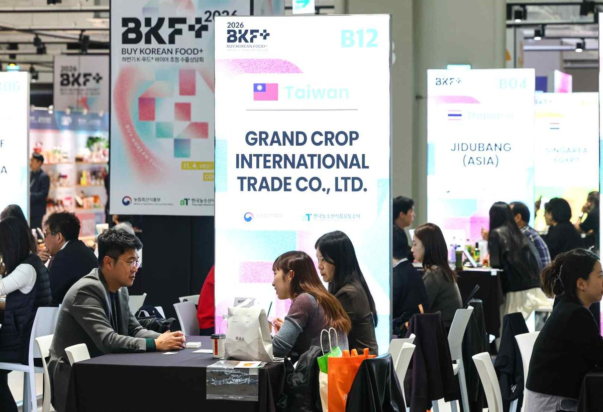

입력 2026-11-11

*11월 4~7일 서울 코엑스에서 열린 '푸드위크 코리아 2026' 전시장. 사진=농림축산식품부 제공*

지난 4~7일 서울 코엑스에서 열린 식품산업 박람회 '푸드위크 코리아 2026'에 5만 6천여 명이 다녀갔다. 현장에서 맺은 수출 계약은 1,400만 달러로 지난해보다 약 18% 늘었다.

농림축산식품부는 11일 보도자료에서 '맛으로 잇는 세계, K-푸드로 통하다'를 주제로 열린 이번 박람회에 46개국 약 1,000개 식품기업과 252개 바이어사가 참여하고 1,622개 부스가 운영됐다고 밝혔다. 일반 관람객과 바이어를 합친 방문객은 5만 6천여 명으로, 전년도 5만 5천여 명보다 많았다.

## 상담 2,937건, 계약 47건

3일간 열린 비즈니스 상담회에서는 총 2,937건의 상담이 이뤄졌고, 현장 계약 47건, 1,400만 달러 규모의 계약이 체결됐다.

농식품부에 따르면 해외 바이어들은 완제품뿐 아니라 불고기 양념 소스 등 소스류와 식자재에 관심을 보였다. 미국의 대형 급식·유통 관계자들은 한국 소스류와 식자재를 현지 단체급식·외식 시장에 접목할 가능성에 주목해 국내 기업들과 공급 방안을 협의했다.

## 신선 과채류·우리술 계약 800만 달러

포도·딸기 등 신선 과채류와 우리술의 현장 계약액은 약 800만 달러로 전년보다 515% 늘었다. 전시장에는 'K-주막' 라이브 쇼케이스와 신선 과채류·전통주 페어링 시음·시식 코너가 마련됐다. 산청 곶감에 유자·대추·잣·인삼 등 지역 특산물을 더한 디저트 등 'K-디저트' 부스에도 바이어 상담 문의가 이어졌다고 농식품부는 전했다.

행사 기간에는 신선 농산물 수출을 늘리기 위한 '고숙도 딸기 수출 시범사업' 업무협약(MOU)도 생산자·수출업체·싱가포르 바이어 3자 사이에 체결됐다. 협약에 참여한 농가 대표는 "이번 시범사업이 농가 소득 증대에 큰 보탬이 될 것"이라며, "이를 발판 삼아 한국산 딸기가 세계 시장에서 명품 브랜드로 굳건히 자리매김하길 기대한다"고 말했다.

*'푸드위크 코리아 2026' 전시장의 상담 부스. 사진=농림축산식품부 제공*

전시장을 찾은 한 러시아 바이어는 "러시아에서 최근 K-푸드 수요가 꾸준히 늘고 있으며, 특히 신선과일과 냉동식품, 프리미엄 식품에 대한 관심이 높다"며, "관련 기업들과 심도 있는 미팅을 진행한 것은 물론, 전시장에서 소비자의 생생한 반응까지 함께 확인할 수 있어 제품 경쟁력을 평가하는 데 큰 도움이 됐다. 한국의 다채로운 식문화와 제품을 체계적으로 연계한 프로그램 구성 역시 매우 만족스럽다"고 밝혔다.

행사 마지막 날인 7일 전시장을 찾은 송미령 농식품부 장관은 참가기업들에게 "지금 K-푸드는 전 세계인의 입맛을 사로잡으며 글로벌 식품 영토를 확장해 나가는 골든타임을 맞이했다."라며, "우리 식품기업들이 세계 무대로 힘차게 도약할 수 있도록 정책적·외교적 지원을 아끼지 않고 뒷받침하겠다."라고 말했다.

정경석 농식품부 식품산업정책관은 "역대 최대 규모인 5만 6천여 명의 관람객이 다녀간 이번 「푸드위크코리아 2026」을 통해 국내 식품기업과 글로벌 바이어 간의 튼튼한 비즈니스 협력 네트워크가 구축되었다"라며, "앞으로 소스류 및 식자재 등 유망 품목의 수출 다변화를 돕고, AI·로봇 등 첨단 푸드테크와의 융합을 적극 뒷받침하여 K-푸드가 글로벌 시장에서 대체 불가능한 명품 브랜드로 도약하도록 경쟁력을 강화해 나가겠다"고 밝혔다.

※ 이 기사는 농림축산식품부 보도자료(정책브리핑, 공공누리 제1유형·출처표시)를 바탕으로 작성했습니다. 사진은 농림축산식품부가 보도자료와 함께 제공한 것입니다.
