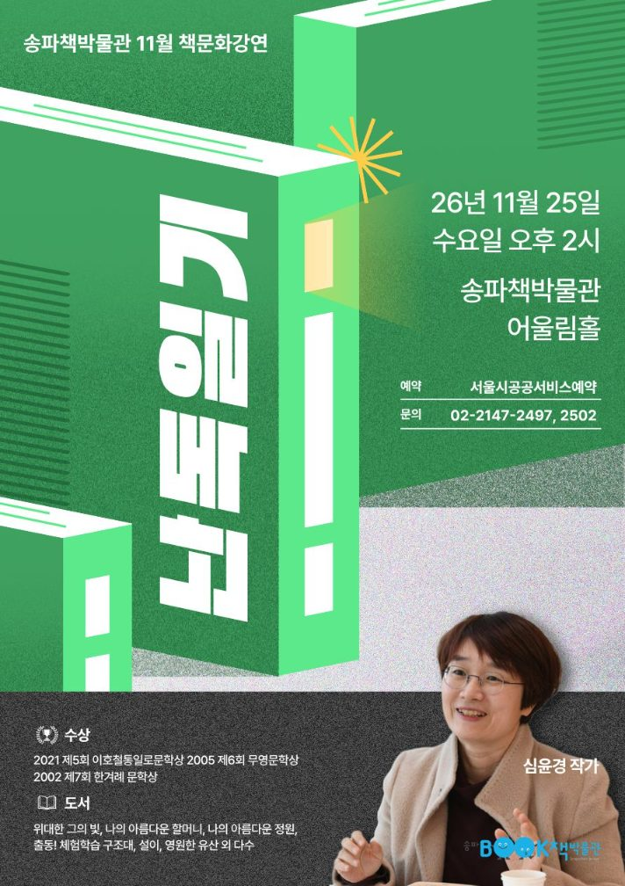

입력 2026-11-12

*송파책박물관 11월 책문화강연 '난독일기' 포스터. 자료=송파구 제공*

소설가 심윤경이 25일(수) 송파책박물관에서 '난독일기'를 주제로 강연한다. 책문화에 관심 있는 성인이면 누구나 무료로 들을 수 있다.

송파구는 12일 보도자료에서 이날 오후 2시 송파책박물관 어울림홀에서 심윤경 작가를 초청해 책문화 강연을 연다고 밝혔다.

강연에서 심 작가는 직접 겪은 난독이 책 읽기와 글쓰기에 어떤 영향을 미쳤는지, 그 경험이 자신의 삶과 작품에 어떤 변화를 가져왔는지를 들려준다. 글을 쓰는 작가에게 난독이라는 경험이 갖는 의미를 짚고, 독서와 창작으로 개인적인 아픔을 마주하고 치유해 가는 과정을 관객과 나눌 예정이다.

심윤경 작가는 『나의 아름다운 정원』, 『달의 제단』, 『설이』, 『나의 아름다운 할머니』 등을 발표했다. 2002년 제7회 한겨레문학상, 2005년 제6회 무영문학상, 2021년 제5회 이호철통일로문학상 등을 받았다.

이번 강연은 송파책박물관이 책 읽는 즐거움을 나누고 구민의 문화 향유 기회를 넓히기 위해 운영하는 '저자와 함께하는 책문화 강연'의 하나다.

## 참여 방법

- 일시: 11월 25일(수) 오후 2시
- 장소: 송파책박물관 어울림홀
- 대상·비용: 책문화에 관심 있는 성인 누구나, 무료
- 예약: 서울시공공서비스예약(잔여석이 있으면 현장 접수 가능)
- 자세한 사항: 송파책박물관 누리집(www.bookmuseum.go.kr), 문의 02-2147-2497, 2502

서강석 송파구청장은 "이번 강연이 구민들에게 책을 읽는 즐거움과 글을 쓰는 기쁨을 되새기는 계기가 되길 바란다"며 "앞으로도 책을 통해 일상에 새로운 영감과 즐거움을 더할 수 있도록 다양한 문화 프로그램을 마련하겠다"고 전했다.

※ 이 기사는 송파구 보도자료(11월 12일)를 바탕으로 작성했습니다.
