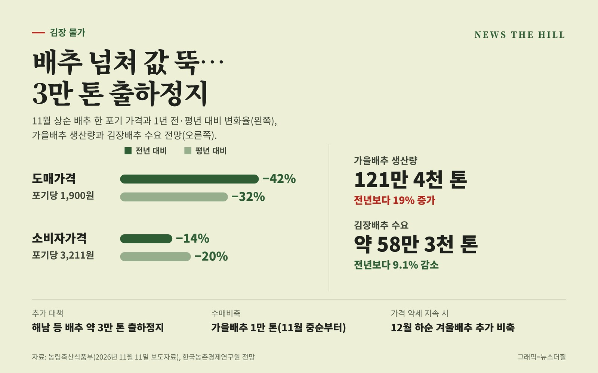

입력 2026-11-12

*그래픽=뉴스더힐(자료: 농림축산식품부)*

올해 가을배추가 많이 나오면서 배추 도매가격이 1년 전보다 42% 떨어졌다. 정부는 공급이 넘치는 배추 약 3만 톤을 출하정지하고, 값이 계속 낮으면 겨울배추도 추가로 사들여 비축하기로 했다.

농림축산식품부는 11일 보도자료에서 가을배추 생산량 증가로 가격이 하락함에 따라 지난 11월 3일 발표한 김장재료 수급안정대책에 이어 산지 출하정지, 수매비축 확대 등 추가 대책을 시행한다고 밝혔다.

## 배추값 얼마나 내렸나

11월 상순 기준 배추 도매가격은 포기당 1,900원으로 전년 같은 기간보다 42%, 평년보다 32% 낮다. 소비자가격도 포기당 3,211원으로 전년보다 14%, 평년보다 20% 내렸다.

농식품부는 올해 가을배추가 재배기간 중 기상이 좋아 생산량이 전년보다 크게 늘어난 반면, 김치 소비 감소 등으로 수요는 줄어 가격이 약세를 보이고 있다고 설명했다.

- 가을배추 생산량(한국농촌경제연구원 전망): 121만 4천 톤, 전년보다 19%·평년보다 3% 증가
- 겨울배추 생산량(12월부터 주 출하): 26만 5천 톤, 전년보다 7%·평년보다 11% 증가 예상
- 김장배추 수요: 약 58만 3천 톤, 전년보다 9.1% 감소 추정

현재 배추가 주로 출하되는 강원 춘천, 충남 서산, 전북 고창, 경북 문경 등 중부 지역과 11월 하순부터 주로 출하되는 해남 등 남부 지역도 작황이 좋아, 지금 같은 기상이 이어지면 김장철 배추 공급과잉이 우려된다고 농식품부는 밝혔다.

## 추가 대책 세 가지

농식품부는 11월 6일 전남광주통합특별시 겨울배추 주산지협의체를 열어 현장 의견을 들은 뒤 추가 대책을 마련했다.

- 출하정지: 11월 하순 이후 김장배추 주 출하지인 해남 등에서 평년보다 공급과잉이 예상되는 배추 약 3만 톤(400ha 내외)을 출하정지한다. 참여 농가에는 농산물 안정생산공급지원사업을 통해 경영비 이상의 금액을 보전한다.
- 겨울배추 추가 수매비축: 김장 성수기 이후에도 가격 약세가 이어지면 12월 하순부터 추진한다. 수매 시기와 물량은 수급 상황에 따라 정한다.
- 소득보전: 안정생산공급지원사업에 참여하는 겨울배추 재배농가는 시장가격이 크게 떨어지면 평년가격의 80% 수준까지 가격 차를 보전한다(2027년 1분기). 수입안정보험 가입 농가는 평년수입의 최대 85%까지 보장받는다.

## 이미 하고 있는 대책

- 농수산물 할인에 640억 원을 투입해 배추·무 등 김장재료 할인행사(농산물 최대 40% 할인)
- '김장 한 포기 더하기' 캠페인, 김장 나눔행사·김치 단체 구매 확대
- 김치협회 누리집(kimchikorea.org) 김치 공동구매 창구에서 11월 11일부터 24일까지 구매 신청 접수. 공동브랜드 '한채담'은 100% 국산 농산물을 쓰고 20% 이상 할인된 가격에 공급
- 11월 중순부터 가을배추 1만 톤 수매비축
- 농협 계약재배 신청기간을 11월까지 연장. 11월 상순 기준 계약물량은 가을배추 3만 2천 톤, 겨울배추 5만 2천 톤으로 전년보다 각각 27%, 14% 증가

송미령 농식품부 장관은 "올해는 배추 생산량 증가와 소비 부진으로 가격이 하락하면서 농업인들의 어려움이 커지고 있다"라며, "정부는 관계기관과 협력하여 기존 김장대책에 더해 선제적인 출하정지와 추가 수매비축 등 가용한 정책수단을 최대한 동원하여 배추 가격 회복과 농가경영안정에 만전을 기하겠다"라고 밝혔다.

※ 이 기사는 농림축산식품부 보도자료(정책브리핑, 공공누리 제1유형·출처표시)를 바탕으로 작성했습니다.
