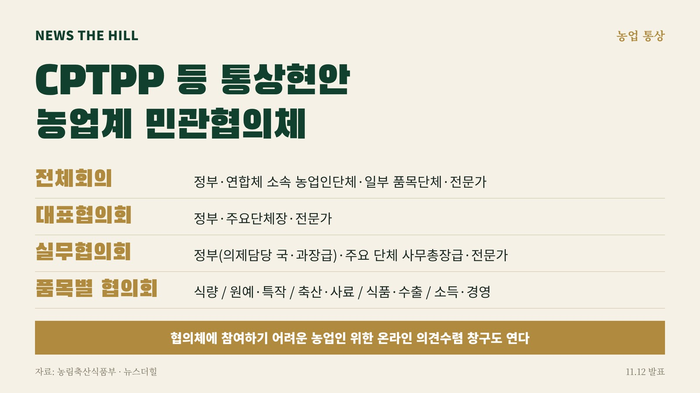

입력 2026-11-12

*그래픽=뉴스더힐(자료: 농림축산식품부)*

포괄적·점진적 환태평양경제동반자협정(CPTPP) 등 통상현안이 국내 농업에 미칠 영향을 농업인단체와 정부가 함께 따져 보는 협의체가 꾸려졌다. 식량·원예·축산은 물론 식품·수출 분야까지 품목별로 영향과 우려 사항을 살펴본다.

농림축산식품부는 12일 보도자료에서 주요 통상현안에 대한 농업계 의견을 폭넓게 수렴하고 대응방안을 함께 모색하기 위해 민관협의체(가칭 '농업 분야 통상현안 대응 민관협의체')를 구성하고 본격적인 운영에 들어간다고 밝혔다.

농식품부는 지난 8월 27일 CPTPP 관련 사회적 논의가 시작된 뒤 농업인단체 등과 간담회와 의견교환을 하며 농업계의 우려와 현장 의견을 들어 왔다. 이번 협의체는 CPTPP 등 메가 FTA가 국내 농업에 미칠 수 있는 영향과 농업계의 우려를 살펴보고, 농업인단체와 정부 간 소통을 체계적이고 지속적으로 이어가기 위해 마련됐다.

## 협의체 어떻게 꾸려지나

협의체에는 농업인단체, 정부, 전문가 등이 참여하며 전체회의, 대표협의회, 실무협의회, 품목별 협의회로 구성된다.

- 전체회의: 정부, 연합체 소속 농업인단체, 일부 품목단체, 전문가. 각 협의회의 주요 논의 내용을 공유하고 공통 현안을 논의
- 대표협의회: 정부, 주요 단체장, 전문가. 농업계의 주요 관심 사항과 쟁점 논의
- 실무협의회: 정부(의제 담당 국·과장급), 주요 단체 사무총장급, 전문가
- 품목별 협의회: 정부(국장급), 품목단체 대표 또는 사무총장, 전문가. 식량, 원예·특작, 축산·사료, 식품·수출, 소득·경영 분야별 영향과 우려 사항을 살펴보고 대응방안 모색

협의체에서 논의된 사항은 관계 부처와 협의하고 관련 정책을 검토하는 과정에 반영할 계획이라고 농식품부는 밝혔다. 식량·축산·원예 등 분야별로 장차관 현장간담회도 열어 품목별 민감 사항에 대한 현장 의견을 듣는다.

## 온라인 의견수렴 창구도

협의체에 직접 참여하기 어려운 농업인 등의 의견을 받기 위해 온라인 의견수렴 창구도 마련된다. 접수된 의견은 소관 부서에서 검토한 뒤 관련 협의체 논의에 활용한다. 구체적인 이용 방법은 농식품부 누리집을 통해 추후 별도로 안내할 예정이다.

농식품부는 이번 협의체 구성이 CPTPP 가입을 전제로 하거나 가입 절차의 개시를 의미하는 것은 아니며, 향후 추진 가능성에 대비하면서 농업계와 충분히 소통하며 관련 현안을 신중하게 검토하기 위한 것이라고 설명했다.

박상호 농식품부 국제농식품협력관은 "CPTPP는 농업 분야에 미치는 영향과 현장의 우려를 충분히 살펴봐야 하는 사안"이라며, "농업계의 목소리를 지속적으로 듣고 주요 쟁점을 함께 논의하면서 신뢰를 쌓아가는 데 중점을 두겠다"라고 밝혔다.

※ 이 기사는 농림축산식품부 보도자료(정책브리핑, 공공누리 제1유형·출처표시)를 바탕으로 작성했습니다.
