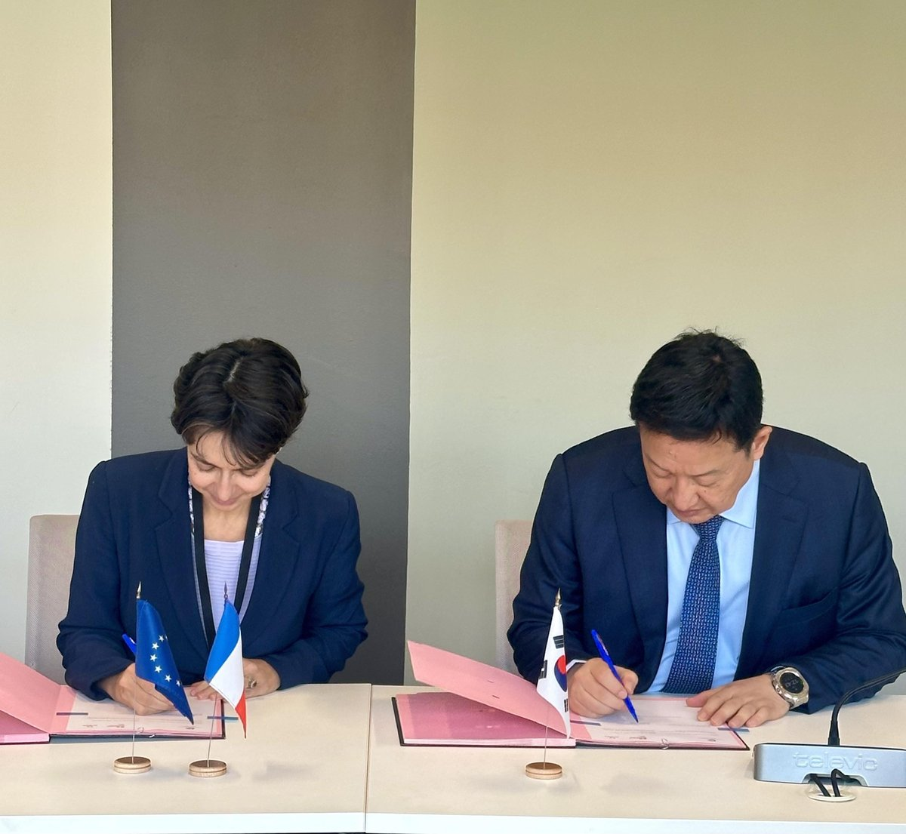
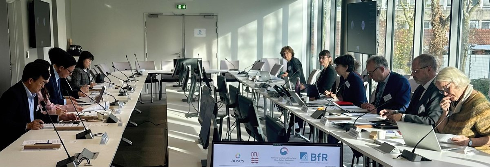

입력 2026-11-12

*프랑스 파리 협력회의 기간 열린 한국(NIFDS)-프랑스(ANSES) 협약(MOU) 서명식. 사진=식품의약품안전처 제공*

식품의약품안전처가 프랑스·독일·덴마크의 식품 위해평가기관과 실무자 간 핫라인을 만들고 온라인으로 수시 협의하기로 했다. 과불화화합물(PFAS), 식품포장재에서 나오는 비의도적 오염물질 같은 식품안전 현안에 함께 대응하기 위해서다.

식품의약품안전처 식품의약품안전평가원은 12일 보도참고자료에서 10월 29일 프랑스 파리 식품환경위생노동청(ANSES)에서 열린 한국(NIFDS)·프랑스(ANSES)·독일(BfR)·덴마크(DTU-Food) 4개국 위해평가기관 협력회의에 참석해 유럽 주요 위해평가기관과의 협력을 강화했다고 밝혔다. ANSES는 프랑스 식품환경위생노동청, BfR은 독일 연방위해평가원, DTU-Food는 덴마크 국립식품연구원이다.

식약처는 이번 방문이 유럽연합(EU)의 식품규제 변화에 선제적으로 대응하고 유럽 위해평가기관과의 협력을 이어가기 위해 추진됐다고 설명했다.

## 무엇을 합의했나

- 4개국은 과불화화합물(PFAS), 식품포장재에서 유래하는 비의도적 오염물질(NIAS) 등 공통 관심 사안에 대한 위해평가와 관리 경험을 공유했다.
- 기관 실무자 간 핫라인을 구축하고 온라인으로 수시 협의하기로 합의했다.
- 식약처 평가원과 ANSES는 회의 기간 협약(MOU) 기념 서명식을 열었다. 5년마다 갱신하던 협약을 유효기간 제한 없이 협력이 이어지도록 개정했다.

*한국·독일·프랑스·덴마크 위해평가기관 협력회의. 사진=식품의약품안전처 제공*

## AI 주제 컨퍼런스, 발표 24건

10월 29일부터 이틀간 열린 4개국 공동 컨퍼런스에서는 '식품안전, 동물, 식물 건강 분야의 감시와 위해성평가를 위한 인공지능(AI)의 활용'을 주제로 5개 세션, 24건의 발표가 진행됐다.

주요 발표에서는 문헌 검색·요약, 이미지를 활용한 사료 내 이물 구분, 유전체 분석을 통한 식중독균 위험도 예측, 화학물질 구조를 활용한 독성 예측 등 AI를 활용한 위해평가 사례가 소개됐다. AI 분석 결과에 대한 최종 판단과 책임은 사람에게 있으며 전문가의 검증과 관리가 중요하다는 점도 강조됐다.

이에 앞서 10월 28일에는 33개 위해평가기관과 국제기구가 참여하는 화학물질 위해평가 국제협의회(ILMERAC)에 참석해 동물시험을 대체하는 차세대 위해평가기술(NAMs)의 개발 동향을 공유하고 국제 협력 방안을 논의했다.

식약처는 이번 회의에서 공유된 유럽의 위해평가·관리 경험을 국내 식품 안전관리에 반영하고, 공통 관심 현안은 유럽 위해평가기관과 수시로 정보를 교환할 계획이다. 차기 협력회의와 공동 컨퍼런스는 2028년 한국에서 열린다.

식약처 관계자는 "이번 협력은 과학적 위해평가에 기반한 우리나라 식품안전 관리의 우수성을 국제사회에 알리고, K-푸드의 세계 시장 진출에 신뢰를 더하는 계기가 되었다"며, "앞으로도 국민이 안심할 수 있는 과학기반 식품안전관리 체계를 한층 강화해 나가겠다"고 밝혔다.

※ 이 기사는 식품의약품안전처 보도참고자료(정책브리핑, 공공누리 제1유형·출처표시)를 바탕으로 작성했습니다. 사진은 식품의약품안전처가 보도자료와 함께 제공한 것입니다.
