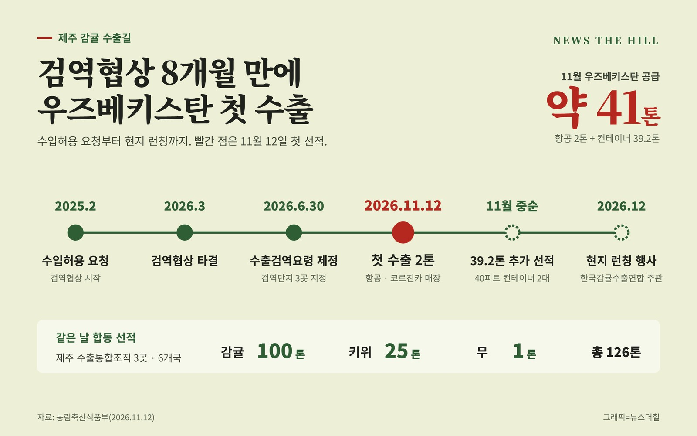

입력 2026-11-13

*그래픽=뉴스더힐(자료: 농림축산식품부)*

제주 감귤이 우즈베키스탄 소비자를 처음 만난다. 올해 3월 양국 검역협상이 타결된 지 8개월 만에 첫 수출 물량 2톤이 항공편으로 나갔고, 11월 중순 39.2톤이 더 실려 이달에만 약 41톤이 우즈베키스탄에 공급된다.

농림축산식품부는 12일 보도자료에서 농식품부와 제주특별자치도, 한국농수산식품유통공사(aT)가 이날 오후 제주시농협 농산물산지유통센터에서 제주시농협 주관으로 '우즈베키스탄 감귤 초도 수출 및 제주 농산물 합동 선적식'이 열렸다고 밝혔다.

## 첫 물량은 현지 최대 슈퍼마켓 체인으로

이번에 항공편으로 수출되는 감귤 2톤은 인천공항을 거쳐 우즈베키스탄 최대 슈퍼마켓 체인인 코르진카(Korzinka) 매장에서 판매된다. 제주시농협은 지난 8월 수출업체 성신엘앤피, 코르진카와 제주산 농산물 수출 확대 업무협약을 맺었다.

이어 11월 중순에는 조천농협에서 40피트 컨테이너 2대 분량(39.2톤)의 감귤이 부산항을 출발해 러시아 블라디보스토크를 거쳐 우즈베키스탄으로 간다.

농식품부에 따르면 우즈베키스탄은 만다린을 대부분 수입에 의존하고 있으며, 올해 1~2월 만다린 수입량이 4만 5,600톤(2,330만 달러)으로 전년 같은 기간보다 50% 늘었다.

## 수입허용 요청부터 첫 선적까지

- 2025년 2월: 우즈베키스탄에 한국산 감귤류 수입허용을 공식 요청하며 검역협상 시작
- 2026년 2월: 감귤류를 수출검역협상 중점추진품목으로 선정
- 2026년 3월: 양국 검역협상 최종 타결
- 2026년 6월 30일: 농림축산검역본부, 「한국산 감귤류 생과실의 우즈베키스탄 수출검역요령」 제정
- 수출검역단지 3곳 지정: 제주시농협·조천농협·제주감협무역사업소
- 2026년 11월 12일: 첫 수출(항공 2톤)

이로써 검역협상을 통해 한국산 감귤 수출이 타결된 나라는 미국, 뉴질랜드, 필리핀, 태국에 이어 우즈베키스탄까지 5개국이 됐다.

## 감귤·키위·무 126톤 합동 선적

이날 제주지역 감귤·키위·무 수출통합조직 3개사는 감귤 100톤, 키위 25톤, 무 1톤 등 모두 126톤을 함께 선적했다. 몽골·싱가포르 등 6개국으로 가는 물량이다. 몽골에는 감귤·키위·무 세 품목이 모두 실린다.

현지 홍보도 이어진다. 몽골에서는 11월 28일(토) 이번에 선적한 제주산 감귤·키위·무를 알리는 판촉·홍보 행사가 열리고, 우즈베키스탄에서는 12월 한국감귤수출연합 주관으로 현지 런칭 행사가 열린다.

농식품부는 수출검역단지의 병해충 관리와 수출 검역을 뒷받침하고, 현지 소비자 반응과 유통 성과를 바탕으로 만감류, 키위 등 제주 농산물의 수출 품목과 시장을 단계적으로 넓혀갈 방침이다.

제주시농협 고봉주 조합장(한국감귤수출연합㈜ 대표)은 "검역 기준에 맞춰 정성껏 선별한 제주 감귤이 우즈베키스탄 소비자의 식탁에 처음 오르게 됐다"며 "이달 중순 컨테이너 물량과 12월 현지 런칭 행사로 이어 가 첫 수출이 일회성에 그치지 않도록 하겠다"라고 말했다.

농식품부 정경석 식품산업정책관은 "지난해 2월 수입허용을 요청한 지 1년여 만에 검역협상을 타결하고, 8개월 만에 첫 선적까지 이어진 것은 정부와 산지가 속도를 함께 맞춘 결과"라며, "신선농산물은 검역의 문을 넘어야 수출이 시작되는 만큼, 수출 유망 품목과 국가의 검역협상을 속도감 있게 추진해 우리 농산물이 나갈 수 있는 시장을 계속 넓혀 가겠다"라고 말했다.

※ 이 기사는 농림축산식품부 보도자료(2026년 11월 12일, 공공누리 제1유형·출처표시)를 바탕으로 작성했습니다.
