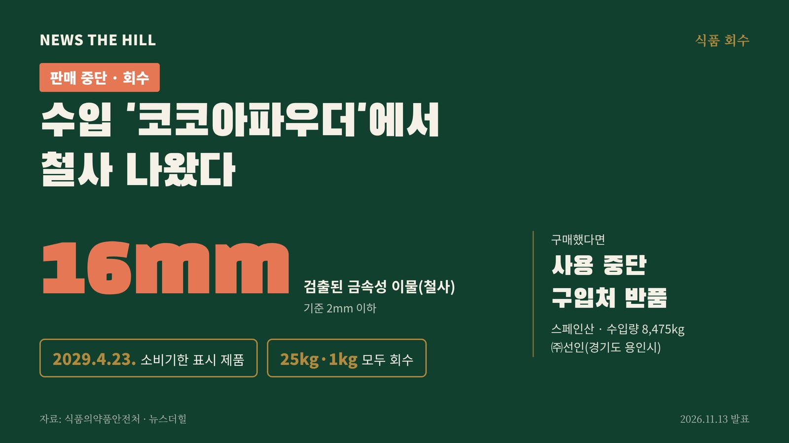

입력 2026-11-13

*그래픽=뉴스더힐(자료: 식품의약품안전처)*

수입 코코아분말에서 길이 약 16mm의 철사가 나와 판매 중단·회수에 들어갔다. 수입된 25kg 원료 제품과 이를 나눠 담아 판 1kg 제품이 모두 대상이다.

식품의약품안전처는 13일 보도참고자료에서 수입식품등 수입판매업체 ㈜선인(경기도 용인시)이 수입해 판매한 '코코아파우더'(식품유형 코코아분말)에서 금속성 이물(철사, 약 16mm)이 검출돼 해당 제품을 판매 중단하고 회수 조치한다고 밝혔다.

## 회수 대상

- 수입·소분 업체: ㈜선인(경기도 용인시)
- 제품명(식품유형): 코코아파우더, COCOA POWDER(코코아분말)
- 제조업소(원산지): NATRA CACAO S.L(스페인)
- 소비기한: 2029년 4월 23일 표시 제품(생산일자 2026년 4월 23일)
- 포장단위: 25kg(수입 원료 제품), 1kg(소분 제품)
- 수입량: 8,475kg

## 무엇이 문제인가

식약처에 따르면 이 제품의 금속성 이물 기준은 2mm 이하다. 검사 결과 약 16mm 길이의 금속성 이물이 나와 부적합 판정을 받았다.

## 소비자 행동 요령

- 해당 제품을 샀다면 사용을 멈추고 산 곳에 반품한다. 식약처는 구매 소비자에게 사용을 중단하고 구입처에 반품해 달라고 당부했다.
- 식품 관련 불법 행위를 보면 불량식품 신고전화 1399나 식품안전정보 필수앱 '내손안'으로 신고할 수 있다.

※ 이 기사는 식품의약품안전처 보도참고자료(공공누리 제1유형·텍스트에 한함)를 바탕으로 작성했습니다.
