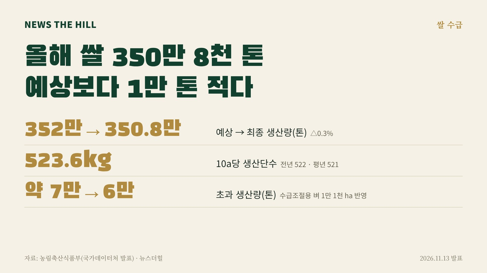

입력 2026-11-13

*그래픽=뉴스더힐(자료: 농림축산식품부)*

올해 쌀 생산량이 350만 8천 톤으로 최종 집계됐다. 지난달 예상치보다 1만 톤 줄면서 시장에 남는 쌀(초과 생산량)도 당초 약 7만 톤에서 6만 톤 수준으로 줄었다.

농림축산식품부는 13일 보도참고자료에서 국가데이터처가 이날 발표한 2026년산 쌀 최종 생산량이 350만 8천 톤으로, 10월 8일 발표한 예상 생산량보다 1만 톤(0.3%) 감소했다고 밝혔다.

## 얼마나 거뒀나

- 최종 생산량: 351만 톤(350만 8천 톤), 예상 생산량 352만 톤보다 1만 톤 감소
- 10a당 생산단수: 523.6kg(예상 525kg). 전년 522kg, 평년 521kg보다 높다
- 수급조절용 벼 신청 면적: 1만 1천 ha
- 수급조절용 벼를 고려한 생산량: 345만 톤 수준(당초 예상 기준 346만 톤)
- 초과 생산량: 당초 약 7만 톤 → 6만 톤 수준

'수급조절용 벼'는 올해 처음 도입된 제도로, 평시에 가공용으로 용도를 한정해 밥쌀 시장에서 미리 격리하는 벼다. 농식품부는 이행점검 결과 등에 따라 최종 수치가 달라질 수 있다고 덧붙였다.

## 왜 줄었나

농식품부는 생육 전반에 걸쳐 기상은 양호했지만 7~8월 가뭄·고온 등이 복합적으로 작용해 최종 생산량이 예상보다 줄어든 것으로 보인다고 설명했다.

정부는 지난 10월 14일 쌀 수급 상황을 고려해 정부양곡 대여곡 잔여물량 반납을 당초 계획대로 추진하는 내용의 쌀 수급안정대책을 발표했다. 앞으로 수급 동향을 살펴 필요하면 대책을 보완할 계획이다.

## 산지 쌀값

올해 벼 수확은 대부분 끝났고, 산지쌀값은 전년도와 비슷한 추세를 보이고 있다고 농식품부는 밝혔다.

- 10월 5일: 20kg당 5만 8,803원
- 10월 15일: 5만 7,580원
- 10월 25일: 5만 7,454원
- 11월 5일: 5만 7,403원

정부는 벼 매입가 등 쌀 시장 상황을 모니터링하면서 농업인과 소비자 모두에게 도움이 되는 수급 정책을 추진할 계획이다.

※ 이 기사는 농림축산식품부 보도참고자료(공공누리 제1유형, 출처표시)를 바탕으로 작성했습니다.
