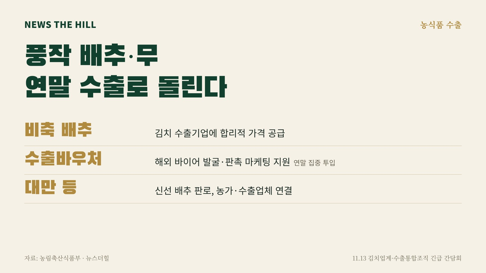

입력 2026-11-13

*그래픽=뉴스더힐(자료: 농림축산식품부)*

풍작으로 공급이 늘어 값이 떨어진 배추·무를 해외로 더 내보내기 위해 정부가 김치 수출기업에 비축 배추를 합리적인 가격에 공급하고, 연말 수출 마케팅 비용을 집중 지원한다.

농림축산식품부는 13일 보도자료에서 이날 정부세종청사에서 김치업계, 배추·무 수출통합조직 등 관계기관과 긴급 간담회를 열고 연말 수출 촉진을 위한 정부 지원 방안을 공유했다고 밝혔다.

농식품부는 최근 생산량 증가로 가격 하락 등 어려움을 겪는 상황에서 김치·배추·무 수출을 늘려 농가 소득을 높이고, 민·관이 함께 돌파구를 찾기 위해 간담회를 긴급히 마련했다고 설명했다.

## 무엇을 지원하나

- 비축 배추 공급: 김치 제조기업의 원료비 부담을 덜고 신규 수출을 늘리도록 정부 비축 배추를 합리적인 가격으로 공급한다. 김치 수출기업의 연말 추가 수출 물량과 원료 수요를 바탕으로 비축 물량을 연계한다.
- 수출바우처 등 마케팅 지원: 정부 비축 배추를 쓰는 김치 수출기업과 신선 배추·무 수출통합조직 회원사를 대상으로 연말 수출 활동에 재원을 집중 투입해, 해외 바이어 발굴과 판촉·마케팅을 자율적으로 추진할 수 있게 지원한다.
- 신선 배추 판로 연결: 수출 의지가 있지만 판로 확보가 어려운 농가와 수출 여력이 있는 업체를 연결해 대만 등 해외 시장 진출을 넓힌다. 사전 등록 정보 정비·변경 지원 등으로 그동안 수출 기회가 제한됐던 농가도 수출에 참여할 수 있도록 현장 지원을 강화한다.

농식품부는 이 자리에서 업계 관계자들에게 "지금은 우리 농가들이 땀 흘려 가꾼 농산물의 가격 하락으로 시름이 깊은 비상 상황인 만큼, 김치업계와 생산자 단체 등 민간에서도 우리 농산물 소비와 수출 확대에 적극적으로 동참해 줄 것"을 당부했다.

정경석 농식품부 식품산업정책관은 "최근 배추와 무의 생산량 증가에 따라 국내 소비를 확대하는 것과 동시에, 수출을 통한 새로운 수요 창출이 매우 중요한 시점"이라며, "정부는 비축 물량 공급부터 마케팅 지원, 수출 기반 강화까지 가동할 수 있는 모든 수단을 동원해 연말 김치·배추·무 수출 확대에 총력을 기울이겠다"라고 밝혔다. 이어 "현장의 목소리를 지속적으로 경청하며 우리 농산물의 해외 진출이 농가 소득 증대로 이어지도록 세심히 챙겨나갈 것"이라고 강조했다.

※ 이 기사는 농림축산식품부 보도자료(공공누리 제1유형, 출처표시)를 바탕으로 작성했습니다.
