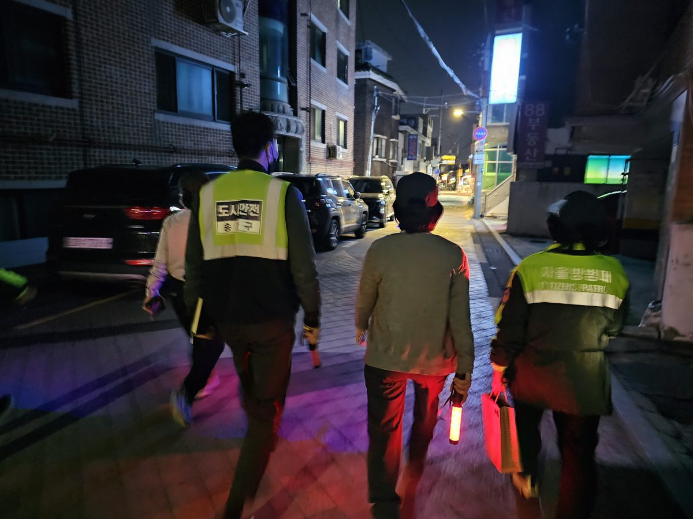
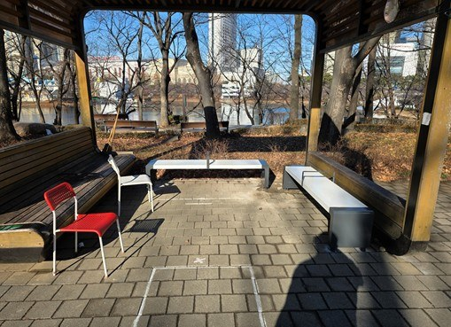

입력 2026-11-15

*송파구 마천동 야간 순찰 모습. 사진=송파구 제공*

송파구가 15일부터 내년 3월 15일까지 4개월간 한파 종합대책을 시행한다. 버스정류장 온열의자와 온기텐트를 운영하고, 지난해 처음 놓은 공원 온열의자는 30개를 더 설치한다. 한파특보가 내리면 재난도우미 1,273명이 홀몸어르신과 고령자 가구의 안부를 확인한다.

송파구는 15일 보도자료에서 겨울철 한파로부터 주민 안전을 지키기 위해 이같이 대책을 추진한다고 밝혔다. 구는 올겨울에도 찬 공기가 일시적으로 들어오면서 기온이 급격히 떨어지는 기습 한파가 예상돼 미리 대비할 필요가 있다고 설명했다.

## 한파 저감시설

- 버스정류장 온열의자 325개, 온기텐트 18개 운영
- 공원 온열의자 확대: 서울시 재난관리기금 9천만 원을 확보해 삼전공원, 아시아공원 등 6개소에 30개를 추가 설치할 계획

*석촌호수 공원 쉼터에 설치된 온열의자. 사진=송파구 제공*

## 취약계층 보호

- 재난도우미: 통장, 행복울타리, 자율방재단 등으로 구성된 1,273명이 한파특보 발효 시 홀몸어르신과 고령자 가구를 방문하거나 전화로 안부를 확인한다.
- 주·야간·휴일 순찰반: 석촌호수, 근린공원, 지하철 역사 주변 등을 중심으로 거리 노숙인을 살피고 방한용품 지원과 복지시설 입소 상담을 함께 한다.
- 안내: 구 공식 블로그와 대형전광판 등으로 한파 대비 행동요령을 알리고, 한파특보 발효 시 재난문자를 바로 보낸다.

## 대응 체계

구는 평상시 한파대책 전담반(TF)을 운영하고, 한파특보가 발효되면 종합상황실을 24시간 가동한다. 수도관 동파나 정전 등 생활 불편에 대비해 유관기관과 긴급복구 협력체계도 유지한다.

## 지난겨울에는

- 홀몸어르신 대상 방문·전화 안부 확인 7만 5,887건
- 장애인·만성질환자 등 건강취약계층 대상 안부 확인 1만 40건
- 한파쉼터 65개소 운영
- 버스정류장 온열의자 11개 추가 설치, 노후 시설 5개 교체
- 공원 6개소에 온열의자 15개 처음 설치

서강석 송파구청장은 "겨울철 한파로부터 구민의 안전을 지키는 것이 무엇보다 중요하다"며 "생활 속 한파 저감시설을 확대하고 취약계층을 세심하게 살펴 구민 모두가 안전하고 따뜻한 겨울을 보낼 수 있도록 하겠다"고 전했다.

※ 이 기사는 송파구 보도자료(11월 15일)를 바탕으로 작성했습니다.
