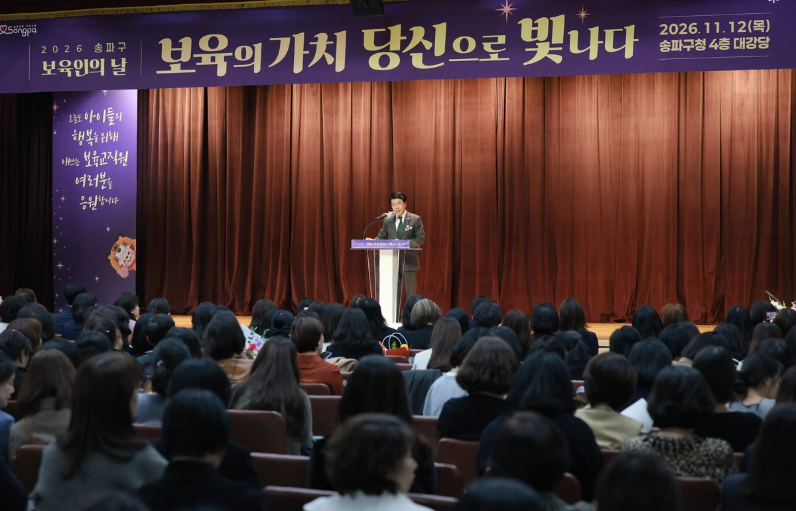
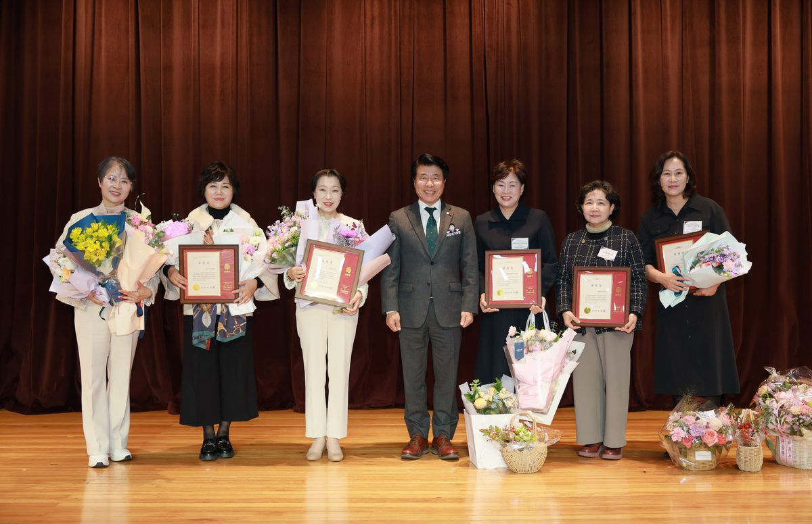

입력 2026-11-16

*12일 송파구청 4층 대강당에서 열린 '2026 송파구 보육인의 날' 기념식. 사진=송파구 제공*

송파구가 보육 현장에서 일하는 교직원들의 노고를 격려하는 '2026 송파구 보육인의 날 기념식'을 열고 보육 발전에 기여한 유공자 100명에게 표창을 줬다. 85명은 송파구청장 표창, 15명은 지역구 국회의원 표창을 받았다.

송파구는 16일 보도자료에서 12일 송파구청 대강당에서 보육교직원 400여 명이 참석한 가운데 기념식을 개최했다고 밝혔다. 행사는 송파구 국공립어린이집 연합회(회장 김덕분)가 주관했다.

## 기념식 내용

올해 주제는 '보육의 가치, 당신으로 빛나다'다. 기념식은 보육교직원의 일상을 담은 응원 영상 '보육인의 하루' 상영으로 시작해 유공자 표창, 공감토크, 어린이집 교사들의 축하공연 순으로 진행됐다.

방송인 윤형빈이 사회를 맡아 보육교직원들과 이야기를 나눴다. 참석자들은 바쁜 보육 현장에서 잠시 벗어나 서로의 노고를 격려했다.

*보육인의 날 기념식에서 표창을 받은 보육유공자들이 기념촬영을 하고 있다. 사진=송파구 제공*

## 보육교직원 처우개선

송파구는 민선 8기 출범 이후 보육교직원 처우개선을 위해 복리후생비, 장기근속수당, 명절휴가비 등을 매년 확대해 왔고, 2025년부터는 독감 예방접종비 지원도 시작했다고 밝혔다.

서강석 송파구청장은 "아이들이 건강하고 행복하게 성장할 수 있는 것은 보육 현장에서 묵묵히 헌신하는 선생님들 덕분"이라며 "앞으로도 보육 교직원들이 자긍심을 갖고 일할 수 있도록 근무 여건을 개선하고, 아이 키우기 좋은 송파를 만드는 데 힘쓰겠다"고 말했다.

※ 이 기사는 송파구 보도자료(11월 16일)를 바탕으로 작성했습니다.
