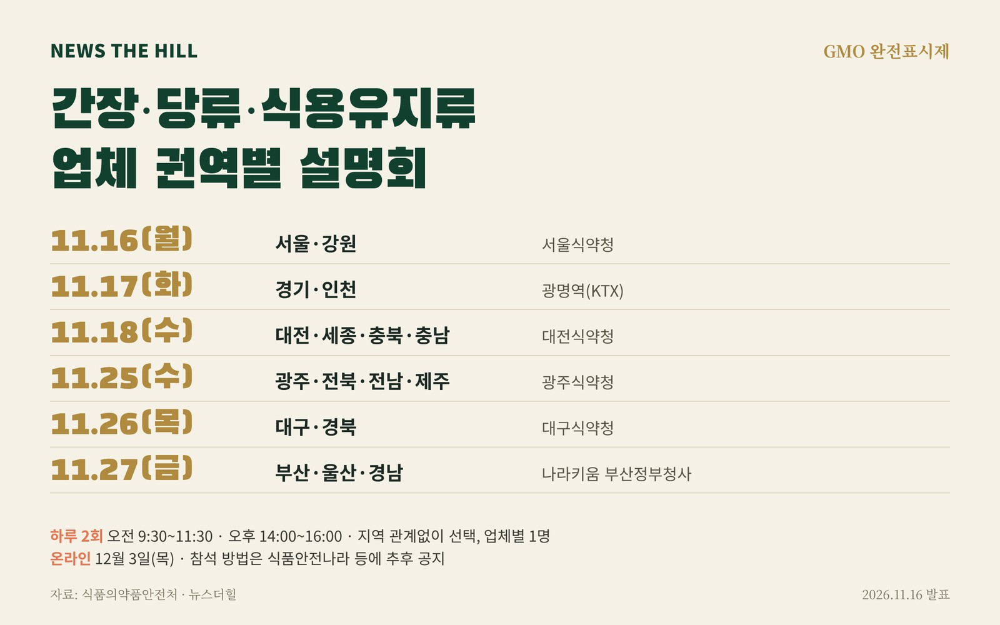

입력 2026-11-16

*그래픽=뉴스더힐(자료: 식품의약품안전처)*

유전자변형(GMO) 원료를 쓴 간장, 당류, 식용유지류도 GMO 표시 대상이 되면서 식품의약품안전처가 제조·수입업체를 대상으로 권역별 설명회를 연다. 11월 16일부터 27일까지 전국 6곳에서 12회 열린다.

식약처는 16일 보도참고자료에서 GMO 완전표시제 도입으로 유전자변형식품의 표시 대상이 확대됨에 따라 영업자의 제도 이해를 돕고 원활한 이행을 지원하기 위해 설명회를 연다고 밝혔다. 최종 제품에 유전자변형 DNA나 단백질이 남아 있지 않더라도 유전자변형 원료를 사용한 간장·당류·식용유지류까지 표시 대상이 넓어진다.

## 설명 내용

- GMO 완전표시제 도입 배경과 주요 개정사항
- GMO 표시 대상 여부와 표시 방법
- 표시 면제 요건과 증빙서류 관리
- 유전자변형 원료의 구분유통·구분관리 기준

식약처는 식품유형별 표시 사례와 구분관리·증빙서류 구비 방법을 구체적으로 설명하고 질의응답을 통해 업계의 애로사항을 듣는다. 「유전자변형식품등의 표시 가이드라인」과 「식품용 GMO 구분관리기준 가이드라인」도 제공한다. 두 가이드라인은 11월 중 식약처 누리집(mfds.go.kr) '법령/자료 → 법령정보 → 공무원지침서/민원인안내서 → 민원인안내서'에 올라온다.

## 일정과 장소

- 11월 16일(월) 서울·강원: 서울식약청
- 11월 17일(화) 경기·인천: 광명역(KTX)(오전 대회의실, 오후 KTX실)
- 11월 18일(수) 대전·세종·충북·충남: 대전식약청
- 11월 25일(수) 광주·전북·전남·제주: 광주식약청
- 11월 26일(목) 대구·경북: 대구식약청
- 11월 27일(금) 부산·울산·경남: 나라키움 부산정부청사 2층 대강당

설명회는 하루 두 번, 오전 9시 30분~11시 30분과 오후 2시~4시에 열린다. 지역과 날짜에 관계없이 원하는 곳에 참석할 수 있지만, 장소별 수용 인원이 제한돼 업체별 1명만 참석해야 한다. 서울·경기 지역은 오전에는 수입업체, 오후에는 제조업체가 참석한다. 주차 공간이 좁고 주차비는 지원하지 않아 대중교통 이용을 권했다.

현장 참석이 어려운 영업자를 위해 12월 3일(목) 온라인 설명회도 연다. 참석 방법은 식품안전나라 등을 통해 추후 공지한다.

오유경 식약처장은 "이번 권역별 설명회가 영업자들의 GMO 완전표시제에 대한 이해도를 높이고 제도 이행에 필요한 준비사항을 점검하는 계기가 될 것으로 기대한다"며, "앞으로도 업계와 지속적으로 소통하여 새로운 표시제도가 현장에 안정적으로 정착될 수 있도록 적극 지원하겠다"고 밝혔다.

※ 이 기사는 식품의약품안전처 보도참고자료(정책브리핑, 공공누리 제1유형·출처표시)를 바탕으로 작성했습니다.
