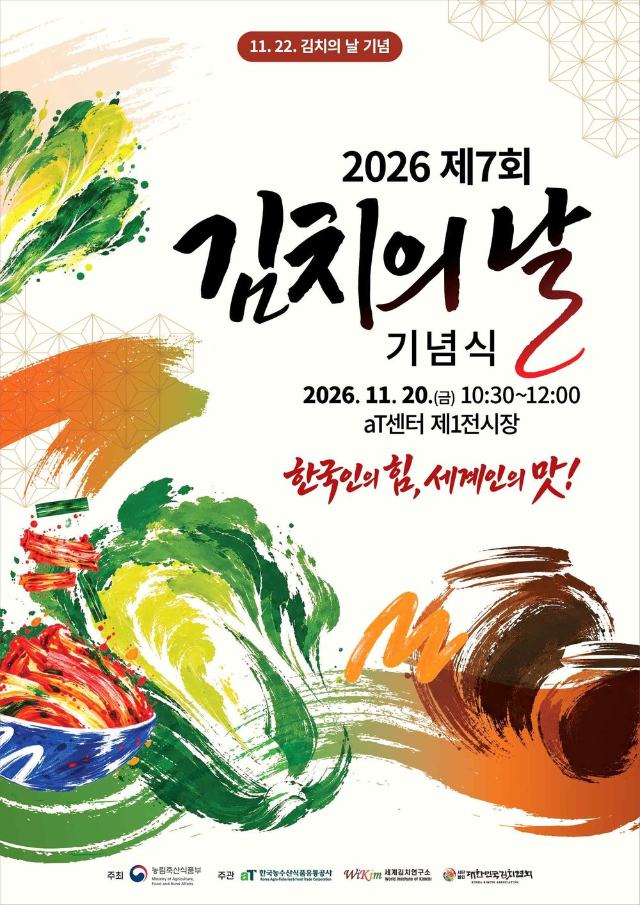

입력 2026-11-16

*제7회 김치의 날 기념식 포스터. 자료=농림축산식품부 제공*

김치의 날(11월 22일)을 앞두고 20일(금) 서울 양재동 aT센터 제1전시장에서 '제7회 김치의 날' 행사가 열린다. 올해는 초청객 중심 기념식에서 벗어나 누구나 찾아와 김치를 보고, 맛보고, 살 수 있는 대국민 축제로 처음 열린다. 국산 김치를 평소보다 약 30% 싸게 파는 할인 판매도 한다.

농림축산식품부는 15일 보도자료에서 이같이 밝혔다. 올해는 김장문화의 유네스코 인류무형문화유산 등재 13주년이다. 포스터에 따르면 기념식은 오전 10시 30분부터 12시까지다.

## 김장 체험

배우 김동준, 방송인 사유리·크리스티나와 사전 모집한 외국인 40명이 김장 체험에 참여한다. 참가자들은 김치명인의 설명과 시연을 바탕으로 김치를 직접 버무려 본다.

## 전시·시식

- 대한민국 김치품평회와 어린이 김치 콘텐츠 공모전 수상작 전시
- 글로벌 김치요리 레시피 경연대회 수상작 '김치 휘낭시에', 김치 스타트업이 개발한 김치 붕어빵·김치 소시지 등 김치 퓨전 요리 시식
- 푸드트럭에서 보쌈김치, 김치 주먹밥 등 김치 간편 먹거리 판매

## 국산 김치 약 30% 할인

상품 김치를 사는 소비자를 위한 할인 판매에는 (사)대한민국김치협회 회원사를 중심으로 2026년 김치품평회 수상업체를 포함한 약 20개 업체가 참여한다. 행사장에서 김치를 비교해 맛보고 살 수 있고, 현장에서 주문하면 원하는 시기에 택배로 받을 수도 있다.

정경석 농식품부 식품산업정책관은 "올해 김치의 날은 국민 누구나 찾아와 김치의 전통과 다양한 맛을 직접 경험할 수 있도록 대국민 축제로 준비했다"며 "김장 체험과 색다른 김치 먹거리, 수상작 전시, 우수 국산 김치 할인 판매 등 풍성한 프로그램을 마련한 만큼 많은 국민이 행사장을 찾아 김치의 매력을 즐기시길 바란다"고 밝혔다.

※ 이 기사는 농림축산식품부 보도자료(정책브리핑, 공공누리 제1유형·출처표시)를 바탕으로 작성했습니다. 포스터는 농림축산식품부가 보도자료와 함께 제공한 것입니다.
