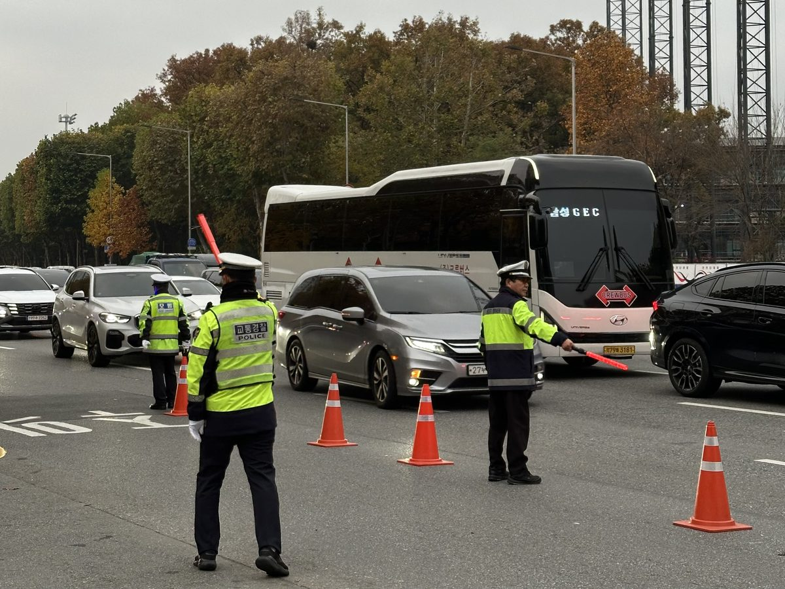
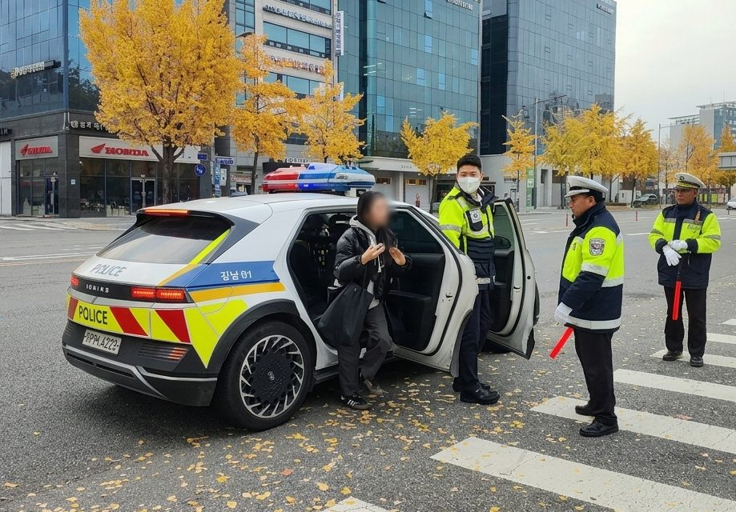
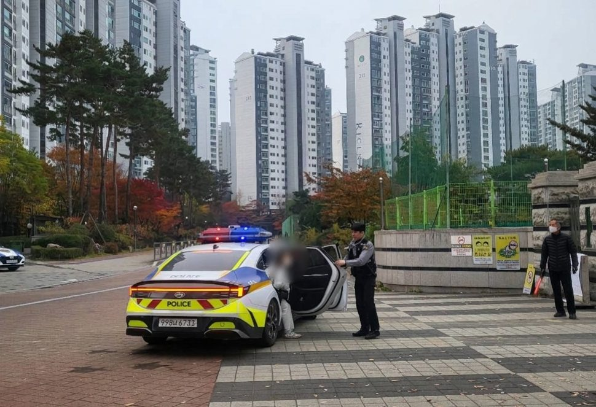

입력 2026-11-17

*지난 2025년 대학수학능력시험 당일 교통지도를 하고 있는 현장 모습. 사진=송파구 제공*

송파구가 19일(목) 치러지는 2027학년도 대학수학능력시험 당일 수험생들이 교통 혼잡 없이 제시간에 시험장에 들어갈 수 있도록 수송지원차량 43대와 인력 178명을 투입한다. 올해 송파구 관내에서는 16개 시험장에서 수험생 9,550명이 시험을 치를 예정이다.

송파구는 17일 보도자료에서 이같이 밝혔다. 올해 수능은 19일 오전 8시 40분부터 오후 5시 45분까지 치러진다. 구는 등교 시간대 교통 정체로 수험생이 불이익을 겪지 않도록 현장 중심의 신속 수송 체계를 가동한다.

## 수송지원차량 43대, 지하철역·버스정류소에 배치

'수험생 수송지원차량' 43대는 안내문을 붙이고 시험장 인근 주요 지하철역과 버스정류소, 상습 정체 교차로 등에 배치된다. 대중교통 이용에 차질이 생긴 수험생을 시험장 정문까지 빠르게 태워 준다.

*지난 2025년 영파여자고등학교 앞에서 수험생 이동을 지원하는 현장 모습. 사진=송파구 제공*

## 시험장 반경 200m 불법 주정차 집중 단속

등교 시간대에는 공무원과 모범운전자회 회원 등 178명이 16개 시험장 주변 주요 길목에 배치돼 교통질서를 유지한다. 시험장 반경 200m 구간은 '집중 불법 주·정차 단속 지역'으로 지정된다. 구는 수험생 차량의 진출입을 방해하는 불법 주정차에 과태료 부과와 견인 조치 등으로 강력히 대응할 방침이다.

구는 구청 누리집, 누리소통망(SNS), 청사 디지털전광판 등을 통해 수능 당일 출근 시간대 자가용 이용을 자제하고 대중교통을 이용해 달라고 권하고 있다.

## 영어 듣기평가 시간 소음 통제

영어 듣기평가가 치러지는 오후 1시 10분부터 1시 35분까지는 시험장 인근 도로 굴착·건축 공사, 대규모 행사 등 소음이 생길 수 있는 요인을 통제할 계획이다.

*지난 2025년 잠신고등학교 앞에서 수험생 이동을 지원하는 현장 모습. 사진=송파구 제공*

서강석 송파구청장은 "수험생들이 이동 과정에서 겪을 수 있는 불편을 최소화하고, 편안한 상태로 시험에만 집중해 그동안 갈고닦은 실력을 유감없이 펼칠 수 있도록 모든 관계기관과 부서가 합심해 최선을 다할 것"이라며 "구민 여러분께서도 수험생들의 안전한 이동과 시험 환경 조성을 위해 교통대책과 소음 통제에 적극 협조해 주시기 바란다"고 말했다.

※ 이 기사는 송파구 보도자료(11월 17일)를 바탕으로 작성했습니다.
