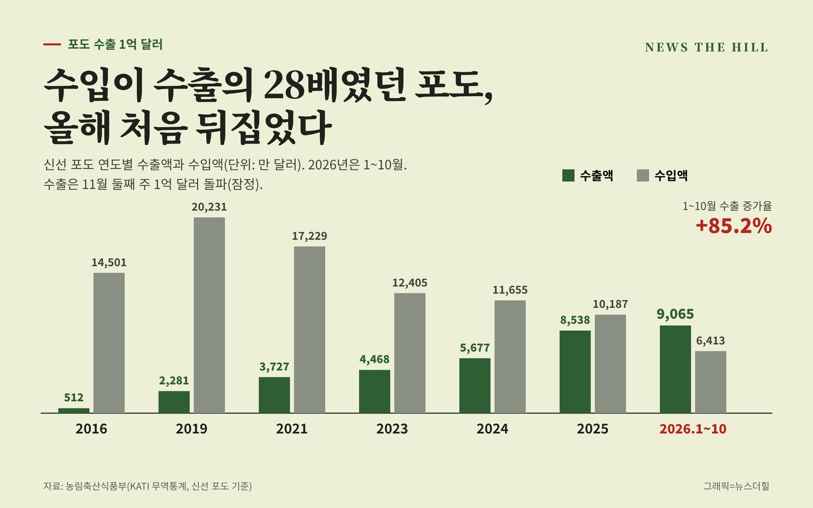

입력 2026-11-17

*그래픽=뉴스더힐(자료: 농림축산식품부)*

올해 포도 수출액이 1억 달러를 넘었다. 신선농산물 가운데 단일 품목으로 '수출 1억 달러'를 달성한 것은 처음이다. 올해 1~10월에는 처음으로 신선 포도 수출액이 수입액을 앞질렀다.

농림축산식품부는 16일 보도자료에서 농식품부와 경상북도, 한국농수산식품유통공사(aT)가 이날 오후 경북 상주시 대경사과원예농협 상주농산물산지유통센터에서 '포도 수출 1억 달러 달성 기념 선적식'을 열었다고 밝혔다.

## 10월 말 9,065만 달러, 11월 둘째 주 1억 달러

올해 포도 수출액은 10월 말 9,065만 달러로 전년 같은 기간보다 85.2% 늘었고, 11월 둘째 주 1억 달러를 돌파했다(잠정). 10월 15일 상주에서 생산자·수출업체·정부가 '수출 1억 달러 달성'을 결의한 지 한 달 만이다. 열 달 만에 지난해 연간 수출액(8,538만 달러)을 넘어섰고, 성출하기인 10월 한 달 수출은 전년 같은 달의 2.7배였다.

국가별 수출(1~10월)은 다음과 같다.

- 대만: 5,130만 달러(+114.5%), 전체의 절반 이상
- 미국: 1,644만 달러(+177.6%), 코스트코 등 대형 유통매장 납품 본격화로 증가율 가장 높음
- 홍콩 +24.4%, 베트남 +17.4%, 캐나다 +5.6%

## 2016년엔 수입이 수출의 28배

2004년 한·칠레 FTA 발효 뒤 수입산 포도가 급증하면서 포도는 대표적인 시장 개방 피해 품목으로 꼽혔다. 2016년에는 수입액(1억 4,501만 달러)이 수출액(512만 달러)의 28배에 달했다. 올해 1~10월에는 수출액(9,065만 달러)이 신선 포도 수입액(6,413만 달러)을 처음으로 넘어섰다.

농식품부는 출하가 몰리는 성출하기에 지난해 같은 기간의 두 배가 넘는 물량(1~10월 물량 +135.0%)이 해외로 분산되면서 국내 공급 과잉 부담을 덜고 농가 수취가격을 지지했다고 설명했다. 지난 10월 도입한 「상생 표준거래계약서」를 계기로 농가가 제값을 받는 수출 질서를 정착시켜 나갈 계획이다.

## 샤인머스캣 컨테이너, 18일 미국으로

이날 행사에서는 수출 경과 보고, 기념패 전달, 검역증명서 교부에 이어 참석자들이 함께 버튼을 눌러 '수출 1억 달러 달성'을 선포했다. 상차한 샤인머스캣 컨테이너(경북통상㈜, 미국 대형 유통매장 납품용)는 18일 부산항에서 미국으로 출항한다.

농식품부와 aT는 남미산 포도 출하 공백기인 12월부터 이듬해 1월까지 미국 시장을 집중 공략하고, 대만 선물세트 수요 대응, 아세안 위조 방지 포장 등 국가별 맞춤형 마케팅을 이어가 연간 수출 목표(1억 1,250만 달러)를 달성한다는 계획이다.

송미령 농식품부 장관은 "포도를 키워낸 농업인과 수출업체·통합조직, 한 송이씩 골라 담은 선과장 직원, 신선함을 지킨 콜드체인 기사님과 주말에도 현장을 지킨 검역관 등 모든 주역이 함께 쓴 역사"라며 "원예농산물 출하 집중으로 농가 어려움이 큰 시기이지만 수출로 내수 부담을 덜고 농가가 제값을 받는 구조를 만들겠다. 포도의 성공 공식을 다른 원예농산물로 확산시키고 연말까지 지원에 단 한 치의 공백도 없도록 끝까지 뒷받침하겠다"라고 강조했다.

※ 이 기사는 농림축산식품부 보도자료(11월 16일, 정책브리핑, 공공누리 제1유형·출처표시)를 바탕으로 작성했습니다.
