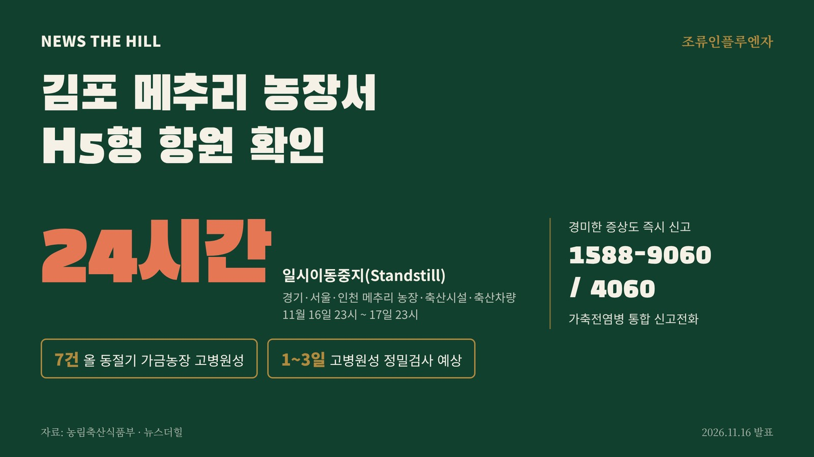

입력 2026-11-17

*그래픽=뉴스더힐(자료: 농림축산식품부)*

경기 김포의 메추리 농장에서 H5형 조류인플루엔자 항원이 확인됐다. 방역당국은 경기·서울·인천의 메추리 농장과 축산시설, 축산차량에 16일 23시부터 17일 23시까지 24시간 일시이동중지(Standstill) 명령을 내렸다.

고병원성 조류인플루엔자 중앙사고수습본부(본부장 송미령 농림축산식품부 장관, 이하 중수본)는 16일 보도자료에서 이같이 밝혔다. 고병원성 여부는 농림축산검역본부가 정밀검사 중이며 약 1~3일 걸릴 것으로 예상된다. 11월 3일 이후 이번 동절기 가금농장 고병원성 조류인플루엔자 발생은 7건(연천·장흥·여주·강화·진천·파주·경주 각 1건)이다.

## 해당 농장 출입 통제·가축처분

중수본은 조류인플루엔자 긴급행동지침(SOP) 등 관련 규정에 따라 해당 농장에 초동대응팀을 투입해 출입 통제, 가축처분, 역학조사 등 방역조치를 하고 있다.

일시이동중지 대상은 경기·서울·인천 소재 메추리 농장, 축산시설(도축장, 사료공장 등), 축산차량 등이다.

## 축산농가 방역수칙

중수본은 축산농가에 다음 기본 방역수칙을 철저히 지켜 달라고 강조했다.

- 철새도래지 출입금지
- 외부 차량·인력 출입통제
- 농장 매일 소독
- 축사 출입 전 전용 장화 갈아신기
- 기계·장비 등을 축사에 들일 때 세척·소독

폐사 증가, 산란율 저하 같은 주요 의심증상뿐 아니라 사료섭취 저하, 침울, 졸음, 호흡기 증상, 녹변(녹색 설사) 같은 경미한 증상이 보여도 즉시 방역당국에 신고해 달라고 당부했다. 가축전염병 통합 신고전화는 1588-9060·4060이다.

※ 이 기사는 농림축산식품부 보도자료(11월 16일, 정책브리핑, 공공누리 제1유형·출처표시)를 바탕으로 작성했습니다.
