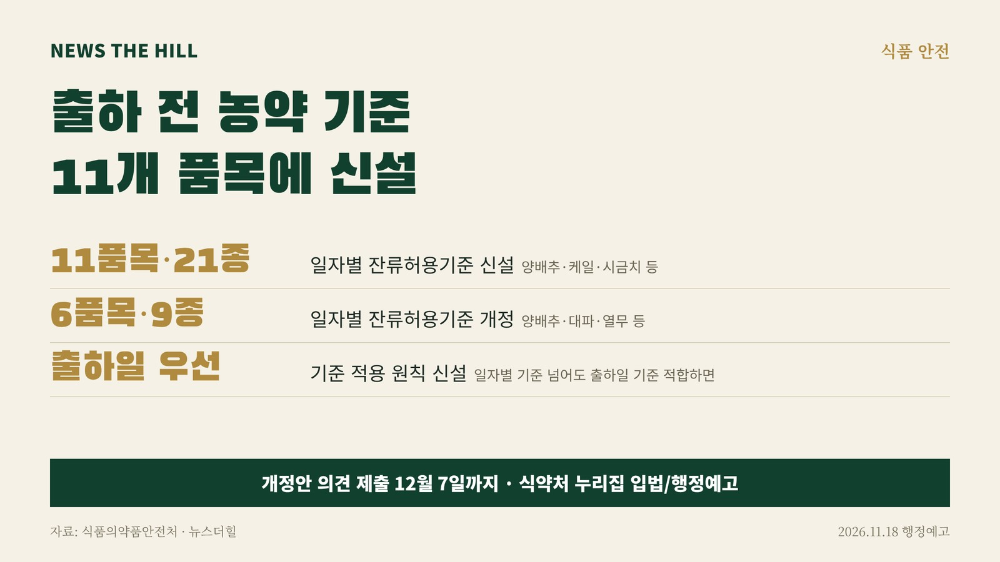

입력 2026-11-18

*그래픽=뉴스더힐(자료: 식품의약품안전처)*

양배추, 케일, 시금치 등 11개 농산물 품목에 출하 전 날짜별 농약 잔류허용기준이 새로 생긴다. 출하 전 검사에서 일자별 기준을 넘더라도 출하일 기준에 맞으면 출하일 기준을 우선 적용한다는 원칙도 새로 담긴다.

식품의약품안전처(처장 오유경)는 이런 내용을 담은 「생산단계 농수산물 등의 유해물질 안전기준」 개정안을 18일 행정예고한다고 이날 밝혔다. 농산물 생산단계에서 농약 잔류량을 미리 관리해 안전한 농산물이 유통되도록 출하 전 농산물에 대한 기준 적용 방법을 명확히 하고, 농산물별 기준을 정비하려는 것이다.

생산단계 농약 잔류허용기준은 농산물별 농약의 감소 특성을 반영해 출하 전 10일부터 출하일까지 날짜별로 정한 기준이다. 출하 전 잔류농약 검사로 부적합 농산물이 출하되는 것을 미리 막기 위해 운영되고 있다.

## 주요 개정 내용

- **적용 원칙 신설**: 출하 전 검사에서 일자별 잔류허용기준을 초과하더라도 출하일 기준에 적합하면 출하일 기준을 우선 적용한다. 세부 품목별 기준이 없으면 같은 품목의 다른 세부 품목 기준 가운데 가장 낮은 기준을 적용한다. 예를 들어 홍고추에 '아세타미프리드' 기준이 없으면 풋고추와 꽈리고추의 기준 중 가장 낮은 풋고추 기준을 적용한다.
- **11개 품목 기준 신설**: 갓, 갯개미자리, 갯기름나물, 당귀잎, 머위, 무잎, 시금치, 양배추, 유채, 치커리잎, 케일에 카벤다짐 등 농약 21종의 일자별 잔류허용기준을 새로 정한다. 생산단계 농약 잔류허용기준 설정 연구 결과를 반영했다.
- **6개 품목 기준 개정**: 「식품의 기준 및 규격」의 농약 잔류허용기준 개정사항(2025년 8월 26일)을 반영해 겨자채, 무잎, 무잎(열무), 양배추, 얼갈이배추, 파(대파)의 농약 9종 일자별 기준을 고친다.

식약처는 앞으로도 생산단계 농산물의 농약 잔류허용기준 적용 대상 품목을 계속 늘리는 등 식품 안전관리에 힘쓸 계획이라고 밝혔다.

개정안 자세한 내용은 식약처 누리집(www.mfds.go.kr)의 '법령·자료 > 입법/행정예고'에서 볼 수 있으며, 의견은 12월 7일(월)까지 낼 수 있다.

※ 이 기사는 식품의약품안전처 보도참고자료(11월 18일, 정책브리핑, 공공누리 제1유형·출처표시)를 바탕으로 작성했습니다.
