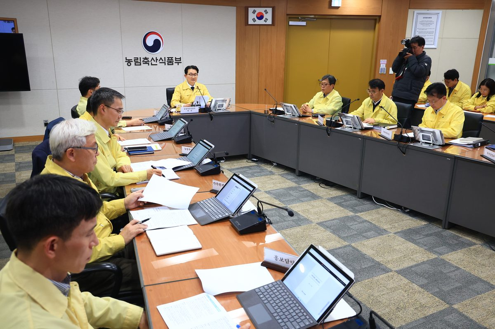
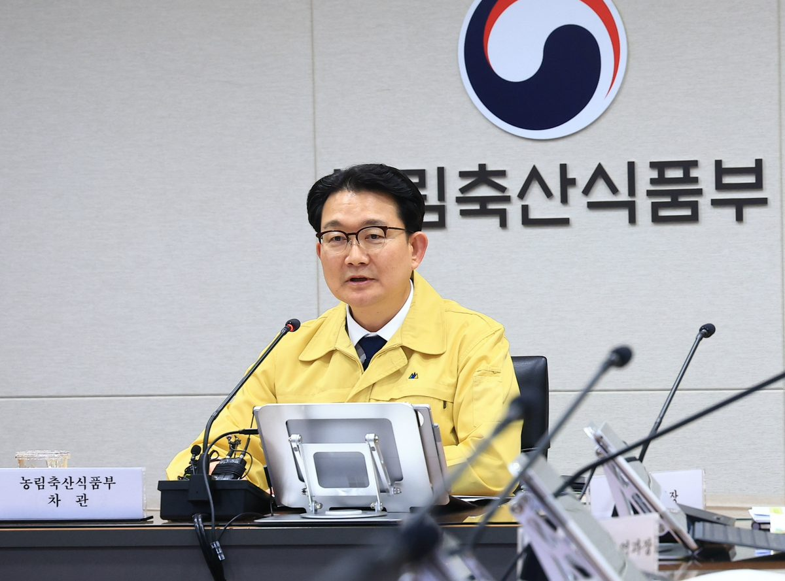

입력 2026-11-18

*농림축산식품부가 17일 김종구 차관 주재로 겨울철 고병원성 조류인플루엔자 방역상황점검회의를 열고 있다. 사진=농림축산식품부 제공*

11월 3일 경기 연천을 시작으로 올겨울 전국에서 고병원성 조류인플루엔자(AI)가 9건 발생했다. 농림축산식품부는 산란계 밀집단지 같은 고위험 지역의 방역을 강화하고, 방역 수칙을 어긴 농장에는 법에 따라 엄정 조치하겠다고 밝혔다.

농식품부는 17일(화) 김종구 차관 주재로 겨울철 고병원성 AI 총력 대응을 위한 방역상황점검회의를 열었다고 같은 날 보도자료에서 밝혔다. 농식품부는 올해는 발생 지역과 축종이 다양하고 혈청형 2종이 동시에 확인되고 있어 차단·초동방역에 힘써야 할 중요한 시점이라고 설명했다.

11월 17일 기준 발생 현황은 다음과 같다.

- 축종별: 닭 3건, 오리 3건, 메추리 2건, 관상용 거위 1건
- 지역별: 경기 4건, 전남광주 2건, 인천 1건, 충북 1건, 경북 1건

## 산란계 농장 일제 점검

농식품부는 이번 회의에서 관계기관과 지방정부별 방역조치 상황을 점검하고, 축산시설·농장 종사자·차량에 대한 빈틈없는 소독과 산란계 밀집단지 등 고위험 지역의 방역관리 강화를 당부했다.

특히 산란계 농장은 농장 출입 전 차량·사람 사전등록과 전담관 등이 제대로 운영되는지 관리하고, 차량 소독 실태와 방역시설 적정성, 관계 법령 준수 여부 등을 일제히 점검해 위반사항은 서둘러 개선하도록 요청했다.

농장주뿐 아니라 농장 종사자와 방문자도 방역시설 관리, 장화 갈아신기 등 5대 핵심방역 수칙을 지키도록 교육·홍보를 강화하고, 축산농가가 발생 상황을 빨리 알 수 있도록 알림톡, 문자메시지(SMS) 등으로 관련 정보를 수시로 알리도록 했다.

*김종구 농림축산식품부 차관이 17일 방역상황점검회의에서 발언하고 있다. 사진=농림축산식품부 제공*

김종구 차관은 "이번 고병원성 AI 발생농장에서 사전등록이 되지 않았거나 출입이 제한된 축산차량·사람의 관리 미흡 등 기본 방역수칙 위반 사례들이 여러 건 확인된 만큼, 각 지방정부와 관계기관의 철저한 관리를 당부드린다"라며, "현장 가금농가가 경각심을 갖고 농장방역에 참여할 수 있도록, 방역 수칙 위반이 확인될 경우 관련 법령에 따라 엄정 조치할 것"을 거듭 요청했다.

가축전염병 통합 신고전화는 1588-9060·4060이다.

※ 이 기사는 농림축산식품부 보도자료(11월 17일, 정책브리핑, 공공누리 제1유형·출처표시)를 바탕으로 작성했습니다. 사진은 농림축산식품부가 보도자료와 함께 제공한 것입니다.
