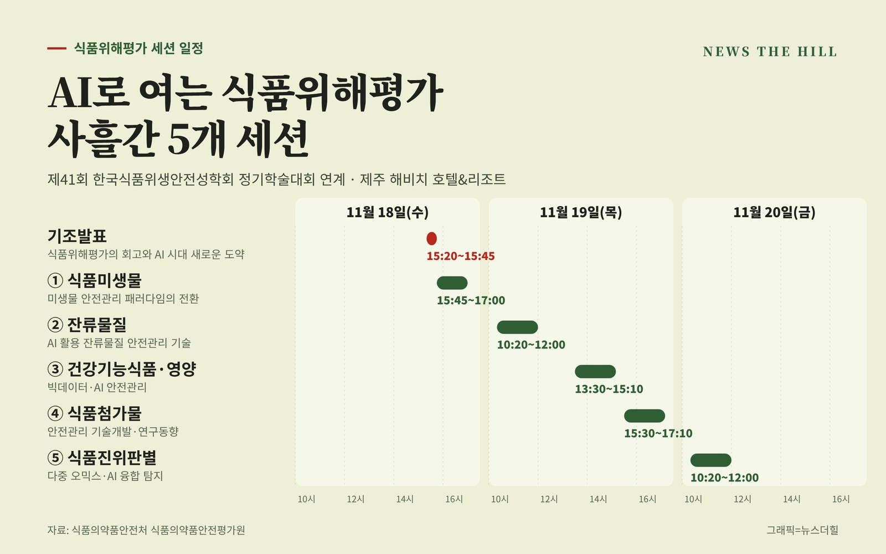

입력 2026-11-18

*그래픽=뉴스더힐(자료: 식품의약품안전처)*

빅데이터와 인공지능(AI)을 식품위해평가와 안전관리에 어떻게 쓸지 정부와 산·학·연 전문가가 사흘 동안 머리를 맞댄다.

식품의약품안전처(처장 오유경) 식품의약품안전평가원(원장 강석연)은 11월 18일부터 20일까지 제주 해비치 호텔&리조트에서 열리는 제41회 한국식품위생안전성학회 정기학술대회와 연계해 'AI로 여는 식품위해평가의 새로운 지평'을 주제로 식품분야 5개 세션을 연다고 18일 밝혔다. 한국식품위생안전성학회는 식품 위생·안전분야 학술교류와 연구증진을 목적으로 1986년 설립된 학술단체다.

이번 세션은 빅데이터와 AI 등 첨단 디지털 기술을 식품위해평가와 안전관리에 활용하기 위한 국내외 연구 동향과 성과를 공유하고, 식품위해평가의 발전방향을 함께 찾기 위해 마련됐다.

## 세션 일정

- **기조발표(18일 15:20~15:45)**: 이순호 식품위해평가부장이 '식품위해평가의 회고와 AI 시대 새로운 도약'을 발표한다.
- **식품미생물(18일 15:45~17:00)**: '안전을 위한 변화와 도약 : 식품 미생물 안전관리 패러다임의 전환'을 주제로 식품 미생물 안전 연구의 성과와 글로벌 연구 동향, K-Food 식품안전 혁신 등을 다룬다.
- **잔류물질(19일 10:20~12:00)**: 'AI를 활용한 잔류물질 안전관리 기술 혁신 방안'을 주제로 AI를 이용한 작물의 농약 잔류 예측 모델, AI 기반 잔류농약 신속 검출 방법 등이 발표된다.
- **건강기능식품·영양(19일 13:30~15:10)**: '빅데이터와 AI로 여는 건강기능식품·영양 안전관리'를 주제로 데이터 기반 영양·건강기능식품 안전관리 연구 등을 논의한다.
- **식품첨가물(19일 15:30~17:10)**: '식품첨가물 안전관리 기술개발 현황 및 최신 연구동향'을 주제로 식품첨가물 관리 현황과 시험분석 기술 개발 동향 등을 공유한다.
- **식품진위판별(20일 10:20~12:00)**: '식품 진위 판별 및 탐지 기술의 발전: 다중 오믹스 데이터와 인공지능의 융합'을 주제로 대사체학·머신러닝을 활용한 진위 판별 등을 다룬다.

식약처는 현장에 참석한 산업체 등을 대상으로 식품규제과학 발전을 위한 다양한 의견도 듣는다.

식약처는 "이번 학술대회에서 공유된 연구성과가 식품안전 정책으로 이어지는 소통의 장이 되기를 기대한다"며, "앞으로도 과학적 근거에 기반한 식품 위해평가와 안전관리 체계를 강화해 국민이 안심할 수 있는 식품안전 환경을 조성해 나가겠다"고 밝혔다.

※ 이 기사는 식품의약품안전처 보도참고자료(11월 18일, 정책브리핑, 공공누리 제1유형·출처표시)를 바탕으로 작성했습니다.
