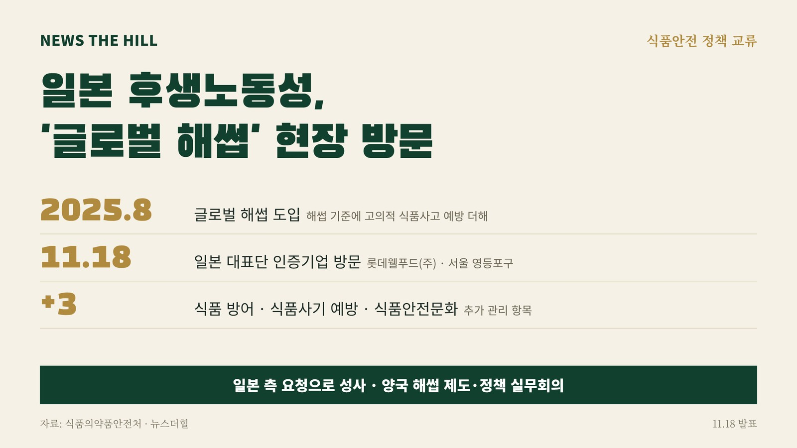

입력 2026-11-18

*그래픽=뉴스더힐(자료: 식품의약품안전처)*

일본 정부가 우리나라의 '글로벌 해썹(HACCP)' 제도 운영 현장을 직접 살펴봤다.

식품의약품안전처(처장 오유경)는 일본 후생노동성 대표단이 11월 18일 글로벌 해썹 인증 기업인 롯데웰푸드(주)(서울 영등포구 소재)를 방문하고, 양국 간 해썹 제도와 정책 교류를 위한 실무회의를 열었다고 이날 밝혔다. 후생노동성은 일본의 복지·고용·노동 정책과 식품·의약품 안전관리를 맡는 중앙행정기관이다.

글로벌 해썹은 식품의 제조·가공 등 모든 과정에서 생길 수 있는 위해요소를 확인해 중요 공정을 관리하는 해썹 기준에, 고의적·의도적인 식품사고를 막기 위한 식품 방어, 식품사기 예방, 식품안전문화 등을 더해 관리하는 시스템이다. 2025년 8월 도입됐다.

이번 방문은 일본 후생노동성의 요청으로 이뤄졌다. 일본 대표단은 글로벌 해썹 기준이 적용된 식품안전관리 현장을 직접 확인하고, 현장 운영 사례를 자국의 식품안전정책 수립에 참고할 계획이다.

식약처는 이번 방문에서 글로벌 해썹 제도의 도입 배경과 운영 현황 등을 일본 측에 공유하고, 일본의 해썹 정책과 운영 사례도 함께 살펴보는 등 양국 간 정책 교류를 진행한다.

식약처는 "이번 방문은 민·관 협력을 바탕으로 국내외 식품제조 환경 변화에 대응하고 국제기준에 부합하도록 발전시켜 온 글로벌 해썹 제도에 해외 정부가 관심을 보인 사례"라며, "앞으로도 국제 동향을 신속하게 파악하고 제도를 지속적으로 개선·정비하여 글로벌 해썹의 신뢰성과 국제적 인지도를 높여 나가겠다"고 밝혔다.

※ 이 기사는 식품의약품안전처 보도참고자료(11월 18일, 정책브리핑, 공공누리 제1유형·출처표시)를 바탕으로 작성했습니다.
