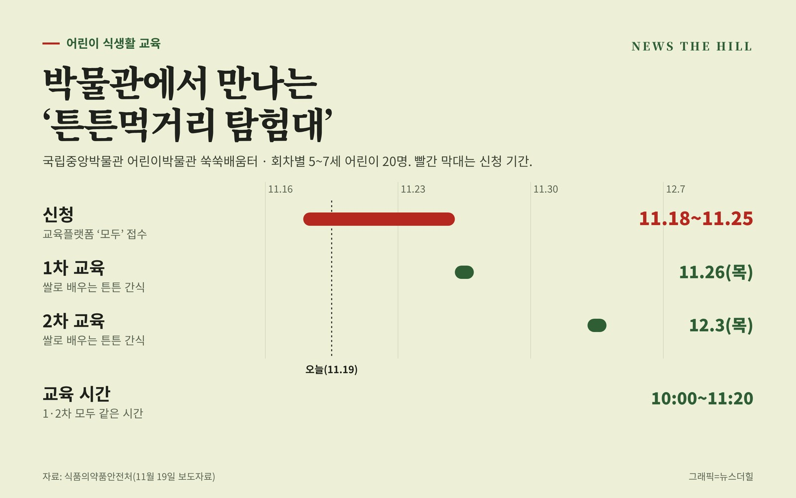

입력 2026-11-19

*그래픽=뉴스더힐(자료: 식품의약품안전처)*

어린이집과 학교를 찾아가던 식품의약품안전처의 어린이 식생활 교육이 박물관으로 무대를 넓힌다. 5~7세 어린이가 쌀의 역사와 문화유산을 배우고 당류를 줄인 쌀강정을 직접 만들어 보는 프로그램이다.

식품의약품안전처(처장 오유경)는 식생활 교육 프로그램 '튼튼먹거리 탐험대'를 다양한 문화·체험 공간으로 확대 운영한다고 19일 밝혔다. 튼튼먹거리 탐험대는 어린이집, 학교 등을 찾아가 손씻기, 건강 간식 만들기, 영양표시 읽기 같은 이론교육 등을 하는 식약처의 건강 식생활 교육프로그램이다.

이번 확대는 그동안 어린이집과 학교를 중심으로 진행되던 교육을 일상생활 속에서 자연스럽게 건강한 식생활을 배울 수 있도록 마련됐다. 식약처는 국립중앙박물관과 협력해 박물관의 역사·문화 콘텐츠와 식약처의 위생·영양 교육을 연계한 프로그램을 선보인다.

## 교육 내용

- **주제**: 쌀로 배우는 튼튼 간식
- **이론**: 쌀의 역사와 문화유산, 생활 속 당류 줄이기 실천 방법
- **실습**: 식중독 예방을 위한 올바른 손 씻기, 당류를 줄인 건강 간식 '알록달록 쌀강정 만들기'
- **전시 관람**: 어린이박물관 '밥상 위의 문화유산' 전시를 어린이 눈높이에 맞춰 풀어내고, 식재료와 조리도구에 담긴 역사 이야기도 탐구한다.

## 일정과 신청 방법

- **일시**: 1차 11월 26일(목), 2차 12월 3일(목) 오전 10시~11시 20분
- **장소**: 국립중앙박물관 어린이박물관 쑥쑥배움터(서울 용산구)
- **대상**: 회차별 5~7세 어린이 20명
- **신청 기간**: 11월 18일(수)~25일(수)
- **신청 방법**: 국립중앙박물관 교육플랫폼 '모두'(modu.museum.go.kr)

오유경 식약처장은 "어린이 시기는 평생의 건강한 식습관을 형성하는 매우 중요한 때인 만큼, 이번 교육을 통해 어린이들이 우리 식문화에 관심을 갖고 일상에서 건강한 식생활 실천 문화가 확대되는 계기가 되길 바란다"고 말했다.

식약처는 튼튼먹거리 탐험대를 다양한 문화·체험 콘텐츠와 지속 연계하고, 어린이 식생활 교육을 확대해 나갈 계획이다.

※ 이 기사는 식품의약품안전처 보도자료(11월 19일, 정책브리핑, 공공누리 제1유형·출처표시)를 바탕으로 작성했습니다.
