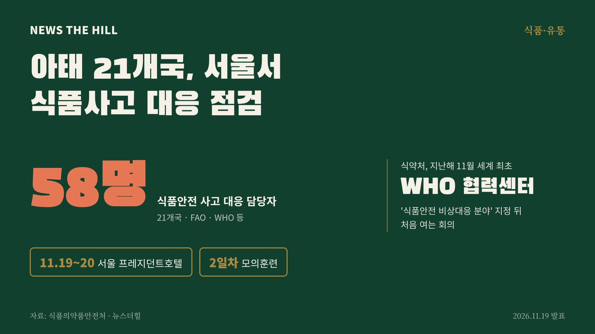

입력 2026-11-19

*그래픽=뉴스더힐(자료: 식품의약품안전처)*

한 나라에서 난 식품안전 사고가 수입 식품을 타고 다른 나라 식탁까지 번지는 일을 막기 위해 아시아·태평양 21개국 담당자들이 서울에 모였다. 각국의 비상대응 체계를 점검하고, 가상의 국제 식품사고를 놓고 정보공유 절차를 훈련한다.

식품의약품안전처(처장 오유경)는 11월 19일부터 20일까지 서울 프레지던트호텔에서 유엔식량농업기구(FAO), 세계보건기구(WHO)와 공동으로 '2026 아시아·태평양 국제식품안전당국네트워크(INFOSAN) 국제회의'를 연다고 19일 밝혔다.

INFOSAN은 식품안전 사고가 났을 때 국가 간 위해정보를 신속하게 공유하고 공동 대응을 지원하기 위해 FAO와 WHO가 2004년 설립한 국제 네트워크다.

이번 회의는 식약처가 지난해 11월 세계 최초로 '식품안전 비상대응 분야' WHO 협력센터로 지정된 뒤 처음 여는 회의다. 우리나라가 주도해 한국의 식품안전 위기대응 전문성과 경험을 공유하고 아시아·태평양 국가들의 비상대응 역량을 강화하기 위해 마련됐다.

## 21개국·58명 참석

'글로벌 식품안전 대응역량 강화'를 주제로 아시아·태평양 지역 21개국과 FAO, WHO 등 식품안전 사고 대응 담당자 58명이 참여한다. 참가국은 대한민국, 뉴질랜드, 라오스, 말레이시아, 미얀마, 방글라데시, 베트남, 부탄, 브루나이, 사모아, 스리랑카, 싱가포르, 인도, 인도네시아, 일본, 중국, 캄보디아, 태국, 팔라우, 필리핀, 호주다.

## 이틀간 일정

- **19일(목)**: 식약처장 등의 개회사, INFOSAN 중장기 전략 발표, 식약처의 WHO 협력센터 주요 활동과 한국의 식품안전 모의훈련 경험 소개. 참가국은 식품안전 사고 대응 사례를 공유하고 국제보건규칙 자가평가(IHR-SPAR) 결과 등으로 자국의 비상대응 역량을 점검한 뒤, 그룹별 토론으로 사고 관리·정보보고 체계의 미비점과 개선 사항을 논의한다.
- **20일(금)**: 글로벌 식품안전 사고를 가정한 모의훈련으로 국가별 비상대응 계획과 정보공유 절차를 점검한다. 참가국은 훈련 결과 등을 바탕으로 2027년에 우선 추진할 사고 대응 개선과제를 선정하고 이행 계획과 필요한 지원방안을 구체화한다.

식약처는 이번 회의를 통해 국내 식품안전 위기대응 경험과 위해정보 분석·관리체계를 아시아·태평양 국가들과 공유할 계획이다. 또 WHO 협력센터로서 국제 식품안전 네트워크를 강화해 글로벌 식품안전 사고가 나면 신속하게 협력 대응하고 안전한 식품이 수입될 수 있는 환경을 마련해 나갈 방침이다.

오유경 처장은 "식품안전 사고는 국경을 넘어 여러 국가의 국민 건강에 영향을 미칠 수 있는 만큼 국가 간 신속한 정보 공유와 긴밀한 협력이 중요하다"며, "이번 회의가 아시아·태평양 국가들의 식품안전 위기대응 역량을 높이고, 실질적인 국제 공조 체계를 강화하는 계기가 되기를 기대한다"고 말했다.

이어 "앞으로도 식약처가 WHO 협력센터로서 한국의 식품안전관리 전문성을 국제사회와 나누고, 글로벌 식품안전 수준 향상에 기여하겠다"고 밝혔다.

※ 이 기사는 식품의약품안전처 보도자료(11월 19일, 정책브리핑, 공공누리 제1유형·출처표시)를 바탕으로 작성했습니다.
