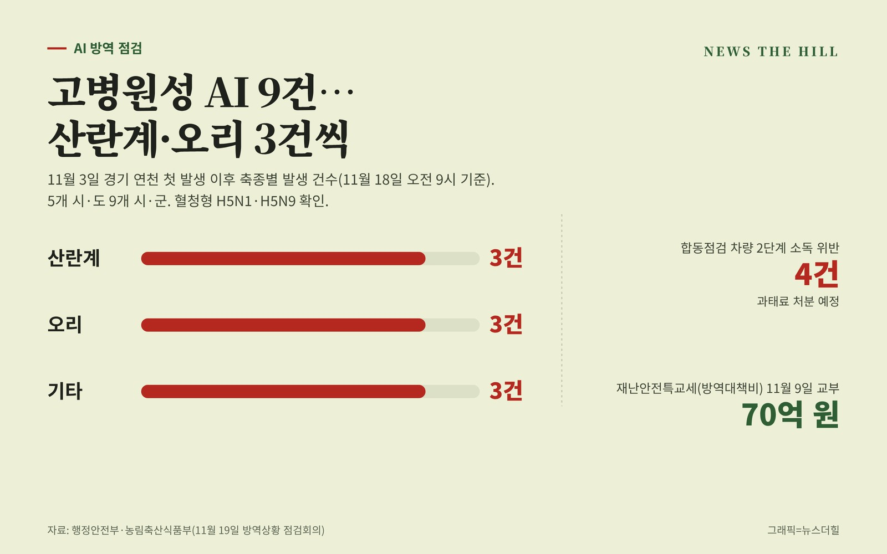

입력 2026-11-19

*그래픽=뉴스더힐(자료: 행정안전부·농림축산식품부)*

고병원성 조류인플루엔자(AI)가 산란계 농장을 중심으로 이어지자 정부가 가축 방역부서뿐 아니라 재난관리부서까지 대응에 끌어들였다. 농림축산식품부의 방역상황 점검회의를 이번에는 행정안전부 사회재난실장이 주재했다.

행정안전부(장관 윤호중)와 농림축산식품부(장관 송미령)는 19일(목) 고병원성 AI 방역상황 점검회의를 공동 개최했다고 같은 날 보도자료에서 밝혔다. 회의에는 행안부, 농식품부, 기후부, 질병청, 검역본부, 방역지원본부와 16개 시도, 산란계 밀집 지역 12개 시군이 참석했다.

이번 회의는 기존 방역부서 중심에서 재난관리부서 등 관계부서까지 참석 대상을 넓혀 총력대응체계를 중점 점검했다. 고병원성 AI가 11월 3일 경기 연천에서 처음 발생한 뒤 확산 가능성이 높은 산란계를 중심으로 발생이 이어지고, 다양한 혈청형(H5N1, H5N9)이 확인되는 등 엄중한 상황을 고려한 것이라고 정부는 설명했다.

11월 18일 오전 9시 기준 발생은 5개 시·도 9개 시·군에서 모두 9건이다.

- 산란계 3건
- 오리 3건
- 기타 3건

## 지대본 운영·특교세 집행 점검

회의에서는 지방정부의 지역재난안전대책본부(지대본) 운영과 재난안전특교세(방역대책비) 집행 상황을 점검하고, 가축 방역부서가 방역에 집중할 수 있도록 다른 부서가 지원하도록 주문했다. 재난안전특교세는 11월 9일 70억 원이 교부됐다. 지난해보다 15일 빠르고 20억 원 늘었다.

가축처분·소독·이동통제 등 방역조치 이행 상황도 점검하고, 농식품부와 행안부 합동점검 중간결과를 공유했다. 합동점검에서는 주요 미흡사항으로 농장 출입 차량의 진입 전 2단계 소독(1차 고정식 소독, 2차 고압분무 소독) 위반이 모두 4건 확인돼 과태료 처분이 예정돼 있다.

기후에너지환경부는 야생조류 AI 검출정보를 관계기관과 신속히 공유하고, 고병원성 AI 검출지 주변 폐사체 수색과 예찰을 강화하는 한편 지방정부의 소독·출입통제 등 방역조치 이행 여부를 계속 점검하겠다고 밝혔다.

이동식 농식품부 방역정책국장은 "최근 철새 본격 도래와 발생이 증가하는 매우 엄중한 시기로 지난 시즌에 발생이 많았던 산란계 농장을 중심으로 농가 스스로 차단방역이 할 수 있도록 지도 및 홍보를 철저히 해 줄 것"을 요청했다.

박형배 행안부 사회재난실장은 "부단체장을 중심으로 지대본을 내실 있게 운영하고, 가축 방역부서와 재난관리부서가 협력하여 고병원성 AI에 총력 대응해 달라"고 당부했다.

정부는 앞으로도 '원팀'으로 지방정부의 대응상황을 점검하면서 고병원성 AI 확산 방지에 최선을 다할 계획이다.

※ 이 기사는 행정안전부·농림축산식품부 보도자료(11월 19일, 정책브리핑, 공공누리 제1유형·출처표시)를 바탕으로 작성했습니다.
