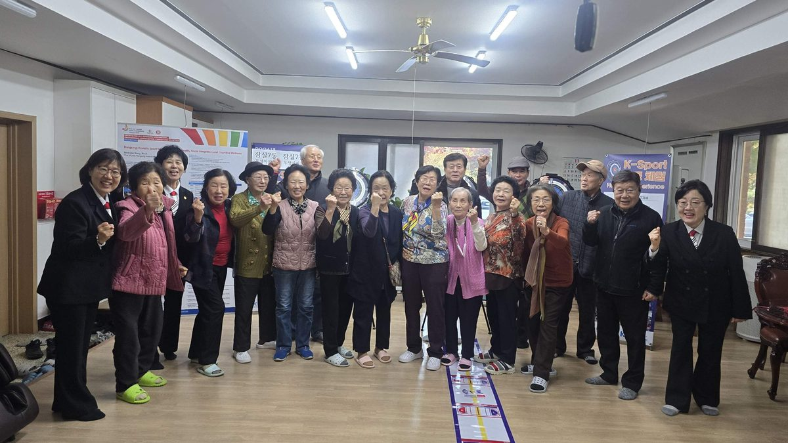
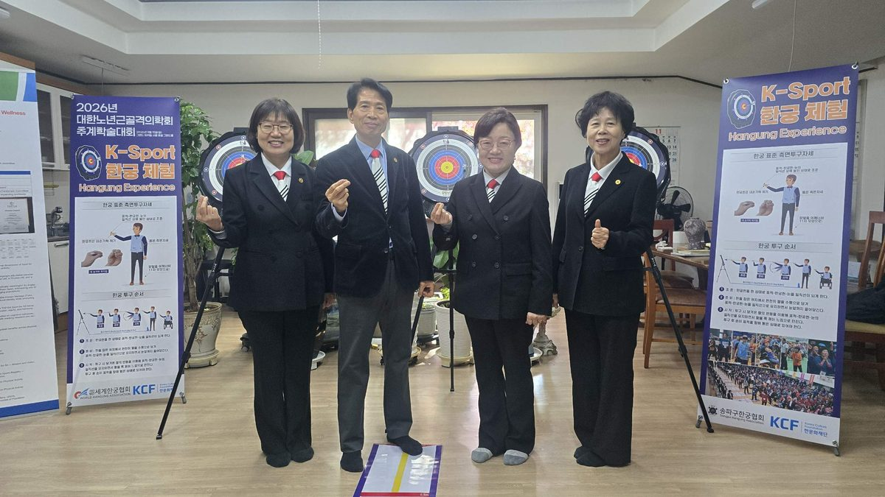
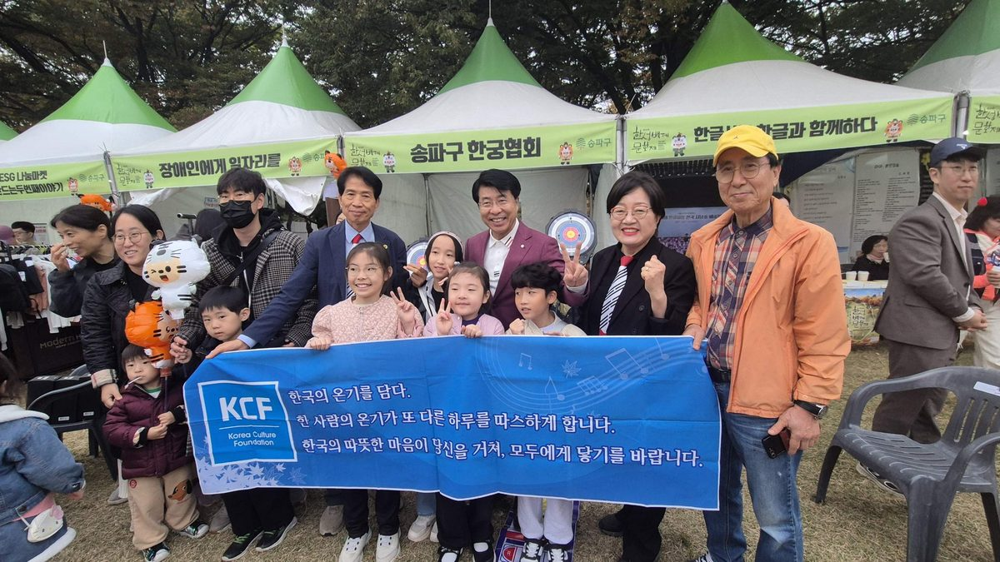
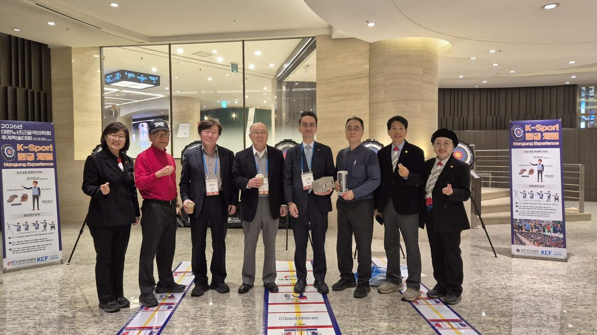

입력 2026-11-20

*19일 서울 송파구 잠실7동 우성아파트 경로당에서 열린 한궁체험 행사에 참여한 어르신들과 송파구한궁협회 관계자들이 기념촬영을 하고 있다. 사진=송파구한궁협회 제공*

송파구한궁협회(회장 서영순)가 19일(목) 서울 송파구 잠실7동 우성아파트 경로당(회장 김규석)에서 대한노인회 송파구지회 회장단과 지역 어르신 등 50여 명을 대상으로 한궁체험 행사를 열었다. 체험을 마친 경로당 회장들은 각자의 경로당에서도 한궁체험 프로그램을 운영해 달라고 요청했다.

송파구한궁협회는 20일 보도자료에서 이같이 밝혔다. 이번 행사는 우리나라에서 창시된 생활체육 종목인 한궁을 지역 어르신들에게 소개하고, 건강한 여가활동과 생활체육 참여 기회를 넓히기 위해 마련됐다.

협회에 따르면 한궁은 서울 송파구 석촌호수에서 시작된 한국형 생활체육 종목으로, 전통놀이인 투호와 서양의 다트, 양궁의 장점을 접목해 개발됐다. 남녀노소 누구나 쉽게 배우고 즐길 수 있고, 어르신들의 집중력과 눈과 손의 협응력 향상에 도움을 줄 수 있는 운동이라고 협회는 설명했다.

*한궁체험 행사가 열린 잠실7동 우성아파트 경로당에서 송파구한궁협회 관계자들이 기념촬영을 하고 있다. 사진=송파구한궁협회 제공*

이날 어르신들은 한궁의 기본적인 경기 방법과 투구 요령을 익힌 뒤 직접 한궁핀을 던졌다. 한궁핀이 과녁에 명중할 때마다 환호와 박수가 이어졌다고 협회는 전했다.

## 12월 20일 첫 협회장배 대회

대한노인회 송파구지회 소속 경로당 회장들은 오는 12월 20일(일) 송파구체육문화회관에서 열리는 '제1회 송파구한궁협회장배 한궁어울림대회'에도 적극 참여하겠다는 뜻을 밝혔다.

이 대회는 송파구한궁협회가 처음 여는 협회장배 대회다. 장애인과 비장애인, 어르신 등 약 200명이 함께하는 생활체육 축제로 준비되고 있으며, '한궁으로 하나 되는 송파! 장애와 세대를 넘어 건강과 행복을 나누다'라는 취지로 진행된다.

서영순 회장은 "어르신들이 한궁핀을 던지며 즐거워하시는 모습을 보니 큰 보람을 느낀다"면서 "특히 경로당 회장님들께서 각 경로당에서도 한궁체험을 진행해 달라고 요청하시고, 12월 20일 개최하는 첫 한궁어울림대회에도 적극 참여하겠다는 뜻을 밝혀주셔서 더욱 뜻깊었다"고 말했다.

이어 "앞으로 '찾아가는 송파구 경로당 한궁교실'을 통해 어르신들이 일상에서 쉽고 즐겁게 한궁을 접할 수 있도록 노력하고, 장애인과 비장애인이 함께 어우러지는 생활체육 환경을 조성하는 데 최선을 다하겠다"고 밝혔다.

협회는 제1회 한궁어울림대회를 시작으로 지역 경로당과 장애인 관련 단체 등 다양한 계층의 참여를 넓히고, 한궁을 통한 건강 증진과 지역사회 화합에 나설 계획이다.

## 한성백제문화제·학술대회서도 체험 부스

*지난 10월 올림픽공원 88잔디마당에서 열린 제26회 한성백제문화제의 송파구한궁협회 한궁체험 부스 앞에서 참가자들이 기념촬영을 하고 있다. 사진=송파구한궁협회 제공*

송파구한궁협회 회원들은 지난해에 이어 10월 23일부터 25일까지 송파구 올림픽공원 88잔디마당에서 열린 '제26회 한성백제문화제'에서 한궁체험 부스를 운영했다.

또 세계한궁협회(회장 허광), 서울특별시한궁협회(회장 강석재)와 함께 한문화재단(이사장 김준일) 후원으로 정형외과 의사들을 대상으로 한 한궁체험 특별 부스도 운영했다.

- **2026년 제70차 대한정형외과학회 국제학술대회**: 10월 8~10일 수원컨벤션센터, 28개국 약 2,800명 참가
- **2026년 대한노년근골격의학회 추계학술대회**: 11월 15일 서울 광진구 그랜드 워커힐 서울호텔

*11월 15일 그랜드 워커힐 서울호텔에서 열린 2026년 대한노년근골격의학회 추계학술대회의 한궁체험 부스에서 참석자들이 기념촬영을 하고 있다. 사진=송파구한궁협회 제공*

※ 이 기사는 송파구한궁협회 보도자료(11월 20일)를 바탕으로 작성했습니다. 사진은 송파구한궁협회가 보도자료와 함께 제공한 것입니다.
