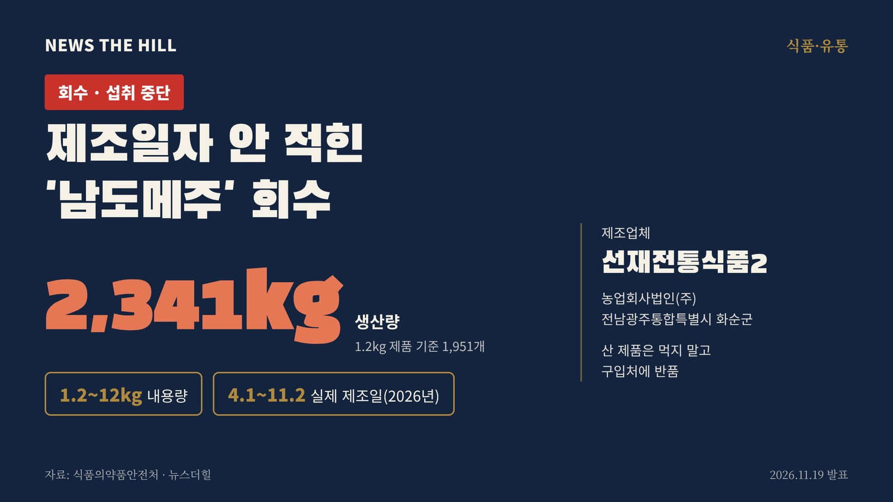

입력 2026-11-20

*그래픽=뉴스더힐(자료: 식품의약품안전처)*

장 담그기용으로 산 메주가 있다면 포장에 제조일자가 적혀 있는지 확인해 볼 필요가 있다. 제조일자를 표시하지 않은 한식메주 제품이 판매 중단·회수에 들어갔다.

식품의약품안전처는 식품제조·가공업체 농업회사법인(주)선재전통식품2(전남광주통합특별시 화순군)가 제조·판매한 '남도메주'(식품유형: 한식메주)에 제조일자를 표시하지 않은 것이 확인돼 판매를 중단하고 회수 조치한다고 19일 밝혔다.

## 회수 대상

- 제조업체: 농업회사법인(주)선재전통식품2(전남광주통합특별시 화순군)
- 제품명(식품유형): 남도메주(한식메주)
- 제조일자: 미표시. 실제 제조일자는 2026년 4월 1일부터 11월 2일 사이(4월 1일, 4월 6일, 4월 20일, 5월 2일, 11월 2일)다.
- 소비기한: 제조일로부터 1년
- 내용량: 1.2kg~12kg
- 생산량: 2,341kg(1.2kg 제품 기준 1,951개)
- 실제 제품은 숯과 건고추가 함께 들어 있는 세트포장 형태다.

회수는 전남광주통합특별시 화순군이 맡는다.

## 소비자 행동 요령

- 해당 제품을 샀다면 먹지 말고 산 곳에 반품한다. 식약처는 구매 소비자에게 섭취를 중단하고 구입처에 반품해 달라고 당부했다.
- 식품 관련 불법 행위를 보면 불량식품 신고전화 1399나 식품안전정보 앱 '내손안'으로 신고할 수 있다.

※ 이 기사는 식품의약품안전처 보도참고자료(11월 19일, 정책브리핑, 공공누리 제1유형·텍스트에 한함)를 바탕으로 작성했습니다.
