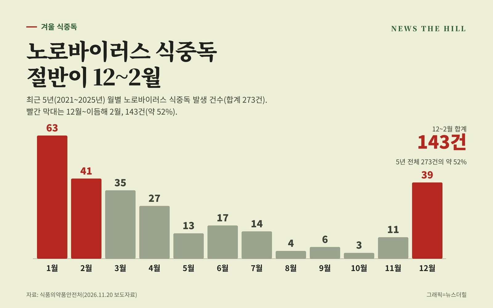

입력 2026-11-20

*그래픽=뉴스더힐(자료: 식품의약품안전처)*

본격적인 겨울을 앞두고 노로바이러스 식중독 철이 시작됐다. 최근 5년간 일어난 노로바이러스 식중독의 절반 이상이 12월부터 이듬해 2월 사이에 몰렸다.

식품의약품안전처(처장 오유경)는 겨울철 늘어나는 노로바이러스 식중독을 막기 위해 손씻기, 가열하기, 세척·소독하기 등 식중독 예방수칙을 철저히 지켜 달라고 20일 당부했다.

## 1월이 가장 많았다

식약처에 따르면 최근 5년(2021~2025년)간 노로바이러스 식중독은 모두 273건 발생했다. 이 가운데 12월부터 이듬해 2월까지가 143건(약 52%)이었다.

달별로는 1월이 63건으로 가장 많았고 2월 41건, 12월 39건, 3월 35건, 4월 27건 순이었다. 반면 8월은 4건, 9월은 6건, 10월은 3건에 그쳤다.

노로바이러스는 낮은 온도에서도 살아남을 수 있어 겨울철부터 이듬해 봄까지 주로 발생하는 대표적인 식중독 원인 병원체다. 구토, 설사 등 급성 위장염을 일으키고 전염성이 강하다. 오염된 음식물이나 지하수를 먹어서 걸리기도 하고, 환자의 분변·구토물·침, 오염된 손 등을 통해 사람 사이 접촉으로도 옮는다.

## 이렇게 예방한다

- 지하수: 소독하지 않은 지하수는 반드시 끓여서 쓴다.
- 굴 등 어패류: 생굴 등 익히지 않은 어패류로, 굴 제품 포장에 '가열조리용' 등의 표시가 있으면 반드시 중심 온도 85℃에서 1분 이상 가열한 뒤 먹는다.
- 손 씻기: 비누 등 세정제를 써서 흐르는 물에 30초 이상, 손가락과 손등까지 깨끗이 씻는다.
- 증상 있으면 조리에서 빠진다: 구토, 설사 등 감염이 의심되는 증상이 있으면 급식 조리 등 식품 취급 업무에 참여하지 않고, 증상이 회복된 뒤에도 2~3일은 쉬어야 한다.
- 어린이집·유치원: 면역력이 약한 영유아가 단체 생활을 하는 곳은 아이들이 하원한 뒤 화장실, 문손잡이, 수도꼭지 등 손이 자주 닿는 곳을 염소 소독제로 소독한다.

식약처는 앞으로도 식중독 안전관리를 강화하고, 일상생활에서 쉽게 실천할 수 있는 식중독 예방 요령 등을 계속 알릴 계획이다.

※ 이 기사는 식품의약품안전처 보도자료(11월 20일, 정책브리핑, 공공누리 제1유형·출처표시)를 바탕으로 작성했습니다.
