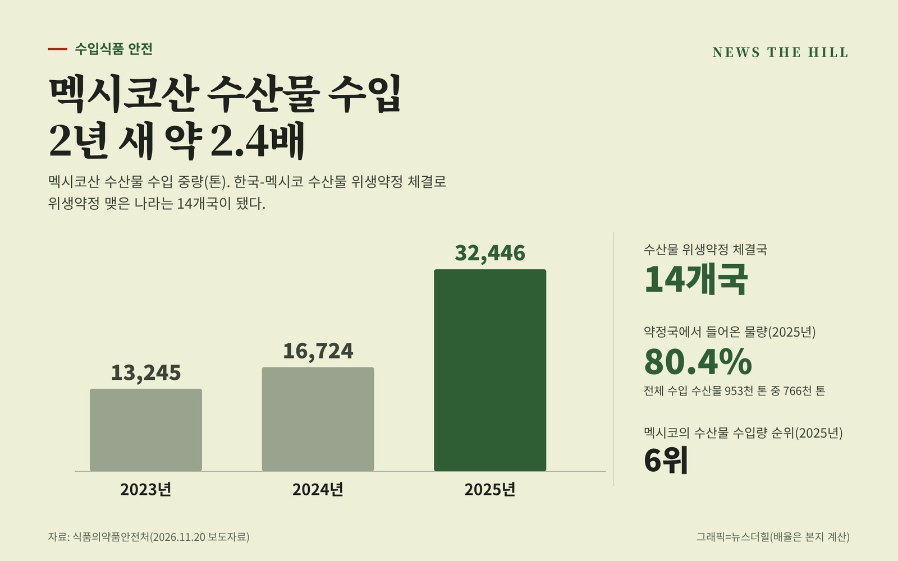

입력 2026-11-20

*그래픽=뉴스더힐(자료: 식품의약품안전처)*

앞으로 멕시코산 수산물은 멕시코 정부가 위생을 관리하고 등록한 시설에서 생산된 것만 국내에 들어올 수 있다. 수입검사 때는 멕시코 정부가 발급한 위생증명서를 반드시 내야 한다.

식품의약품안전처(처장 오유경)는 11월 20일(현지시간 11월 19일 오전 9시 30분) 멕시코 멕시코시티에서 멕시코 보건부(SALUD)와 우리나라로 수입되는 멕시코산 수산물의 안전성을 강화하기 위한 위생약정(MOU)을 맺었다고 20일 밝혔다. 약정은 식약처장과 멕시코 보건부 장관이 체결권자이고, 서명본은 식약처 수입식품안전정책국장과 멕시코 연방보건안전보호위원회(COFEPRIS) 위원장이 교환했다.

## 무엇이 달라지나

약정의 주요 내용은 세 가지다.

- 멕시코 정부가 위생관리하고 등록한 시설에서 생산된 수산물만 수입
- 수입검사 때 멕시코 정부가 발급한 위생증명서 제출 의무화
- 부적합 수산물이 나오면 멕시코 정부에 사후관리 요구

식약처는 이번 약정으로 수입 전 사전관리부터 수입 후 사후조치까지 수입과 관련된 모든 단계에 더 촘촘한 안전망을 갖추게 됐다고 설명했다.

## 멕시코산 수입 빠르게 늘어

이번 약정은 지난 9월 한-멕시코 정상회담(9월 24일)의 후속 조치다. 식약처는 앞서 멕시코 농업농촌개발부(SADER)와 '수입 축산물 전자증명 협력 MOU'를 맺었고, 최근 멕시코산 수산물 수입이 늘어나자 협력 범위를 수산물까지 넓혔다.

멕시코산 수산물 수입량은 2023년 1만3245톤에서 2024년 1만6724톤, 2025년 3만2446톤으로 늘었다. 2년 새 약 2.4배(본지 계산)다. 2025년 기준 수산물 수입량 6위다. 주요 수입 품목은 오징어, 해파리, 대서양민대구, 다랑어 등이다.

2025년 품목별로는 냉동오징어(동체)가 8031톤으로 가장 많았고 염장해파리 5917톤, 냉동오징어 3682톤, 냉동오징어(다리) 3188톤, 냉동오징어(지느러미) 2993톤, 냉동대서양민대구 2796톤 순이었다.

## 약정국 물량이 전체의 80.4%

이번 체결로 우리나라와 수산물 위생약정을 맺은 나라는 14개국이 됐다. 기존 13개국은 중국, 베트남, 인도네시아, 태국, 러시아, 에콰도르, 칠레, 노르웨이, 필리핀, 페루, 아르헨티나, 스페인, 뉴질랜드다. 약정국에서 들어온 물량은 지난해 기준 전체 수입 수산물 953천 톤의 약 80.4%(766천 톤)를 차지한다.

오유경 식약처장은 "이번 멕시코 정부와의 협력은 수출국 단계부터 안전관리를 강화해 우리 국민이 더욱 안심하고 수입 식품을 소비할 수 있는 환경을 만드는 데 의미가 있다"며, "식약처는 앞으로도 수입 식품 안전관리 제고를 위해 글로벌 협력을 지속해서 강화해 나가겠다"고 밝혔다.

※ 이 기사는 식품의약품안전처 보도자료(11월 20일, 정책브리핑, 공공누리 제1유형·출처표시)를 바탕으로 작성했습니다.
