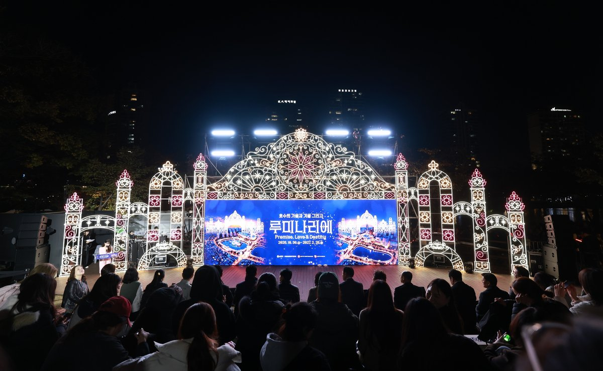
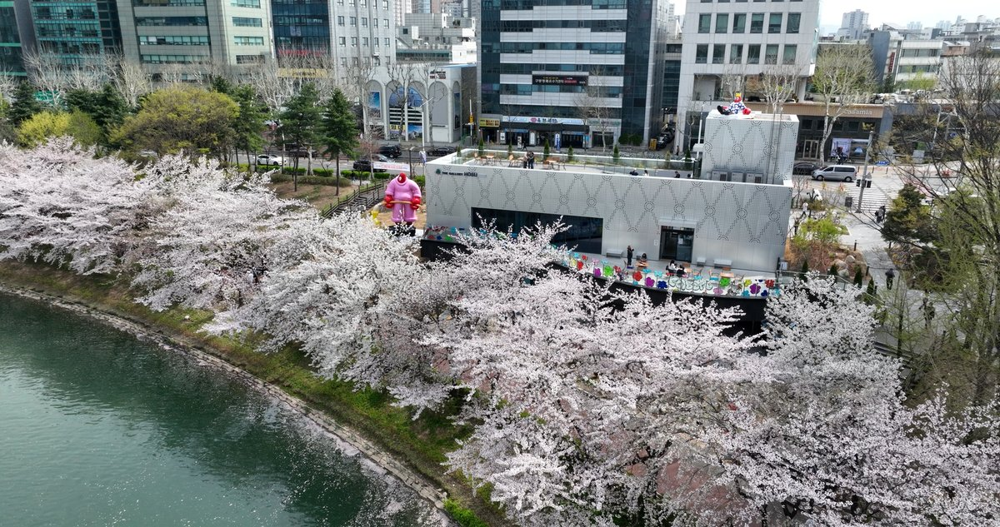

입력 2026-11-20

*석촌호수에서 열린 '호수의 가을과 겨울, 그리고 루미나리에' 개막식. 사진=송파구 제공*

서울 송파구가 석촌호수 일대를 문화예술 공간으로 가꾸고 계절별 지역축제를 키운 성과로 '제22회 대한민국 지방자치경영대전'에서 문화체육관광부장관 표창을 받았다. 이번 대회에서 문체부장관 표창을 받은 곳 가운데 서울 자치구는 송파구뿐이다.

송파구(구청장 서강석)는 20일 보도자료에서 이같이 밝혔다. 구는 '석촌호수 문화클러스터 조성 및 지역축제 활성화' 사업으로 지역특화자원 개발 분야 문화관광 부문 우수상을 받았다.

대한민국 지방자치경영대전은 지역 특성을 살린 지방정부의 우수 정책을 발굴하는 대회다. 문화관광 부문에서는 관광상품 개발, 지역 콘텐츠의 차별성과 브랜드화, 관광객 증가 등을 평가한다.

구는 앞서 지난 6월 여행·관광 전문 연구기관 야놀자리서치의 '2026 한국관광도시 경쟁력 평가'에서 전국 255개 행정구역 가운데 종합 1위를 차지해 대상을 받았다.

## 계절마다 축제…방문객 늘어

구는 송파의 역사와 지역 특색을 반영한 도시브랜드(CI)를 개발했다. 대표 캐릭터 '하하·호호'는 2023년 '제6회 우리동네 캐릭터 대상'에서 최우수상을 받았고, 이 캐릭터를 활용한 관광기념품은 연평균 4,500만 원 이상의 매출을 올리고 있다.

지역축제는 봄 '호수벚꽃축제', 가을 '한성백제문화제', 늦가을부터 겨울까지 '호수의 가을과 겨울, 그리고 루미나리에'로 이어진다. 구는 축제를 인근 상권과 연계해 왔다.

구에 따르면 올해 호수벚꽃축제 기간 석촌호수와 인접 상권, 롯데월드몰 일대를 찾은 방문객은 901만 명으로 전년보다 25만 명 늘었다. 한성백제문화제에는 59만 3,000여 명이 찾아 전년보다 15.4% 늘었고, 지난해 개막한 '호수의 가을과 겨울, 그리고 루미나리에'에는 289만 명이 방문해 전년보다 27% 증가했다.

*석촌호수 산책길의 공공문화시설 '더 갤러리 호수'. 사진=송파구 제공*

## 호수 둘레 공공문화시설 5곳

구는 축제가 없는 날에도 석촌호수 산책길에서 문화예술을 즐길 수 있도록 호수 둘레 2.5㎞에 공공문화시설을 늘려 왔다. 현재 ▲더 갤러리 호수 ▲서울놀이마당 ▲석촌호수 아뜰리에 ▲문화실험공간 호수 ▲더 스피어 등 5곳을 운영하고 있다.

석촌호수를 포함한 잠실관광특구는 올해 서울시 평가에서 2년 연속 최우수 특구로 선정됐다. 올해 송리단길·방이시장·방이맛골 일대가 새로 편입되면서 관광권역도 석촌호수 주변 골목상권까지 넓어졌다.

구는 석촌호수를 찾는 발길이 가락시장까지 이어지도록 송파대로 6.2㎞ 구간에 '걷고 싶은 가로정원'을 조성하고 있다. 가로정원이 완성되면 주민과 관광객이 석촌호수에서 미술작품을 감상한 뒤 정원을 따라 걸어 가락시장에서 먹거리를 즐길 수 있도록 할 계획이다.

서강석 송파구청장은 "구민이 일상에서 문화예술을 쉽게 누릴 수 있는 곳이 진정한 명품도시"라며 "석촌호수에서 전시와 공연을 즐길 기회를 더 넓히고, 세계인이 즐겨찾는 문화예술도시 송파를 만들어 가겠다"고 밝혔다.

※ 이 기사는 송파구 보도자료(11월 20일)를 바탕으로 작성했습니다. 사진은 송파구가 보도자료와 함께 제공한 것입니다.
