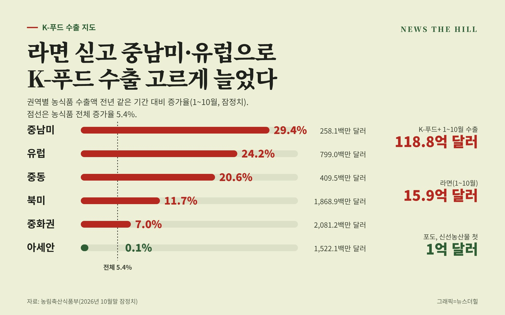

입력 2026-11-20

*그래픽=뉴스더힐(자료: 농림축산식품부)*

농식품과 농기자재·동물용의약품·스마트팜 등을 합친 'K-푸드+' 수출액이 올해 10월까지 118.8억 달러로 1년 전보다 4.9% 늘었다. 라면이 15.9억 달러어치 팔려 나갔고, 포도는 신선농산물 가운데 처음으로 연간 수출 1억 달러를 넘었다.

농림축산식품부(장관 송미령)는 10월 말 기준 K-푸드+ 수출 실적을 19일 이같이 발표했다. 11월 현재 잠정치는 122.9억 달러로, 역대 최고 수출 실적이다. 지난 9월에는 역대 최단 기간인 262일 만에 100억 달러를 돌파했다.

K-푸드+ 가운데 농식품(K-푸드)은 90.7억 달러로 5.4%, 농산업은 28.1억 달러로 3.4% 늘었다.

## 중남미·유럽·중동 고르게 성장

권역별 농식품 수출 증가율은 중남미(29.4%), 유럽(EU+영국, 24.2%), 중동(GCC, 20.6%), 북미(11.7%), 중화권(7.0%) 순으로 높았다. 아세안은 0.1% 늘었다.

최대 시장인 미국 수출은 16.8억 달러로 11.7% 늘었다. 라면(2억 7,650만 달러), 과자(2억 4,950만 달러), 김치(3,830만 달러), 배(2,070만 달러), 포도(1,640만 달러)가 중심이고, 포도는 1년 전보다 177.3% 늘었다. 농식품부는 최근 에스닉 마켓 중심에서 일반 소비자로 소비가 넓어지는 추세라고 설명했다.

2위 시장 중국으로의 수출은 14.1억 달러로 7.0% 늘었다. 중국은 라면 수출 1위 국가로, 라면 수출액이 3억 9,550만 달러로 23.9% 증가했다.

유럽에서는 폴란드(109.9%), 스페인(33.4%), 독일(31.6%)의 증가세가 두드러졌고, 지난해부터 본격적으로 수출된 열처리 닭고기가 6배 이상 늘었다. 중남미는 멕시코(93.0%), 브라질(43.8%)을 중심으로 라면·과자·쌀 가공식품·아이스크림 수출이 크게 늘었다. 중동은 전쟁 직후 물류 경색과 소비 위축으로 3월 수출이 1~2월 평균보다 50% 이상 줄었으나, 우회 경로를 확보하면서 회복해 전년보다 20.6% 성장했다.

## 라면 10억 달러 넘어 15.9억 달러

가공식품 수출은 78.0억 달러로 5.9%, 신선농산물은 12.7억 달러로 2.7% 늘었다. 라면은 지난 7월 10억 달러를 넘어선 데 이어 10월까지 15.9억 달러로 26.3% 증가했다. 과자, 소스, 쌀 가공식품도 수출이 늘었다.

포도는 10월에 이미 지난해 수출액(8,574만 달러)을 넘어섰고, 11월 신선농산물 최초로 1억 달러를 달성했다. 최대 시장 대만에서 114.4%, 2위 시장 미국에서 177.3% 늘었다. 농식품부는 올해 처음으로 포도 수출액이 수입액을 넘어섰다고 밝혔다.

김치 수출액은 1억 4,030만 달러로 2.1% 늘었고, 이 가운데 북미가 약 3분의 1을 차지했다. 딸기는 6,110만 달러로 15.3% 늘었다. 돼지고기(캔햄 포함)는 4,130만 달러로 15.3% 증가했으며, 싱가포르로의 수출이 제주산 한돈 검역 협상 타결 이후 4배 이상 늘었다.

새 시장도 열렸다. 10월 베트남으로 열처리 가금육이 처음 선적됐고, 11월에는 국산 단감이 17년간의 검역 장벽을 넘어 중국에 처음 진출했다. 제주산 감귤은 우즈베키스탄으로 첫 수출길에 올랐다.

## 농산업은 비료·동물약품·스마트팜이 견인

농산업 수출은 비료(4억 7,880만 달러, 26.6%), 동물용의약품(3억 3,300만 달러, 23.6%), 스마트팜(1억 220만 달러, 18.2%)이 늘었다. 농기계(0.9%), 농약(7.4%), 종자(0.6%)는 줄었다.

김정욱 농식품부 농산업혁신정책실장은 "물류비 상승 등 쉽지 않은 여건에서도 K-푸드+ 수출실적이 성장세를 보인 만큼, 앞으로도 더욱 견조한 성장세를 이어 가기 위한 정부 지원을 아끼지 않겠다."라며 "특히 신선농산물 최초로 1억 달러를 달성한 포도의 성공 방정식을 다른 품목으로 확산시켜, 수출이 농업인의 경영 안정에 실질적인 도움이 될 수 있도록 최선을 다할 계획"이라고 밝혔다.

※ 이 기사는 농림축산식품부 보도참고자료(11월 19일, 정책브리핑, 공공누리 제1유형·출처표시)를 바탕으로 작성했습니다.
