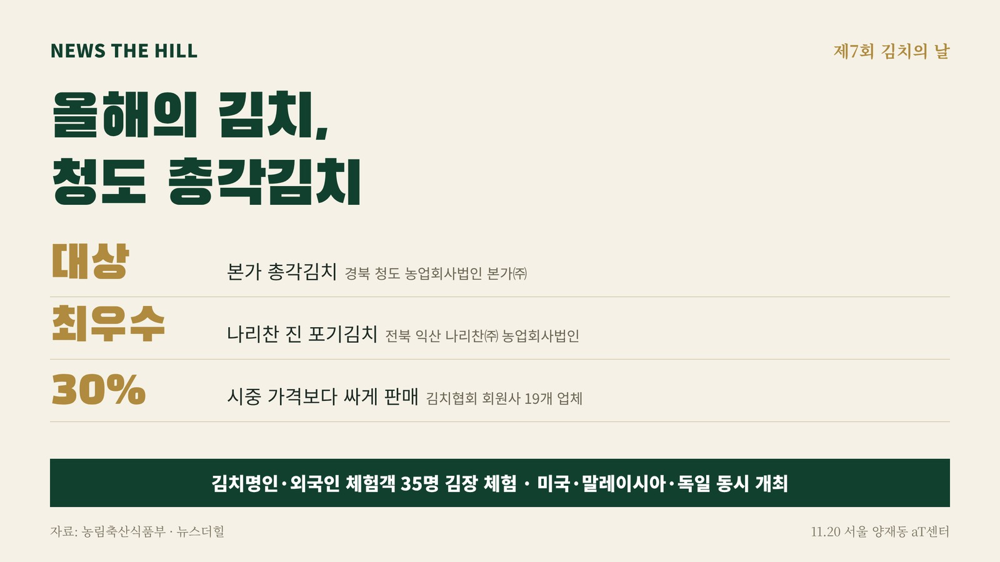

입력 2026-11-20

*그래픽=뉴스더힐(자료: 농림축산식품부)*

올해 김치품평회 대상(국무총리상)은 경북 청도 농업회사법인 본가㈜의 '본가 총각김치'에 돌아갔다. 최우수상(농식품부 장관상)은 전북 익산 나리찬㈜ 농업회사법인의 '나리찬 진 포기김치'가 받았다.

농림축산식품부(장관 송미령)는 '김치의 날(11월 22일)'을 맞아 20일 서울 양재동 aT센터에서 '제7회 김치의 날 기념행사'를 열었다고 이날 밝혔다. 김치의 날은 2020년 식품 분야 최초로 제정된 법정기념일이다. 올해는 관계자 중심의 기념식에서 벗어나 국민 누구나 국산 김치를 맛보고 사고 직접 담가 보는 참여형 축제로 넓혔다.

## 품평회·레시피 경연 시상

기념식에서는 김치품평회, 글로벌 김치요리 레시피 경연대회, 김치 스타트업 아이디어 공모전, 어린이 김치 콘텐츠 창작 공모전 시상식이 열렸다. 김치품평회에서는 대상과 최우수상 외에 우수상 3점과 장려상 4점을 포함해 모두 9점이 상을 받았다.

글로벌 김치요리 레시피 경연대회에서는 김유빈 씨의 '김치 휘낭시에'와 제니퍼 핸슨(Jennifer Hanson) 씨의 'SEOULMATE(김치 슬로피 조)'가 각각 내국인과 외국인 부문 대상(농식품부 장관상)을 받았다. 김치 스타트업 아이디어 공모전 최우수상(농식품부 장관상)은 단호박과 가루쌀을 활용한 김치 스프레드를 제안한 '온한'의 이예린 씨, 어린이 김치 콘텐츠 창작 공모전 대상(장관상)은 '맛있는 김치랜드'를 출품한 오연서 어린이가 받았다.

## 이색 김치 요리 시식·30% 할인 판매

행사장에는 품평회 우수작과 요리 경연 수상작 전시, 세계김치연구소의 연구 성과 소개가 마련됐다. 김치 휘낭시에, 김치 붕어빵, 김치 소시지 등 이색 요리 시식 코너가 운영됐고, 푸드트럭에서는 보쌈김치와 김치 주먹밥을 팔았다.

(사)대한민국 김치협회 회원사 19개 업체가 참여한 판매장에서는 국산 김치를 시중 가격보다 30% 싸게 팔았다.

김장 체험에는 김치명인과 외국인 체험객 35명이 함께했다. 배우 김동준과 방송인 사유리·크리스티나도 참여해 명인에게 김장 비법을 배우고 배추를 버무렸다.

## 미국·말레이시아·독일서도 '코리아 김치 페스티벌'

'코리아 김치 페스티벌'은 올해 한국을 포함해 미국, 말레이시아, 독일 등에서 동시에 열렸다. 미국에서는 김치의 날 현지 기념식과 김장 체험, 말레이시아에서는 할랄 김치 강연이 진행됐다. 말레이시아 행사는 현지 여건으로 11월 13~15일 열렸다. 독일 뮌헨 '오대륙박물관(Museum Fünf Kontinente)'에서는 김치의 역사와 발효과학을 알리는 특별 전시와 김장 문화 체험 행사가 마련됐다.

농식품부는 국가별 식문화와 선호도를 반영한 맞춤형 제품과 응용 레시피를 계속 발굴해 해외 관심이 소비와 수출 확대로 이어지도록 할 계획이다.

송미령 농식품부 장관은 "올해 김치의 날은 국민 누구나 국산 김치를 직접 맛보고, 외국인 참가자도 함께 김치를 담그며 우리의 소중한 김장 문화를 경험하는 진정한 소통의 축제로 마련했다"며 "함께 담근 김치를 이웃과 나누는 따뜻한 전통을 다음 세대에 전하고, 첨단 발효·저장 기술 개발을 적극 지원해 세계 어디서든 우리 김치의 제맛을 일상에서 즐길 수 있도록 하겠다"고 강조했다.

※ 이 기사는 농림축산식품부 보도자료(11월 20일, 정책브리핑, 공공누리 제1유형·출처표시)를 바탕으로 작성했습니다.
