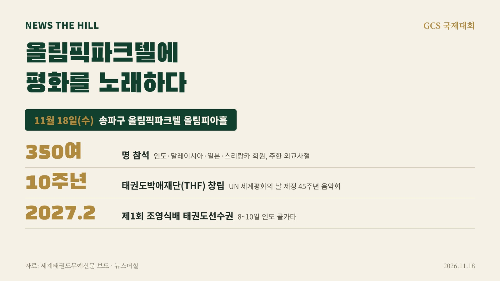

입력 2026-11-21

*그래픽=뉴스더힐(자료: 세계태권도무예신문 보도)*

'2026 GCS 국제대회 및 한국본부 총회'가 18일(수) 서울 송파구 올림픽파크텔 1층 대연회장(올림피아홀)에서 열렸다. 같은 자리에서 태권도박애재단(THF) 창립 10주년 기념식과 제45회 UN 세계평화의 날 기념 음악회도 함께 진행됐다.

세계태권도무예신문 보도에 따르면 이날 행사에는 인도·말레이시아·일본·스리랑카 등 해외 회원국 대표단과 주한 외교사절, 국내 GCS 회원 등 350여 명이 참석했다.

## 내년 2월 인도 콜카타서 제1회 조영식배 태권도선수권

행사는 GCS 한국본부 총회에 이어 오후 3시 30분 서주환 GCS 한국본부 총재의 개회 선언과 타종으로 국제대회가 시작됐다. 프라딥타 쿠마르 로이 인도 서벵골 총재의 GCS 헌장 낭독, 주성호 GCS 한국본부 영남지구 사무총장의 GCS 선서, 삼정명상이 이어졌고, UN 세계평화의 날 제정 45주년 기념 영상이 상영됐다.

시상에서는 조정원 GCS클럽 국제본부 총재가 승명호 GCS클럽 국제본부 이사에게 에머럴드상을, 서주환 총재가 여화선 GCS 한국본부 자문위원에게 루비상을 수여했다. 유공조·신대순 GCS 한국본부 이사가 특별공로상을, GCS 광주클럽과 소나무클럽이 우수클럽 표창을 받았다. 이효정 ICKC 이사장은 조정원 총재에게 발전기금을 전달했다.

조정원 총재는 GCS 인도 서벵골협회가 주관하는 '제1회 조영식배 태권도선수권대회'를 2027년 2월 8일부터 10일까지 인도 콜카타에서 연다고 공식 발표했다. 인도 정부를 대표해 참석한 부드라이 투두 서벵골주 의원이 축사를 했다.

## 태권도박애재단 10주년…AI로 되살린 조영식 박사 목소리

15분 휴식 뒤 열린 2부 태권도박애재단 창립 10주년 기념식은 세계태권도연맹 시범단의 시범으로 막을 올렸다. 태권도박애재단 이사장이기도 한 조정원 총재는 기념사에서 UN 세계평화의 날 제정을 이끈 고(故) 미원 조영식 박사의 뜻을 되새기며, 2027년부터 인류사회의 평화와 공영을 위한 밝은사회 운동에 더욱 힘써 달라고 회원들에게 당부했다. 이어 재단 10년을 돌아보는 영상 상영과 단체 사진 촬영이 있었다.

기념 음악회는 조영식 박사를 기리는 영상으로 시작했다. 영상 끝에는 AI로 복원한 조 박사의 목소리 인사가 나왔다.

강은일 단국대 교수(해금연구회 회장)는 퓨전 재즈 밴드 '밴드케이'의 김기중과 함께 '목련화'와 'Imagine'을 연주했다. 팝페라 가수 한가영 신한대 K-Pop학과장은 'Nella Fantasia', '평화의 노래', '꽃밭에서'를 불렀고, 남성 6인조 팝페라 그룹 '라 보체'는 'You Raise Me Up'과 'Il Mondo'를 선보였다. 앙코르곡 '아름다운 나라'는 한가영과 라 보체가 함께 불렀다.

행사는 경품 추첨과 폐회 선언, 만찬으로 마무리됐다.

이날 행사에는 호르헤 엔리케 발레리오 에르난데스 주한 코스타리카 대사, 쿠언 폰 라따낙 주한 캄보디아 대사, 다미르 쿠센 주한 크로아티아 대사, 알리세르 압둘 살로모프 주한 우즈베키스탄 대사, 사라 안헬리나 솔리스 카스타녜다 주한 과테말라 대사, 모하마드 루트피 알 칼리디 주한 요르단 대사대리, 디디피 세나나약케 주한 스리랑카 공사참사관, 김새려 유엔난민기구(UNHCR) 한국대표부 대표 등이 참석했다. 해외 GCS에서는 유승복 말레이시아 총재, 심정후 일본 총재, 이기수 스리랑카 부총재 등이 자리했다.

※ 이 기사는 세계태권도무예신문 보도(11월 21일)를 바탕으로 작성했습니다.
