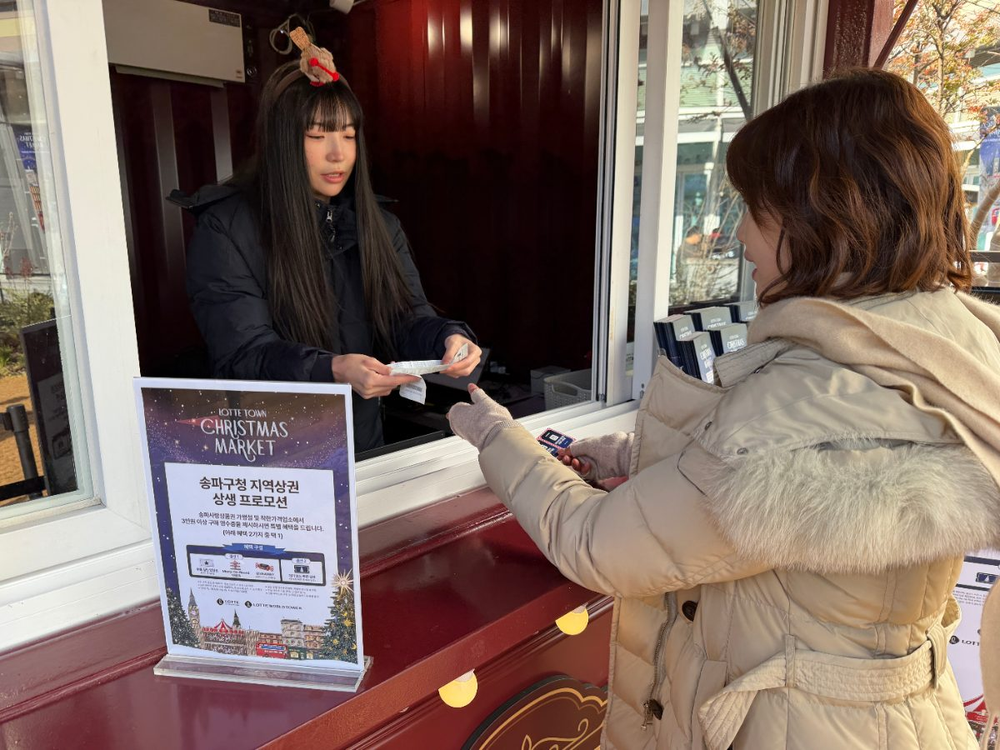
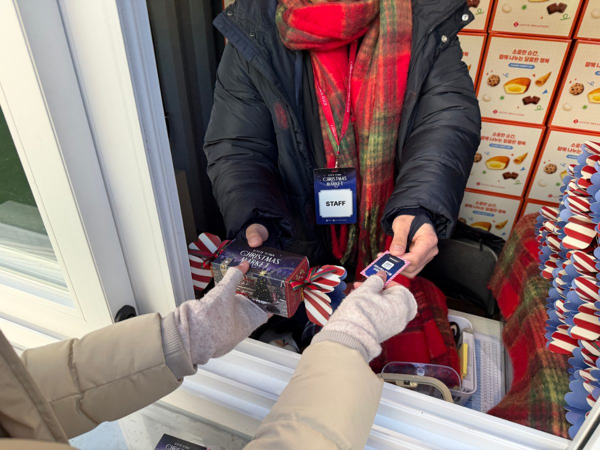

입력 2026-11-22

*잠실 '롯데타운 크리스마스 마켓' 안내소에서 방문객이 동네 가게 영수증을 제시하고 있다. 사진=송파구 제공*

송파구 동네 가게 한 곳에서 3만 원 이상 쓴 영수증을 보여 주면 잠실 크리스마스 마켓에 줄을 서지 않고 들어가는 혜택을 받을 수 있다(하루 선착순 100명). 서울 송파구가 롯데백화점과 손잡고 크리스마스 마켓 방문객을 골목상권으로 이끄는 상생 행사를 연다.

송파구(구청장 서강석)는 22일 보도자료에서 11월 19일부터 내년 1월 3일까지 잠실 롯데월드타워 월드파크 잔디광장에서 열리는 '2026 롯데타운 크리스마스 마켓'과 연계해 이 행사를 진행한다고 밝혔다.

구에 따르면 롯데타운 크리스마스 마켓은 지난해까지 누적 방문객이 110만 명을 넘었다. 올해 사전예매에는 1만 6,000명 이상이 동시에 접속했고, 11월 말까지 쓸 수 있는 주말 빠른 입장권은 판매 시작 30분 만에 매진됐다.

## 빠른 입장 또는 회전목마 패키지

참여자는 일반 입장 줄을 기다리지 않고 들어가는 '빠른 입장'과, 일반 입장에 회전목마 이용권과 기념품 '크리스마스 크래커'를 더한 '일반 입장 패키지' 가운데 하나를 고를 수 있다. 두 혜택을 합쳐 하루 선착순 100명에게 준다. 12월 24일(목)과 25일(금)에는 안전을 위해 크리스마스 크래커만 증정한다.

*방문객이 기념품 '크리스마스 크래커'를 받고 있다. 사진=송파구 제공*

## 참여 방법

- 송파구 안의 송파사랑상품권 가맹점이나 착한가격업소 한 곳에서 당일 3만 원 이상 결제
- 실물 영수증을 마켓 안 종합안내소에 제시
- 여러 점포의 영수증은 합산할 수 없고, 결제수단(상품권·카드·현금 등)은 제한이 없다

대상 점포는 송파사랑상품권 가맹점 2만 9,086곳과 착한가격업소 92곳이다. 가맹점은 서울Pay+ 앱에서, 착한가격업소는 행정안전부 착한가격업소 누리집에서 확인할 수 있다.

## 여름 '서머마켓' 행사서 96% 소진

구는 지난 8월 '롯데타운 서머마켓'과 연계한 상생 행사에서도 호응을 얻었다. 당시 16일간 준비한 한정 물량 2,400개 가운데 약 96%가 소진됐다. 교환 한 건당 3만 원 이상 소비가 조건이었던 만큼 지역 가게에서 최소 수천만 원대 소비가 발생한 것으로 구는 추산했다.

서강석 송파구청장은 "방문객은 마켓을 더 편하게 즐기고, 동네 가게는 새 손님을 만나는 계기가 되길 바란다"며 "앞으로도 대형 행사를 찾는 발길이 지역 상권의 소비로 이어지도록 지역 점포와 연계한 행사를 이어가겠다"고 전했다.

※ 이 기사는 송파구 보도자료(11월 22일)를 바탕으로 작성했습니다.
