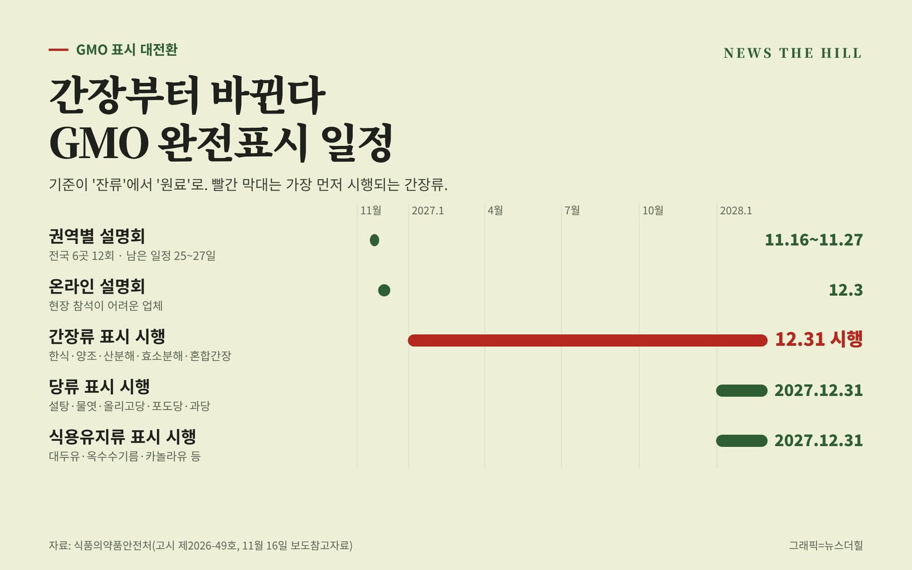

입력 2026-11-23

*GMO 완전표시제 시행 일정. 그래픽=뉴스더힐(자료: 식품의약품안전처)*

간장 라벨이 바뀐다. 12월 31일부터다.

유전자변형(GMO) 표시 제도가 이날부터 바뀐다. 지금까지는 최종 제품에서 유전자변형 DNA나 단백질이 검출될 때만 표시했다. 앞으로는 검출되지 않아도 유전자변형 원료를 썼으면 표시해야 한다. 판단 기준이 '제품에 남았는가'에서 '원료로 썼는가'로 옮겨간다.

첫 대상은 간장이다. 당류와 식용유지류는 1년 뒤인 2027년 12월 31일부터 적용된다. 근거는 식품의약품안전처 고시 「유전자변형식품등의 표시기준」으로, 지난 7월 8일 제2026-49호로 일부개정돼 올해 말 시행을 앞두고 있다.

## 왜 그동안은 표시하지 않았나

간장, 설탕, 식용유는 원료를 고온·고압으로 정제하는 과정에서 DNA와 단백질이 거의 다 분해된다. 그래서 유전자변형 콩으로 만든 간장이라도 완제품을 분석하면 유전자변형 성분이 나오지 않는다. 현행 기준은 '검출될 때 표시'였으므로 이 제품들은 표시 대상에서 빠져 있었다.

소비자단체는 이 지점을 오래 문제 삼았다. 유전자변형 원료로 만든 것은 분명한데 라벨에는 아무 표시가 없으니 고를 수가 없다는 주장이었다. 개정안은 이 틈을 메우는 쪽을 택했다. 관련 법 개정안은 지난해 12월 국회 본회의를 통과했고, 식약처는 올해 2월 27일 고시 개정안을 행정예고해 4월 30일까지 의견을 받은 뒤 7월에 확정했다.

표시 대상이 되는 유전자변형 농축수산물은 식품용으로 안전성 심사를 거쳐 승인된 품목에 한한다. 대두와 옥수수, 면화, 카놀라, 알팔파, 사탕무 여섯 가지다.

## 내 제품이 대상인가

간장류는 한식간장과 양조간장, 산분해간장, 효소분해간장, 혼합간장이 모두 들어간다. 대두를 쓰는 제품이므로 사실상 간장 전반이 영향을 받는다.

당류는 설탕과 물엿, 올리고당, 포도당, 과당 등이다. 옥수수와 사탕무가 원료로 쓰인다. 식용유지류는 대두유와 옥수수기름, 카놀라유 같은 식물성 유지가 중심이다.

반대로 참기름과 올리브유는 식용유지류에 속하지만 실질적인 표시 대상이 아니다. 원료인 참깨와 올리브가 유전자변형 승인 품목이 아니기 때문이다. 원료가 승인 목록에 없으면 표시할 유전자변형 원료 자체가 없다.

당류와 식용유지류의 시행이 1년 늦춰진 이유는 설비다. 유전자변형 원료와 그렇지 않은 원료를 섞이지 않게 나눠 보관하고 생산하려면 저장시설과 제조라인을 손봐야 한다. 간장보다 품목 수가 많고 공정이 복잡한 점이 고려됐다.

## 업체가 지금 확인할 것

제도의 성격이 달라지면 관리 방식도 달라진다. 완제품을 검사해서는 유전자변형 여부를 알 수 없으므로, 관리의 중심이 서류로 옮겨간다.

첫째는 원료 증빙이다. 구분유통증명서나 수출국 정부가 발행한 증명서, 시험검사성적서처럼 공신력 있는 서류로 원료의 성격을 입증해야 한다. 수입 원료를 쓰는 업체라면 거래처에 어떤 서류를 받을 수 있는지 지금 확인하는 편이 낫다.

둘째는 구분관리다. 유전자변형 원료를 쓰지 않는다고 표시하려면 원료 반입부터 보관, 투입, 출고까지 섞이지 않았다는 것을 보여줄 수 있어야 한다. 식약처는 이와 관련해 「식품용 GMO 구분관리기준 가이드라인」을 별도로 마련했다.

셋째는 포장재다. 표시 문구는 '유전자변형식품', '유전자변형 ○○ 포함', '유전자변형 ○○ 포함 가능성 있음' 같은 형태로 쓴다. 라벨을 고치려면 디자인 수정과 인쇄 일정이 필요하다. 간장 제조·수입업체에 남은 시간은 한 달 남짓이다.

## 남은 설명회는 세 번

식약처는 11월 16일부터 27일까지 전국 6곳에서 권역별 설명회를 12회 연다. 남은 일정은 25일(수) 광주식약청(광주·전북·전남·제주), 26일(목) 대구식약청(대구·경북), 27일(금) 나라키움 부산정부청사 2층 대강당(부산·울산·경남)이다. 하루 두 차례로 오전 9시 30분과 오후 2시에 시작한다.

지역과 날짜에 관계없이 원하는 곳에 참석할 수 있지만 장소별 수용 인원이 제한돼 업체당 1명만 받는다. 현장 참석이 어려우면 12월 3일(목) 온라인 설명회가 있다. 참석 방법은 식품안전나라 등을 통해 공지된다.

설명회에서는 표시 대상 여부 판단과 표시 방법, 표시 면제 요건과 증빙서류 관리, 구분유통·구분관리 기준을 다룬다. 「유전자변형식품등의 표시 가이드라인」과 구분관리기준 가이드라인은 식약처 누리집(mfds.go.kr)의 '법령/자료 → 법령정보 → 공무원지침서/민원인안내서 → 민원인안내서'에서 받을 수 있다.

## 가격은 오를까

업계의 걱정은 원료값이다. 유전자변형이 아닌 원료는 유전자변형 원료보다 20~70% 비싸다는 것이 업계 설명이다. 표시를 피하려고 원료를 바꾸면 원가가 오르고, 그대로 쓰면 라벨에 유전자변형 표시가 붙는다. 어느 쪽이든 부담이라는 것이다. 포장재 교체 비용과 수입 원료 증빙서류를 확보하는 업무 부담도 함께 거론된다.

반대편의 평가도 엇갈린다. 경제정의실천시민연합 등은 이번 개정이 유전자변형 원료를 쓴 모든 식품으로 넓어진 것이 아니라 세 가지 품목에 그쳤다는 점에서 '완전표시제'라고 부르기 어렵다고 본다. 2차·3차 가공식품으로 표시 의무가 넓어질지는 아직 정해지지 않았다.

소비자 입장에서 당장 달라지는 것은 간장 매대다. 올해 말부터 간장 라벨에 유전자변형 표시가 있는 제품과 없는 제품이 나뉘어 보이기 시작한다. 표시가 붙었다고 해서 안전성 심사를 통과하지 않았다는 뜻은 아니다. 표시는 안전성 판정이 아니라 원료가 무엇이었는지를 알리는 정보다.

※ 이 기사는 2026년 11월 23일 기준으로 확인한 식품의약품안전처 고시 「유전자변형식품등의 표시기준」(제2026-49호, 2026년 7월 8일 일부개정, 2026년 12월 31일 시행), 식약처 보도참고자료와 정책브리핑 자료, 법무법인 뉴스레터와 업계 보도를 바탕으로 작성했습니다. 설명회 일정과 장소는 식약처 11월 16일 보도참고자료에 따른 것으로, 변경될 수 있습니다. 참고: [국가법령정보센터 고시 원문](https://www.law.go.kr/LSW/admRulInfoP.do?admRulSeq=2100000282012&chrClsCd=010201), [정책브리핑](https://www.korea.kr/news/policyNewsView.do?newsId=148960110), [식약처 누리집](https://www.mfds.go.kr).
