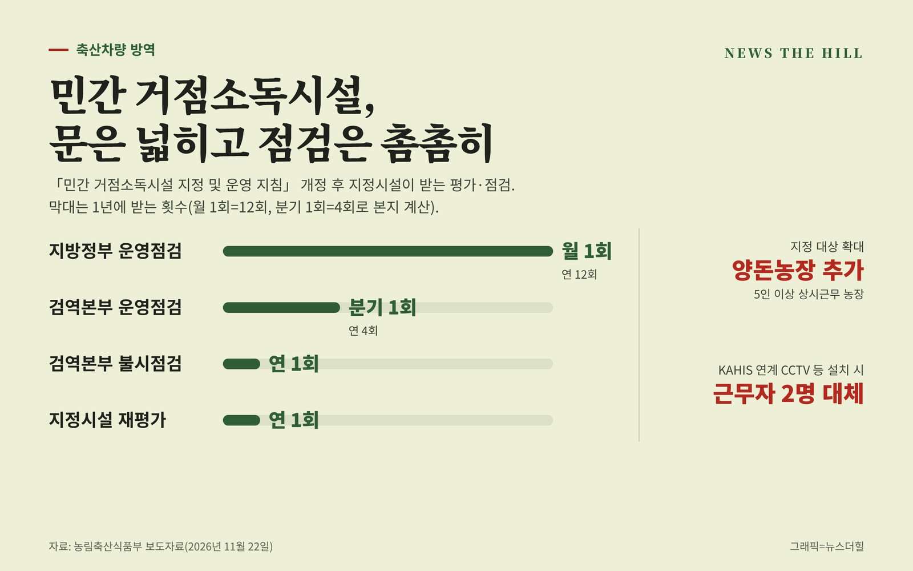

입력 2026-11-23

*그래픽=뉴스더힐(자료: 농림축산식품부)*

5인 이상 상시근무 인력을 둔 양돈농장도 이제 민간 거점소독시설 지정을 신청할 수 있다. 공공 거점소독시설이 멀어 축산차량이 오가기 불편하다는 현장 여건을 반영한 것으로, 대신 지정시설에 대한 평가·점검과 위반 제재는 강화된다.

농림축산식품부는 축산차량 방역 편의성을 높이고 민간 거점소독시설의 활용도를 넓히기 위해 「민간 거점소독시설 지정 및 운영 지침」을 개정·시행한다고 22일 보도자료에서 밝혔다. 농식품부는 이번 개정이 공공 거점소독시설이 원거리에 있어 생기는 축산차량 이동 불편과, 양돈농장 등 민간 축산시설의 자체 출입차량 소독 수요에 대응하기 위해 추진됐다고 설명했다.

## 지정 대상 확대·인력 부담 완화

기존 지정 대상에 양돈농장이 새로 포함된다. 5인 이상 상시근무 인력을 보유한 양돈농장이면 지정을 신청할 수 있다. 농식품부는 이를 통해 양돈농장에 드나드는 축산차량의 소독 편의성을 높이고 농장 자체 방역관리 기능을 강화할 것으로 기대했다.

KAHIS와 연계한 CCTV 등 통제시스템을 설치·운영하면 소독시설 근무자 2명을 대체할 수 있게 했다. 차량번호 인식(LPR) 카메라 등으로 차량 출입과 소독 여부를 확인해 인력 운영 부담을 줄이고 기록 관리 효율을 높인다는 취지다.

## 평가·점검과 제재는 강화

지정시설은 연 1회 재평가를 받고, 농림축산검역본부의 불시점검도 연 1회 실시된다. 운영 상황은 지방정부가 월 1회, 농림축산검역본부가 분기별 1회 점검한다.

지방정부 현장점검 때는 세차장·소독시설 환경검사가 새로 도입된다. 시설 출입구 바닥, 대인소독실, 세차장과 소독시설 사이 차량 이동 동선, 세차를 마친 차량의 적재함 등 주요 지점을 점검해 방역관리 상태를 실제로 확인하도록 했다.

허위 소독확인증 발급, 소독하지 않은 차량에 대한 소독확인증 발급, CCTV 조작 등 중대한 위반사항이 확인되면 지정 정지·취소와 재신청 제한 등의 조치가 내려진다.

농림축산식품부 관계자는 "이번 지침 개정은 민간 거점소독시설의 활용 범위를 넓혀 축산차량의 소독 접근성을 높이는 동시에, 실제 소독 이행 여부를 확인할 수 있는 관리체계를 강화하는 데 중점을 두었다."며 "앞으로도 민간 방역시설과 디지털 기술을 적극 활용해 현장 중심의 촘촘한 축산차량 방역 체계를 구축해 나가겠다"고 밝혔다.

※ 이 기사는 농림축산식품부 보도자료(공공누리 제1유형, 출처표시)를 바탕으로 작성했습니다.
