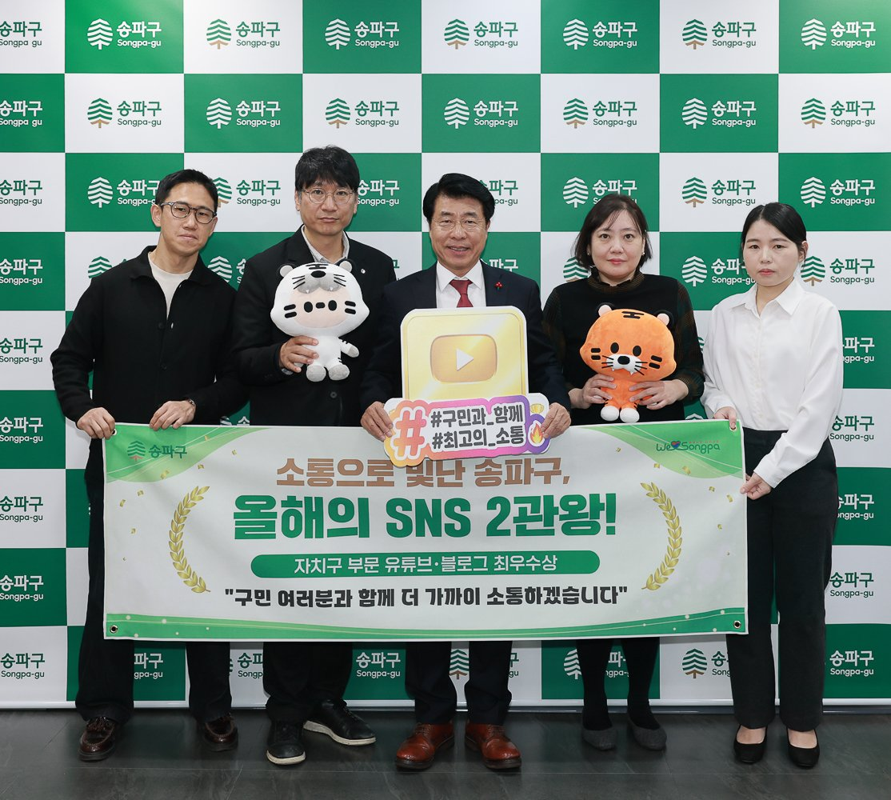
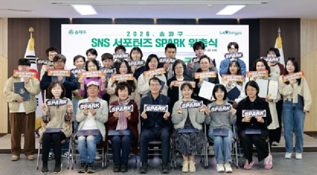

입력 2026-11-24

*송파구 관계자들이 '2026 올해의 SNS' 유튜브·블로그 최우수상 수상을 기념하고 있다. 사진=송파구 제공*

서울 송파구가 23일 열린 '2026 올해의 SNS'에서 유튜브와 블로그 2개 부문 최우수상을 받은 데 이어, 24일 '제36회 대한민국 커뮤니케이션대상'에서 '올해의 기획상'을 받았다.

송파구(구청장 서강석)는 24일 보도자료에서 이같이 밝혔다. '올해의 SNS'는 한국소셜콘텐츠진흥협회가 주최하고 과학기술정보통신부가 후원하며, '대한민국 커뮤니케이션대상'은 한국사보협회가 주관하고 문화체육관광부 등이 후원한다. 두 시상식 모두 공공기관과 기업의 디지털 소통·콘텐츠 제작 역량을 평가한다.

구는 유튜브, 블로그 등 공식 SNS 채널로 구정 소식을 전하면서 주민 관심사와 최신 유행을 반영한 기획 콘텐츠를 꾸준히 내왔다.

## 러닝 예능 '송도사', 벚꽃 개화 카운트다운

대표 콘텐츠는 유튜브 '송파TV'의 기획 시리즈 '송도사(송파를 도는 사람들)'다. 러닝을 하며 석촌호수, 잠실야구장, 성내천, 탄천·장지천 등 지역 명소를 소개하는 예능 형식 프로그램으로, 주민들이 직접 동네를 누비는 모습을 담았다. 송파TV 구독자는 현재 2만 5,000여 명으로 서울 25개 자치구 가운데 3위다.

올해 처음 선보인 '벚꽃 개화 카운트다운'은 구청 직원들이 매일 석촌호수를 찍어 실시간 개화 상황을 알리고, 주민들이 댓글로 요청한 장소를 바로 촬영에 반영한 콘텐츠다. 방문객 안전 정보도 함께 제공했다. 벚꽃축제 기간 만든 관련 콘텐츠 126편의 누적 조회수는 157만 회를 넘었다.

## 블로그 이웃 5만 명…서울 자치구 1위

공식 블로그는 생활밀착형 구정 정보와 현장 취재 기사, 외국인 주민을 위한 영문 콘텐츠 등을 올려 왔다. 블로그 이웃 수는 5만 명으로 서울 자치구 중 1위이고, 누적 방문 수는 1,900만 회를 넘었다.

*송파구 SNS 서포터즈 'SPARK' 위촉식. 사진=송파구 제공*

주민 참여형 콘텐츠도 늘렸다. 구는 올해 3월 기존 SNS 기자단을 사진·영상 등 분야별 크리에이터 55명으로 꾸린 'SPARK 서포터즈'로 확대 개편했다. 서포터즈는 지역의 숨은 명소와 소식을 직접 취재해 채널별 맞춤형 콘텐츠를 만든다.

서강석 송파구청장은 "이번 연이은 수상은 구민의 눈높이에서 소통하고, 주민들의 목소리를 콘텐츠에 적극 반영한 노력의 결과"라며 "앞으로도 구민들이 깊이 공감하고 즐겁게 참여할 수 있는 참신한 콘텐츠로 더욱 가깝게 소통하겠다"고 말했다.

송파구는 앞서 13일 열린 '제19회 대한민국소통어워즈'에서도 '대한민국소셜미디어대상'을 받아, 올해 뉴미디어·SNS 분야에서 상 4개를 받았다.

※ 이 기사는 송파구 보도자료(11월 24일)를 바탕으로 작성했습니다. 사진은 송파구가 보도자료와 함께 제공한 것입니다.
