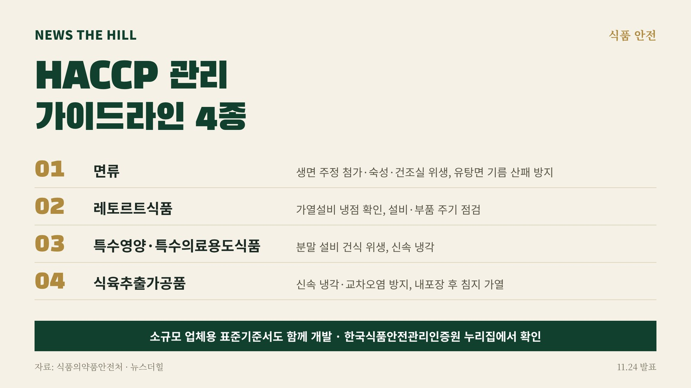

입력 2026-11-24

*그래픽=뉴스더힐(자료: 식품의약품안전처)*

면류, 레토르트식품, 특수영양식품·특수의료용도식품, 식육추출가공품을 만드는 해썹(HACCP) 업체가 참고할 수 있는 유형별 관리 지침이 나왔다. 실제 식품안전사고 사례와 관리가 미흡했던 사항을 분석해 유형마다 무엇을 중점적으로 관리해야 하는지 정리한 것이다.

식품의약품안전처(처장 오유경)와 한국식품안전관리인증원(원장 한상배)은 식중독 등 식품안전사고를 예방하고 안전한 식품 생산을 지원하기 위해 해썹 업체를 대상으로 「올바른 HACCP 관리 가이드라인 4종」을 제공한다고 24일 보도참고자료에서 밝혔다.

## 유형별 중점 관리방안

- **면류**: 생면의 미생물 증식을 억제하기 위한 주정 첨가와 숙성·건조실 위생관리, 유탕면 제조에 쓰는 식용유지의 산패 방지
- **레토르트식품**: 제품이 고르게 가열되도록 가열설비의 냉점(Cold Point)을 확인하고 설비와 부품을 주기적으로 점검
- **특수영양식품·특수의료용도식품**: 분말형 제품 제조설비의 건식 위생관리, 유동식·식단형 제품의 신속한 냉각과 적정 온도 유지
- **식육추출가공품**: 비살균 제품의 신속한 냉각과 교차오염 방지, 내포장 후 침지 가열

## 소규모 업체용 표준기준서도

식약처는 소규모 해썹 적용 업체도 개선된 관리방안을 쉽게 적용할 수 있도록 가이드라인과 함께 해썹 표준기준서도 개발했다.

가이드라인과 표준기준서는 한국식품안전관리인증원 누리집(www.haccp.or.kr)의 '프레시(FRESH) → HACCP 종합자료실 → HACCP자료 및 표준기준서자료'에서 확인할 수 있다.

식약처는 앞으로도 과학적 데이터를 기반으로 한 해썹 가이드라인 등 식품 안전정보를 계속 제공할 계획이라고 밝혔다.

※ 이 기사는 식품의약품안전처 보도참고자료(공공누리 제1유형, 출처표시)를 바탕으로 작성했습니다.
