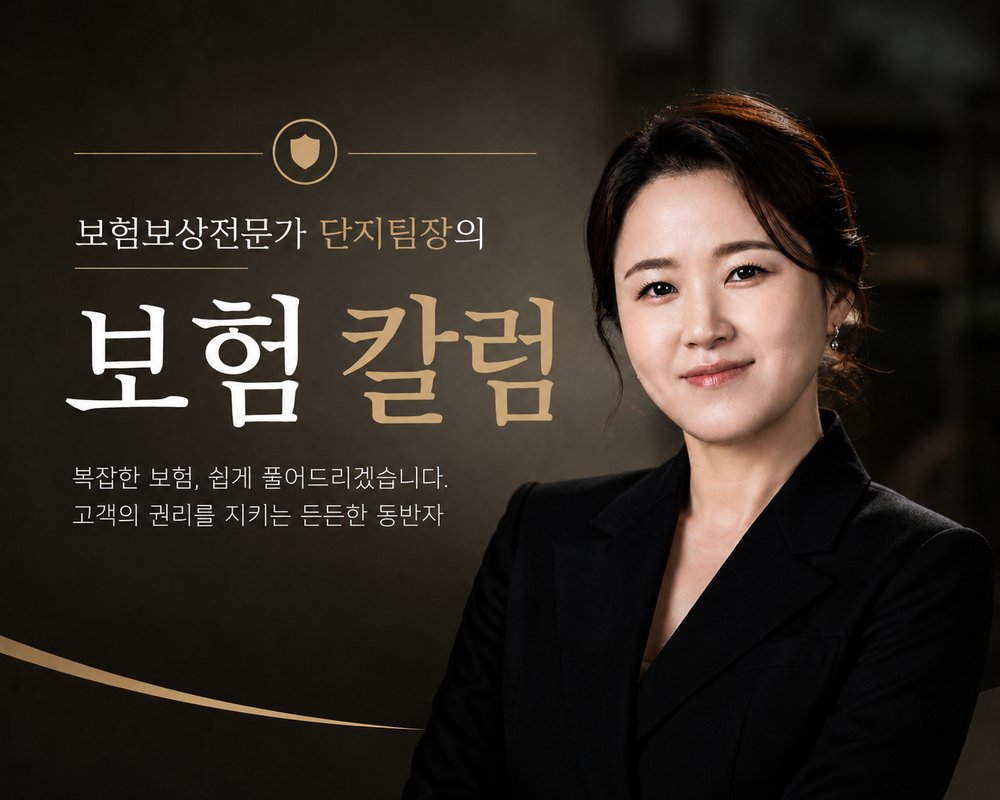

우리는 갑작스럽게 찾아올 질병이나 사고에 대비하기 위해 보험에 가입한다.

그리고 아프거나 다쳤을 때 내가 가입한 보험에서 보험금을 지급받을 수 있을 것이라 생각한다.

그런데 한 번쯤 이런 생각을 해보신 적이 있으신가요?

만약 내가 직접 보험금을 청구할 수 없는 상황이 된다면, 누가 내 보험을 확인하고 청구해 줄 수 있을까?

갑작스러운 사고로 의식을 잃거나 중대한 질병으로 의사소통이 어려워지는 상황은 누구에게나 찾아올 수 있다.

그런 상황에서 가족들은 환자의 치료와 간병만으로도 정신없이 힘든 시간을 보내게 된다.

그런데 정작 가족들은 환자가 어느 보험회사에 보험을 가입했는지, 어떤 보장을 가지고 있는지, 담당 보험설계사는 누구인지조차 모를 수 있다.

필자는 보험금 청구를 도와드리면서 안타까운 상황을 마주할 때가 있다.

특히 가족의 갑작스러운 사망 이후, 남겨진 가족들이 보험금을 청구하는 과정에서 어려움을 겪는 경우이다.

사랑하는 가족을 잃은 슬픔을 감당하기에도 벅찬 상황에서 고인이 가입한 보험을 확인하고, 보험금 청구에 필요한 절차까지 알아봐야 하기 때문이다.

이때 보험의 '수익자' 지정에 따라 보험금 청구 절차가 더욱 까다로워지는 경우가 있다.

보험에는 사망보험금 수익자뿐만 아니라 진단비, 수술비, 입원비 등을 지급받는 사망 외 보험금 수익자도 있다.

특히 사망 외 보험금 수익자가 피보험자 본인으로 지정되어 있고, 생전에 발생한 보험금을 청구하지 못한 채 사망한 경우에는 상속관계를 확인해야 하며, 한 사람이 보험금을 대표로 청구하기 위해 법정상속인들의 위임이 필요한 상황도 발생할 수 있다.

고인이 되시기 전에 보험금 청구를 마무리하는 가족들이 있는 반면, 필자가 경험한 사례 중에는 장례를 모두 치르고 사망신고까지 마친 상태에서 정작 가족들도 몰랐던 보험의 존재를 확인하게 된 경우도 있었다.

필자는 이러한 과정에서 미처 청구하지 못했던 보험금을 찾아드린 경험도 있다.

보험금을 청구하기 위해 필요한 서류와 복잡한 절차를 하나하나 확인하면서, 담당자나 전문가의 도움 없이 일반 고객님들이 이러한 과정을 혼자 진행하기에는 상당한 어려움이 있겠다는 생각이 들었다.

아무리 좋은 보장을 준비해 두었더라도 정작 필요한 순간에 가족들이 그 보험의 존재를 알지 못한다면 어떨까.

보험은 나 자신을 위해 준비하는 것이기도 하지만, 갑작스러운 상황에서 가족들의 경제적인 부담을 덜어주기 위해 준비하는 것이기도 하다.

그렇기에 내가 가입한 보험의 주요 보장 내용과 담당 보험설계사의 연락처 정도는 가족들과 공유해 두는 것도 중요하다고 생각한다.

더불어 내가 가입한 보험의 수익자가 누구로 지정되어 있는지도 한 번쯤 확인해 보셨으면 한다.

또한 내가 직접 보험금을 청구하기 어려운 상황에 대비해 지정대리청구인 제도를 이용할 수 있는지도 확인해 볼 필요가 있다.

물론 가족이라는 이유만으로 모든 보험금을 대신 청구할 수 있는 것은 아니며, 계약관계와 상품에 따라 필요한 절차와 조건은 달라질 수 있다.

보험을 잘 준비해 두는 것만큼이나 필요한 순간에 그 보험을 활용할 수 있도록 준비해 두는 것 역시 중요하다.

오늘은 독자분들께 한 가지 질문을 드리고 싶다.

내가 가족을 위해 준비해 둔 보험, 정작 나의 가족들은 그 보험의 존재를 알고 있을까?

가족을 위해 준비한 보험이, 가족에게 또 하나의 어려움으로 남지 않았으면 한다.
