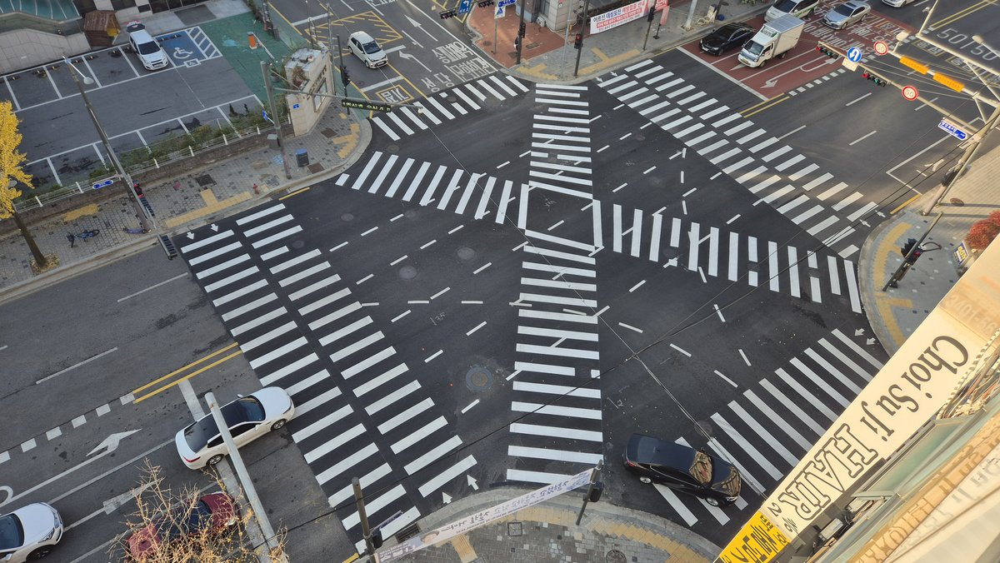
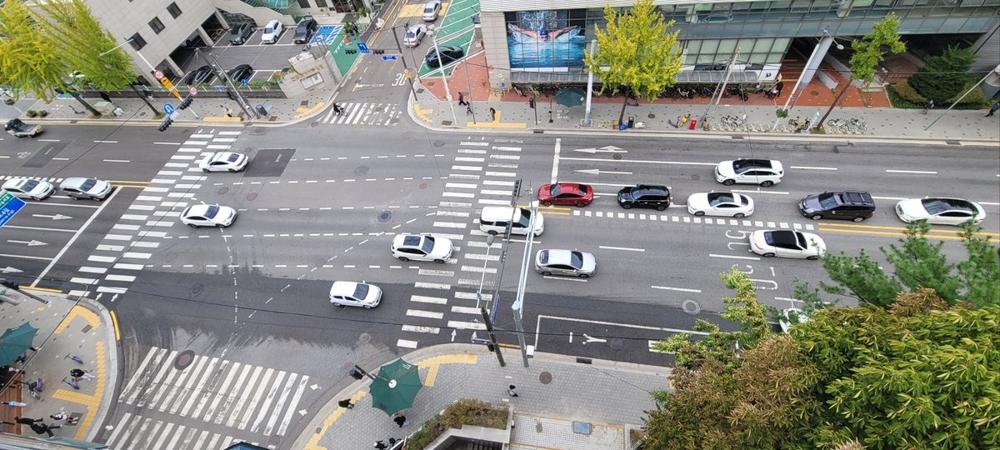

입력 2026-11-25

*송파체육문화회관 앞 교차로에 새로 설치된 대각선 횡단보도. 사진=송파구 제공*

서울 송파구 송파체육문화회관 앞 교차로에 대각선 횡단보도가 생겼다. 대각선 맞은편으로 가려면 횡단보도를 두 번 건너야 했던 주민들이 이제 한 번의 보행신호로 교차로를 가로지를 수 있다.

송파구(구청장 서강석)는 25일 보도자료에서 주민들의 우회 불편을 줄이고 교통약자의 보행 안전을 높이기 위해 대각선 횡단보도를 신설했다고 밝혔다.

## 장애인보호구역…3년간 교통사고 7건

이 교차로는 송파체육문화회관과 거여라이프아파트 등 공동주택이 가까워 주민 통행이 많은 곳이다. 장애인보호구역으로 지정돼 있고 장애인과 어르신 등 교통약자의 이용도 잦다. 최근 3년간 사망사고 1건을 포함해 교통사고 7건이 났다.

구는 지난해 5월 서울시에 대각선 횡단보도 설치를 건의하고 현장 여건과 사업 필요성을 설명하며 관계기관과 협의를 이어왔다. 이후 교통안전심의를 거쳐 올해 서울시 횡단보도 확충사업 대상지로 선정됐고, 시비를 지원받아 올해 11월 설치를 마쳤다.

*대각선 횡단보도 설치 전 교차로 모습. 사진=송파구 제공*

## 보행신호 때 모든 방향 차량 정지

대각선 횡단보도는 교차로를 대각선으로 가로질러 건널 수 있게 만든 X자형 횡단보도다. 보행신호가 켜지는 동안에는 모든 방향의 차량 신호가 적색으로 바뀐다. 구는 이로써 보행자와 회전 차량 간 충돌 위험이 줄고, 체육문화회관과 주변 공동주택, 성당 등을 오가는 주민들의 동선이 짧아져 장애인과 어르신 등의 이동 부담도 줄어들 것으로 보고 있다.

지난해 발표된 서울시의 '대각선 횡단보도 확충 효과 분석' 결과에 따르면 대각선 횡단보도 설치 이후 보행자의 평균 이동거리는 5.6m 줄었고, 차와 보행자 간 교통사고는 27.3% 감소했다.

서강석 송파구청장은 "장애인과 어르신을 비롯한 주민 누구나 일상에서 안전하고 편리하게 이동할 수 있도록 대각선 횡단보도를 신설했다"며 "앞으로도 주민들이 자주 이용하는 길의 불편과 위험요인을 세심하게 살피는 '섬김행정'을 이어가겠다"고 전했다.

※ 이 기사는 송파구 보도자료(11월 25일)를 바탕으로 작성했습니다.
