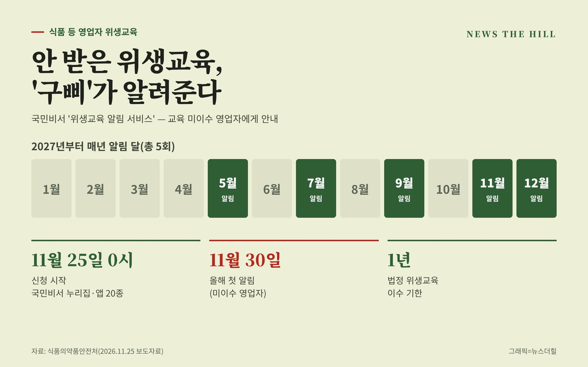

입력 2026-11-25

*그래픽=뉴스더힐(자료: 식품의약품안전처)*

해마다 법정 위생교육을 받아야 하는 식품 영업자가 교육 일정을 놓치지 않도록 국민비서 '구삐'가 알림을 보내준다. 교육을 아직 받지 않은 영업자에게는 올해 11월 30일 첫 알림이 간다.

식품의약품안전처(처장 오유경)는 25일부터 국민비서 '구삐'를 통해 식품(수입식품·위생용품 포함) 영업자를 대상으로 '위생교육 알림 서비스'를 제공한다고 이날 보도자료에서 밝혔다. 국민비서는 생활에 필요한 행정정보를 민간 모바일 앱과 연계해 알려주는 행정안전부 서비스다.

## 우편·문자 안내 놓쳐 이수 시기 넘기는 사례

식품제조·가공업, 식품접객업, 수입식품등 수입·판매업, 위생용품 수입업자 등은 관련 법령에 따라 매년 식품위생 교육을 받아야 한다. 그동안 위생교육기관이 우편이나 문자로 일정을 안내했지만, 영업자가 안내를 확인하지 못하거나 생업 때문에 이수 시기를 놓치는 일이 있었다. 식약처는 행정안전부와 협력해 정해진 기한(1년) 안에 교육을 마칠 수 있도록 이번 서비스를 마련했다.

## 신청 방법과 알림 일정

- **신청**: 11월 25일 0시부터. 국민비서 누리집(www.ips.go.kr) 또는 국민비서 서비스를 제공하는 모바일 앱에서 신청
- **앱**: 카카오톡, 네이버, 토스, PASS(SKT·KT·LG), Tworld, 국민은행, 국민카드, 농협은행, 농협카드, NH올원뱅크, 신한은행, 우리은행, 우리카드, 카카오뱅크, 하나은행, 하나카드, IBK기업은행, 현대카드 등 20종
- **서비스 선택**: '식품 위생교육 알림 서비스', '수입식품 위생교육 알림 서비스', '위생용품 위생교육 알림 서비스' 중 업종에 맞는 것
- **알림**: 위생교육 미이수 영업자에게 올해 11월 30일 첫 알림, 내년부터 매년 5월·7월·9월·11월·12월 총 5회

알림에는 업종에 맞는 교육기관을 찾을 수 있도록 식품안전나라(www.foodsafetykorea.go.kr)와 수입식품정보마루(impfood.mfds.go.kr) 바로가기도 함께 담긴다. 신청 뒤에는 본인이 고른 앱으로 관련 정보를 받는다.

식약처는 이번 서비스가 영업자의 위생교육 이수율을 높이고 교육 미이수로 인한 과태료 처분을 줄이는 데 도움이 될 것으로 기대한다며, 서비스가 현장에서 활용될 수 있도록 홍보해 나갈 계획이라고 밝혔다.

※ 이 기사는 식품의약품안전처 보도자료(공공누리 제1유형, 출처표시)를 바탕으로 작성했습니다.
