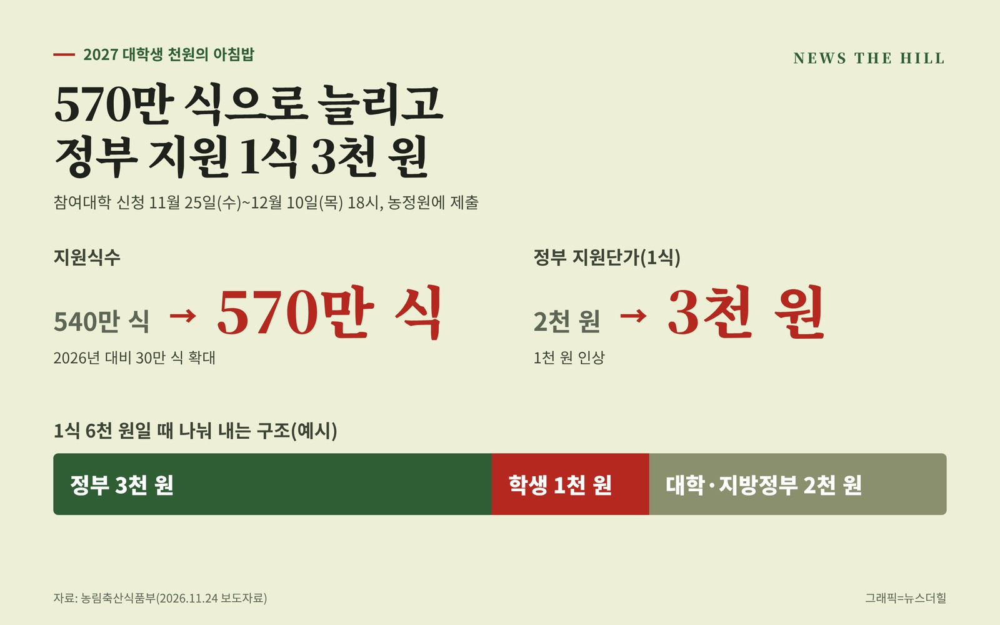

입력 2026-11-25

*그래픽=뉴스더힐(자료: 농림축산식품부)*

내년 대학생 '천원의 아침밥' 지원 규모가 570만 식으로 늘고, 한 끼에 정부가 지원하는 돈도 2천 원에서 3천 원으로 오른다. 학생은 지금처럼 1,000원만 내면 국산 쌀로 지은 아침밥을 먹을 수 있다.

농림축산식품부(장관 송미령)는 「2027년도 대학생 천원의 아침밥 사업」 참여대학 신청을 11월 25일(수)부터 12월 10일(목)까지 받는다고 24일 보도자료에서 밝혔다.

## 220개 대학 참여…만족도 96.2점

대학생 천원의 아침밥은 고물가로 식비 부담에 취약한 대학생에게 국산 쌀을 활용한 아침식사를 1,000원에 제공하는 식생활 돌봄 정책이다. 2017년 시작된 뒤 참여대학과 지원식수가 꾸준히 늘어 2026년에는 전국 220개 대학이 참여하고 있다. 참여대학 재학생 대상 사업 만족도는 2025년 100점 만점에 96.2점이었다.

## 지원식수 30만 식↑, 단가 1천 원↑

농식품부는 학생들의 높은 수요와 물가 상승에 따른 대학의 운영 부담을 고려해 지원식수와 지원단가를 함께 늘린다. 지원식수는 2026년 540만 식에서 2027년 570만 식으로 30만 식 확대하고, 정부 지원단가는 1식당 2천 원에서 3천 원으로 1천 원 올린다.

선정된 대학은 2027년 1월부터 12월까지 아침밥 비용의 일부를 지원받는다. 조식 단가 가운데 정부가 3천 원을 지원하고, 학생 실부담이 1천 원이 되도록 나머지는 대학 자부담과 지방비로 채운다. 예를 들어 한 끼가 6천 원이면 정부 3천 원, 학생 1천 원, 대학·지방정부 2천 원을 낸다.

## 신청 방법

- **대상**: 전국의 모든 대학(방송통신대학, 사이버대학 등 원격대학 제외)
- **기간**: 11월 25일(수)~12월 10일(목) 18시
- **방법**: 신청서와 관련 서류 일체를 작성해 농림수산식품교육문화정보원(농정원)에 제출
- **문의**: 신청서식, 지원기준, 사업기간 등은 농정원 누리집 공고문 참고

정혜련 농식품부 식량정책관은 "천원의 아침밥은 고물가 속에서 대학생의 식비 부담을 덜고 하루를 든든하게 시작하도록 돕는 대표적인 청년 식생활 돌봄 정책"이라며, "2027년에는 지원 규모와 단가를 함께 늘려 지원하는 만큼, 더 많은 대학이 참여하여 학생들이 우리 쌀로 만든 건강한 아침밥을 맛볼 수 있기를 바란다."고 말했다.

※ 이 기사는 농림축산식품부 보도자료(공공누리 제1유형, 출처표시)를 바탕으로 작성했습니다.
