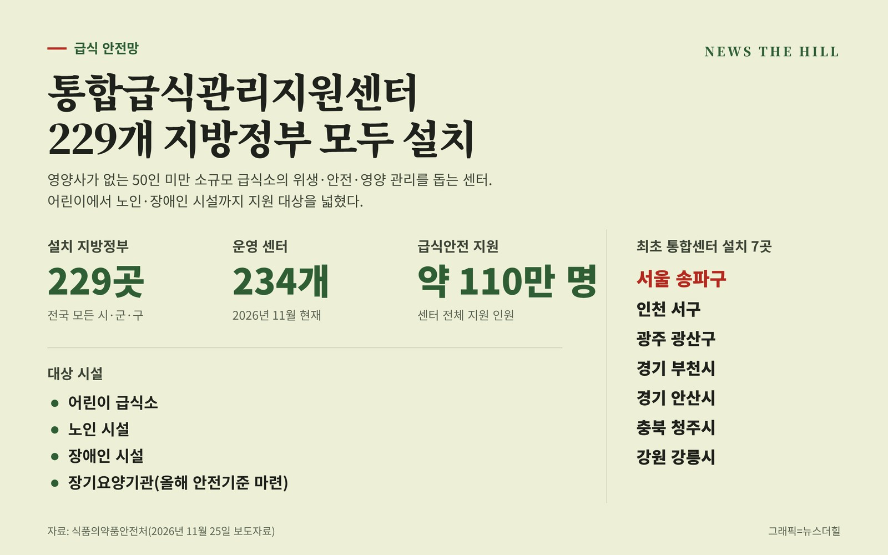

입력 2026-11-25

*그래픽=뉴스더힐(자료: 식품의약품안전처)*

영양사가 없는 50인 미만 소규모 급식소도 이제 사는 지역과 관계없이 위생·영양 관리를 지원받을 수 있게 됐다. 이런 급식소를 돕는 통합급식관리지원센터가 전국 229개 모든 지방정부에 설치됐다.

식품의약품안전처(처장 오유경)는 11월 25일 통합급식관리지원센터 전국 설치 완료를 기념해 식생활안전관리원, 지방정부, 급식관리지원센터 관계자들과 기념행사를 열고 노인복지시설 급식관리 현장을 방문한다고 같은 날 보도자료에서 밝혔다.

## 어린이에서 노인·장애인 시설까지

통합급식관리지원센터는 「어린이식생활법」과 「사회복지시설급식법」에 따라 영양사가 없는 50인 미만 소규모 급식소의 위생·안전과 영양 관리 업무를 지원하는 기관이다.

식약처는 어린이급식관리지원센터 설치로 시작해 영양사가 없는 소규모 노인·장애인 시설까지 지원 대상을 넓혔다. 2026년에는 전국 모든 시·군·구에 통합센터를 설치하는 것을 목표로 지방정부와 협력해 왔고, 11월 현재 모두 234개 센터가 약 110만 명의 급식안전을 지원하고 있다.

올해는 보건복지부와 협력해 장기요양기관도 통합급식관리지원센터의 지원을 받을 수 있도록 장기요양기관 급식안전기준을 마련했다.

## 송파구 등 7곳이 처음 문 열어

이날 기념행사에는 국회 보건복지위원회 서영석·소병훈 의원이 전국 센터 설치 완료를 축하했고, 급식관리 우수 지방정부와 센터 관계자 등 130여 명이 참석해 그간의 사업 성과를 공유하고 급식안전관리 유공자를 격려했다.

식약처가 밝힌 급식관리 우수 지방정부는 다음과 같다.

- **최초 통합급식관리지원센터 설치**: 서울 송파구, 인천 서구, 광주 광산구, 경기 부천시, 경기 안산시, 충북 청주시, 강원 강릉시 등 7개 지역
- **통합급식관리지원센터 '멘토링' 최다 참여**: 경기 용인시
- **장애인 급식시설 최다 지원**: 경북 포항시
- **노인 급식시설 최다 지원**: 경기 부천시

오유경 처장은 "전국 모든 지방정부에 통합급식관리지원센터 설치를 완료한 것은 어린이부터 어르신과 장애인까지 누구나 어디에서나 안전하고 건강한 급식을 누릴 수 있는 기반을 마련했다는 점에서 뜻깊은 성과"라고 전했다. 이어 "센터가 전국에 설치된 만큼 이제는 현장에서 실질적인 지원이 이루어지는 것이 중요하다"며, "앞으로도 관계 부처 및 지방정부와 협력해 급식 취약계층을 위한 위생･영양관리 지원에 최선을 다하겠다"고 강조했다.

오 처장은 기념행사에 이어 경기도 용인시에 있는 노인복지시설 연세간호데이케어센터를 찾아 조리시설 위생관리, 식재료 보관 상태, 어르신 맞춤형 식단 등 급식위생과 영양관리 현황을 살펴볼 계획이다.

※ 이 기사는 식품의약품안전처 보도자료(공공누리 제1유형, 출처표시)를 바탕으로 작성했습니다.
