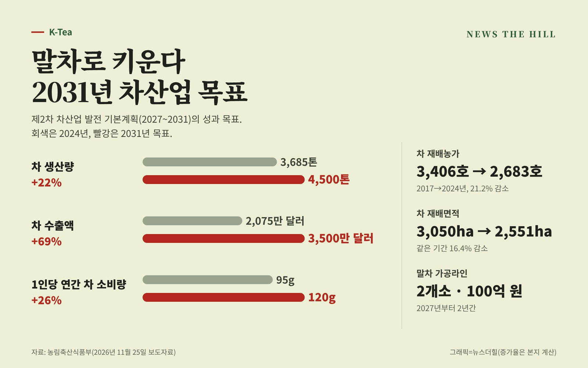

입력 2026-11-25

*그래픽=뉴스더힐(자료: 농림축산식품부)*

말차 음료와 디저트 인기에 힘입어 정부가 국산 차 산업 키우기에 나선다. 2031년까지 차 생산량을 4,500톤으로, 수출액을 3,500만 달러로 늘리고, 국민 1인당 연간 차 소비량도 120g으로 높인다는 목표다.

농림축산식품부(장관 송미령)는 지속 가능한 생산기반 구축, 말차 등 고부가가치 제품 육성, 차 소비·문화 저변 확대를 주요 내용으로 하는 '제2차 차산업 발전 기본계획(2027~2031)'을 수립해 발표했다고 25일 보도자료에서 밝혔다.

## 농가·면적은 줄고, 말차 수요는 늘고

국내 차 재배농가는 2017년 3,406호에서 2024년 2,683호로 21.2% 줄었고, 같은 기간 재배면적도 3,050ha에서 2,551ha로 16.4% 감소했다. 고령화와 노동력 부족으로 생산기반은 약해지고 있지만, 최근 말차 음료와 디저트 소비가 늘고 수출도 증가하고 있다.

농식품부는 이번 계획으로 2031년까지 차 재배면적을 2,500ha 이상 유지하고, 생산량은 3,685톤에서 4,500톤으로 늘린다. 차 수출액은 2,075만 달러에서 3,500만 달러로, 국민 1인당 연간 차 소비량은 95g에서 120g으로 높일 계획이다.

## 차밭 공동영농·기계화

차밭의 생산성과 관리상태, 농가의 영농 지속 의향을 조사해 정상관리·정비·공동관리·임대·위탁 등 5가지 관리유형을 정한다. 산지별로는 생산량·가공능력과 실제 구매 수요를 반영한 생산·공급계획을 세운다.

2027년부터는 수요기업 중심으로 농가를 조직해 차밭을 함께 관리하는 공동영농 시범사업(약 30억 원 규모)을 추진한다. 시비, 전정, 차광, 수확 등 주요 농작업을 함께 해 고령농과 소규모 농가의 부담을 덜고, 청년농에게는 임대형 다원과 현장실습, 재배·제다 교육을 연계한다.

기계화에 알맞은 평지형 다원을 조성하고 작업로·관수시설·방상팬 등 재해예방시설을 늘린다. 기계채엽과 기후변화에 적합한 우량묘 공급은 연간 4만 주에서 6만 주로 확대한다.

## 말차 가공라인 2곳에 100억 원

말차는 K-Tea 산업의 새 성장동력으로 키운다. 농식품부에 따르면 세계 말차시장은 2025년 51억 달러에서 2033년 89억 달러로 약 74% 성장할 전망이고, 우리나라 녹차 수출액도 2024년 595만 달러에서 2025년 866만 달러로 45.5% 늘었다.

생산자와 가공·수요기업이 생산량, 품질규격, 납품시기·구매조건을 미리 정하는 계약생산을 도입해 2027~2028년 시범 운영한 뒤 단계적으로 넓힌다. 2027년부터 2년간 총 100억 원을 들여 주산지 2곳에 말차 가공라인을 구축하고, 증열·건조·선별·저온 미세분쇄 등 핵심설비를 확충한다. 농식품부는 말차 가공시설 확충으로 연간 국내 생산량을 650톤 수준에서 약 800톤까지 늘린다고 밝혔다.

말차의 정의와 색상·입도 등 용도별 거래규격은 단체표준으로 새로 만든다. 수출기업에는 국가별 표시·통관정보와 국제인증 취득, 해외박람회 참가, 구매처 발굴을 지원하고, 시장성이 높은 1~2개 국가에는 체험·홍보와 수출상담을 묶은 현지 거점을 시범 운영한다.

## 공항·대학가 팝업스토어, '차의 날' 캠페인

20·30대를 중심으로 말차 음료·디저트와 바로 마실 수 있는 즉석차 음료(RTD) 소비가 늘어나는 데 맞춰 식품과 기능성 소재 제품 개발을 지원하고 카페·식품기업 판로로 연결한다.

매년 5월 25일 '차의 날'에는 유공자 포상, 학술·국제교류, 소비촉진 캠페인 등 국민 참여형 행사를 열고, 공항·대학가 등에서 시음회와 팝업스토어를 운영한다. 전통 잎차는 산지·품종·수확시기·제다인 정보를 알기 쉽게 표시해 차별화하고, 보성·하동·제주 등 주산지의 차문화 자원을 엮은 관광·체험 프로그램을 발굴한다.

생산·판매·수출입을 아우르는 차산업 전주기 통계를 구축하고, 민·관이 참여하는 차산업발전협의체를 반기마다 운영해 추진상황을 점검한다.

송미령 농식품부 장관은 "이번 기본계획은 차 생산기반을 안정적으로 유지하고, 말차 등 고부가가치 제품의 성장 가능성을 농가소득과 수출확대로 연결하기 위한 것"이라며 "국산 차가 국민의 일상에 자리 잡고 K-Tea가 세계시장에서 각광 받을 수 있도록 정책적 역량을 집중하겠다"고 밝혔다.

※ 이 기사는 농림축산식품부 보도자료(공공누리 제1유형, 출처표시)를 바탕으로 작성했습니다.
