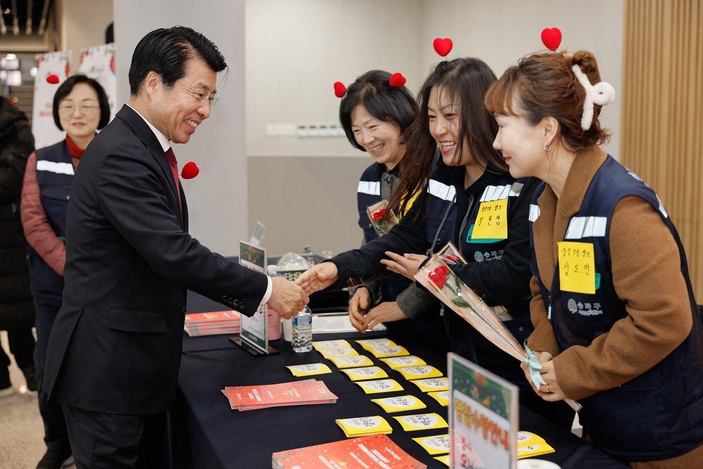
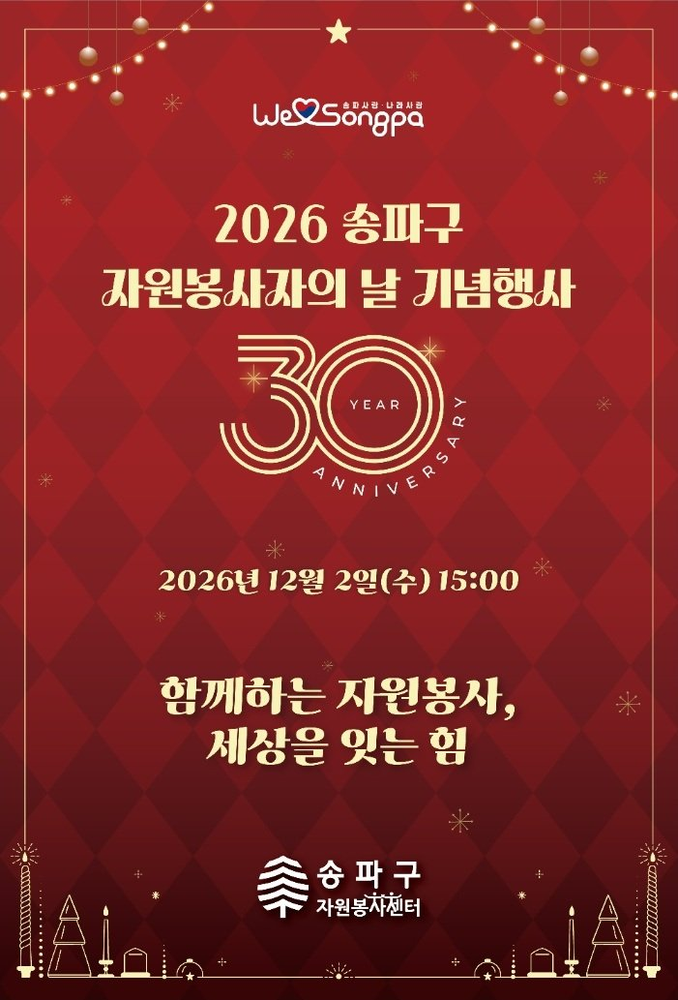
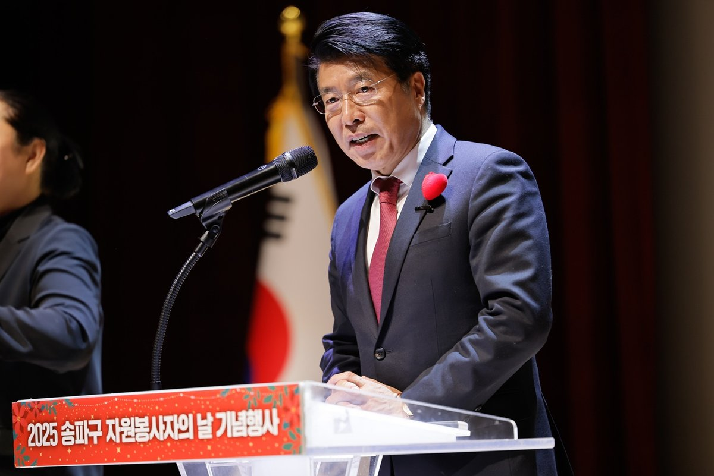

입력 2026-11-26

*지난해 열린 2025년 송파구 자원봉사자의 날 행사에서 자원봉사자들을 격려하는 모습. 사진=송파구 제공*

서울 송파구자원봉사센터가 문을 연 지 30년을 맞아 자원봉사자와 가족, 주민이 함께하는 기념행사가 열린다. 1만 시간 넘게 봉사한 주민 3명이 '소나무 금상'을 받고, 센터 개소 때부터 30년째 봉사를 이어온 주민의 사연도 소개된다.

송파구(구청장 서강석)는 26일 보도자료에서 오는 12월 2일(수) 오후 3시 송파문화예술회관 3층 송파아트홀에서 '2026년 송파구 자원봉사자의 날 기념행사'를 연다고 밝혔다.

## 30년간 16만 6천여 명이 함께한 나눔

이번 행사는 1996년 7월 4일 문을 연 송파구자원봉사센터의 설립 30주년을 기념하고, 지난 30년간 16만 6천여 명의 자원봉사자가 지역 곳곳에서 일궈온 나눔의 발자취를 되새기기 위해 마련됐다.

주제는 '함께하는 자원봉사, 세상을 잇는 힘'이다. 기념식에는 자원봉사자와 가족, 지역주민 등 약 550명이 참석할 예정이다.

*2026 송파구 자원봉사자의 날 기념행사 리플릿. 자료=송파구 제공*

행사는 청년예술인 금관5중주 팀 '모멘트엠'의 식전공연과 30주년 기념영상 상영으로 시작한다. 이어 1만 시간 이상 봉사한 '소나무 금상' 수상자 3명을 비롯해 꾸준히 나눔을 실천해 온 우수 자원봉사자와 단체에 대한 시상식, 유공자 표창이 진행된다.

## 1996년부터 30년째 봉사한 주민

센터와 30년을 함께한 장기 봉사자의 사연도 소개된다. 풍납동에 사는 박순희 씨는 센터가 문을 연 1996년부터 올해까지 30년째 봉사활동을 이어오고 있다.

## 포토존·캘리그라피 달력 등 체험부스

행사장 안팎에서는 체험·나눔 프로그램도 운영된다.

- **송파문화예술회관 1층 로비**: 30주년 기념 포토존, 복주머니 응원메시지 트리, 팝콘·옛날과자 간식부스
- **3층**: 캘리그라피 달력 제작, 인생네컷 사진관, 추억의 뽑기판, 지문 적성으로 알아보는 자원봉사

*지난해 열린 2025년 송파구 자원봉사자의 날 기념행사에서 서강석 송파구청장이 인사말을 하고 있다. 사진=송파구 제공*

서강석 송파구청장은 "송파구자원봉사센터가 걸어온 지난 30년의 역사는 이웃을 위해 기꺼이 시간과 정성을 내어준 16만 6천여 명 자원봉사자분들이 함께 써 내려간 값진 기록"이라며, "앞으로도 나눔이 일상이 되는 송파를 만들기 위해 자원봉사자들의 헌신을 세심하게 살피고 지원하는 '섬김행정'을 이어가겠다"고 전했다.

※ 이 기사는 송파구 보도자료(11월 26일)를 바탕으로 작성했습니다. 사진과 리플릿은 송파구가 보도자료와 함께 제공한 것입니다.
