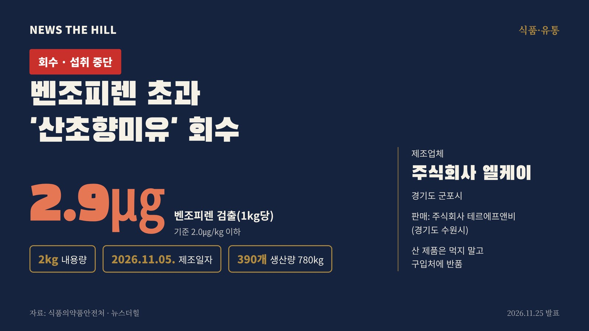

입력 2026-11-26

*그래픽=뉴스더힐(자료: 식품의약품안전처)*

음식에 향을 더할 때 쓰는 향미유 제품에서 벤조피렌이 기준치보다 많이 나와 판매 중단·회수에 들어갔다. 제조일자가 2026년 11월 5일로 표시된 2kg 제품이 대상이다.

식품의약품안전처는 식품제조·가공업체 주식회사 엘케이(경기도 군포시)가 제조하고 유통전문판매업체 주식회사 테르에프앤비(경기도 수원시)가 판매한 '산초향미유'(식품유형: 향미유)에서 벤조피렌이 기준치보다 초과 검출돼 해당 제품을 판매 중단하고 회수 조치한다고 25일 보도참고자료에서 밝혔다.

## 회수 대상

- 제품명(식품유형): 산초향미유(향미유)
- 제조업체: 주식회사 엘케이(경기도 군포시)
- 유통업체: 주식회사 테르에프앤비(경기도 수원시)
- 제조일자: 2026년 11월 5일로 표시된 제품(소비기한: 제조일로부터 1년)
- 내용량: 2kg (생산량 780kg, 390개)

## 얼마나 나왔나

벤조피렌 기준은 1kg당 2.0㎍(마이크로그램)인데, 이 제품에서는 2.9㎍이 검출됐다. 기준의 1.45배(본지 계산)다. 검사는 중앙생명연구원 주식회사가 맡았고, 회수는 경기도 군포시청이 진행한다.

## 소비자 행동 요령

- 해당 제품을 샀다면 먹지 말고 산 곳에 반품한다. 식약처는 구매 소비자에게 섭취를 중단하고 구입처에 반품해 달라고 당부했다.
- 식품 관련 불법 행위를 보면 불량식품 신고전화 1399나 식품안전정보 앱 '내손안'으로 신고할 수 있다.

※ 이 기사는 식품의약품안전처 보도참고자료(정책브리핑 전재, 공공누리 제1유형·텍스트에 한함)를 바탕으로 작성했습니다.
