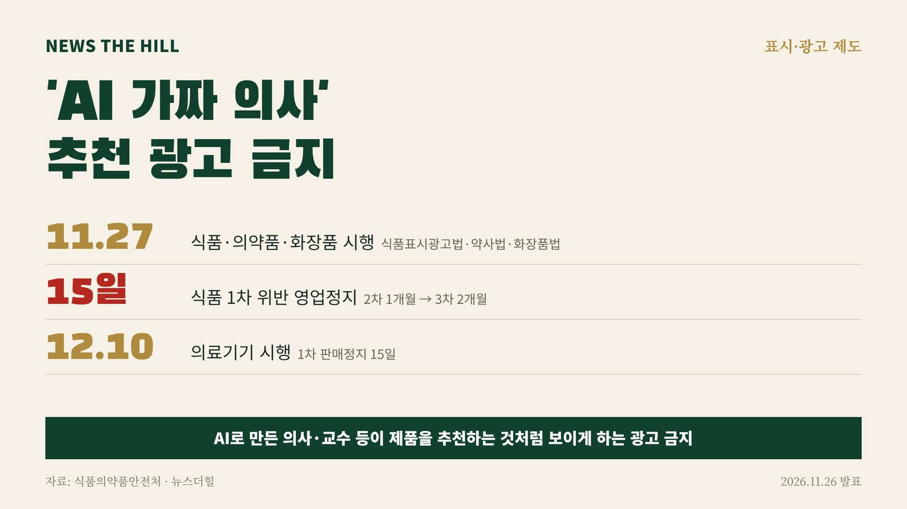

입력 2026-11-26

*그래픽=뉴스더힐(자료: 식품의약품안전처)*

인공지능(AI)으로 만든 가상의 의사나 교수가 제품을 추천하는 것처럼 꾸민 광고가 27일부터 금지된다. 식품·건강기능식품·축산물을 파는 업체가 이런 광고를 하다 걸리면 처음 위반에도 영업정지 15일 처분을 받는다.

식품의약품안전처는 AI 기술을 활용해 의사 등 가짜 전문가가 식품·의약품·의약외품·화장품·의료기기를 추천하는 것으로 오인하게 하는 광고를 금지하기 위해 관련 법령의 시행규칙을 정비하고 제도를 시행한다고 26일 보도자료에서 밝혔다.

## 언제부터, 무엇이 금지되나

「식품 등의 표시·광고에 관한 법률」, 「약사법」, 「화장품법」은 2026년 11월 27일(금)부터, 「의료기기법」은 12월 10일(목)부터 시행된다.

개정된 시행규칙은 식품·건강기능식품·축산물, 의약품·의약외품, 화장품, 의료기기에 대해 AI 가짜 전문가가 보증하거나 추천하는 것으로 소비자가 오인할 우려가 있는 광고행위를 금지하고, 위반하면 영업정지 또는 광고·판매업무정지 등 행정처분을 하도록 기준을 마련했다.

식약처는 AI 기술 발전으로 실제 사람과 구분하기 어려운 가상의 인물(의사·교수 등)이 제품을 추천하는 광고가 늘어남에 따라 소비자의 경제적 피해와 건강상 위해를 막기 위해 이번 조치를 마련했다고 설명했다.

## 위반하면 받는 처분

- 식품 등의 표시·광고에 관한 법률 시행규칙: 1차 영업정지 15일 → 2차 영업정지 1개월 → 3차 영업정지 2개월
- 의약품 등의 안전에 관한 규칙: 1차 품목 광고업무정지 1개월 → 2차 2개월 → 3차 3개월 → 4차 6개월
- 화장품법 시행규칙: 1차 품목 광고업무정지 2개월 → 2차 4개월 → 3차 6개월 → 4차 이상 12개월
- 의료기기법 시행규칙(12월 10일 시행): 1차 판매정지 15일 → 2차 1개월 → 3차 3개월 → 4차 6개월

## 법 개정 후속 조치

앞서 관계부처는 2025년 12월 10일 국가정책조정회의에서 「AI 등을 활용한 시장 질서 교란 허위·과장광고 대응 방안」을 마련했고, 이에 따라 네 법률이 개정돼 시행을 앞두고 있다. 이번 시행규칙 개정은 법률 개정에 따른 후속 조치다.

식약처는 가짜·조작·왜곡 정보와 부당광고 등 시장 질서를 교란하는 행위에 대응하기 위해 2026년 3월 24일 전담조직인 식품부당행위긴급대응단을 출범시켰다. 정보 수집부터 현장 점검·단속, 과학적 검증, 제도 개선까지 통합 대응체계를 운영하며 부당광고 점검을 강화하고 있다.

식약처는 앞으로도 AI 등 신기술을 악용한 부당광고로부터 국민을 보호해 안심할 수 있는 온라인 소비 환경을 만들어 나갈 계획이라고 밝혔다.

※ 이 기사는 식품의약품안전처 보도자료(정책브리핑 전재, 공공누리 제1유형·텍스트에 한함)를 바탕으로 작성했습니다.
