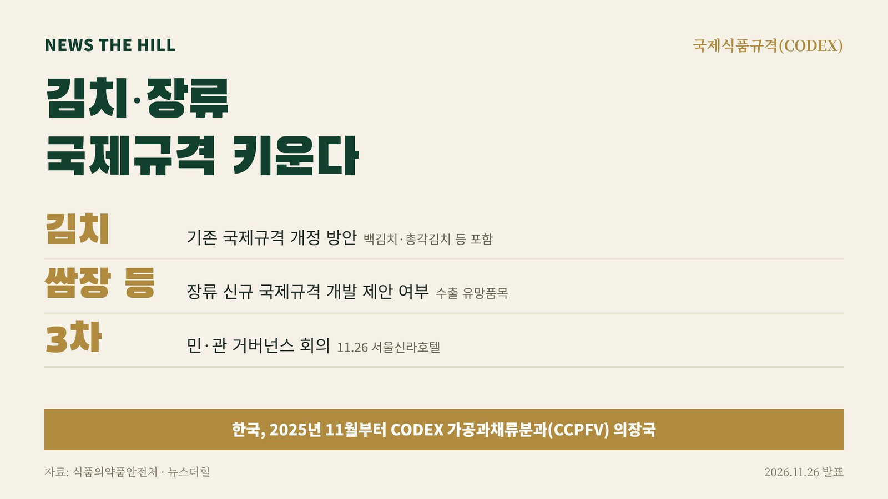

입력 2026-11-26

*그래픽=뉴스더힐(자료: 식품의약품안전처)*

백김치·총각김치 등을 담을 수 있도록 김치 국제규격을 고치는 방안과, 쌈장 같은 장류의 국제규격을 새로 만드는 방안이 민·관 회의 테이블에 올랐다. 우리나라가 의장국을 맡고 있는 국제식품규격위원회(CODEX) 분과의 국내 민·관 협의체 회의에서다.

식품의약품안전처는 26일 서울신라호텔(서울 중구)에서 CODEX 가공과채류분과(CCPFV)의 효율적인 운영과 K-푸드 국제규격 개발을 위한 제3차 민·관 거버넌스 회의를 개최한다고 이날 보도자료에서 밝혔다.

## 김치 규격 개정, 장류 신규 규격 검토

이번 회의에서는 백김치, 총각김치 등을 포함하도록 기존 김치 국제규격을 개정하는 방안과 우리나라 장류 수출 유망품목인 쌈장 등의 신규 국제규격 개발 제안 여부를 중점적으로 논의한다.

세계김치연구소는 김치 국제규격 개정 필요성과 관련 제안사항을 발표하고, 한국장류협동조합은 우리나라 장류의 수출 유망품목을 소개하며 국제규격 개발 가능성을 제시한다. CODEX 총회 부의장과 국제과채주스협회(IFU) 관계자도 참여해 국제 식품규격의 중요성과 국제 과채주스 산업 동향 등 CCPFV의 발전 방향에 대한 의견을 나눈다.

## 한국이 의장국인 분과

가공과채류분과는 과일·채소 가공식품의 안전·품질·표시 등에 관한 국제규격을 논의하는 CODEX 분과위원회로, 우리나라가 2025년 11월 의장국을 맡았다. 식약처는 지난 2월 관계부처, 연구기관, 학계, 산업계가 참여하는 민·관 거버넌스를 발족해 국제규격 논의에 대응하고 국내 식품산업의 의견을 반영한 규격 개발 과제를 찾고 있다.

## 회의 개요

- 행사명: CCPFV 미래전략 심포지엄 및 제3차 거버넌스 회의
- 일시·장소: 2026년 11월 26일(목), 서울신라호텔(서울 중구)
- 순서: 미래전략 논의(10:40~11:40), 거버넌스 회의(13:00~15:00)
- 참석: 국내외 CODEX 업무 관련자 등 30명

식약처는 회의에서 논의된 내용을 바탕으로 김치·장류 등 K-푸드의 국제규격 개발 과제를 발굴하고, 관계부처·민간 전문가와 협력해 국제식품규격 논의를 주도해 나갈 계획이다. 국내 식품산업의 수요가 국제기준에 반영될 수 있도록 민·관 협력도 계속 강화할 예정이다.

※ 이 기사는 식품의약품안전처 보도자료(정책브리핑 전재, 공공누리 제1유형·텍스트에 한함)를 바탕으로 작성했습니다.
