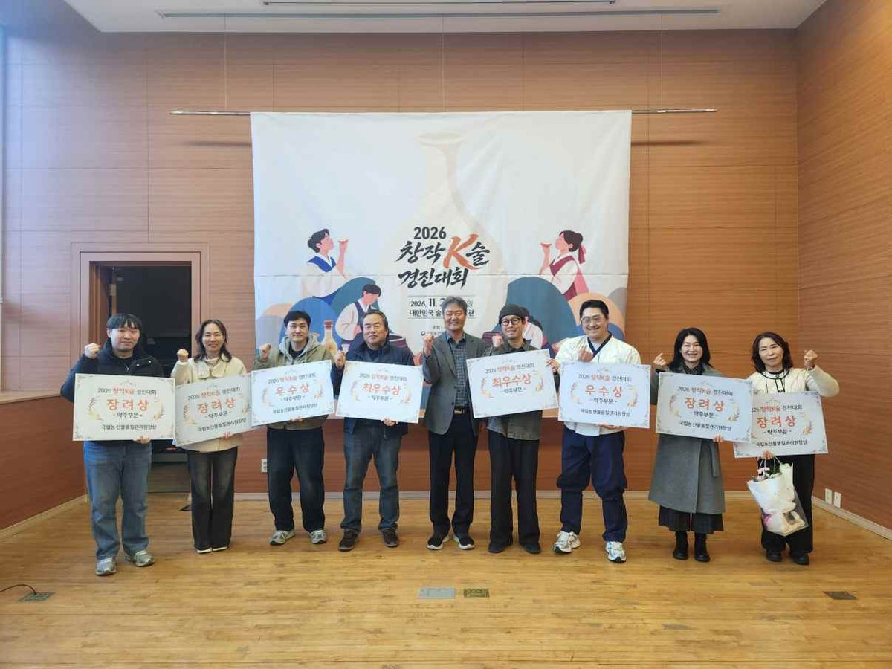

입력 2026-11-26

*'2026년 창작 K-Sool 경진대회' 행사 모습(11월 24일, 전북 완주군 대한민국술테마박물관). 사진=국립농산물품질관리원 제공*

전통주 교육기관 교육생들이 국내산 원료로 직접 빚은 창작 술 가운데 탁주 '선해주'와 약주 '부여 과하주'가 올해 최고의 작품으로 뽑혔다.

국립농산물품질관리원(원장 김철, 이하 농관원)은 11월 24일 전북특별자치도 완주군 대한민국술테마박물관에서 연 '2026년 창작 K-Sool 경진대회'에서 탁주와 약주 2개 부문 총 8점의 우수 작품을 선정했다고 26일 보도자료에서 밝혔다.

이번 대회는 전통주 교육기관 교육생들의 창작 의욕을 높이고 창업·취업을 활성화하기 위해 마련됐다. 우리 술 관련 전문가 5명이 국내산 원료로 직접 빚은 창작 술의 색·향·맛·질감 등을 종합적으로 평가했다.

## 약주 최우수 '부여 과하주'

약주 부문 최우수상은 한국식품연구원 김태완 교육생의 '부여 과하주'가 받아 농림축산식품부 장관상을 수상했다. 국내산 유기농 쌀을 활용해 과하주 방식으로 발효한 약주로, 은은한 연잎 누룩 향과 단맛·산미가 어우러진 부드럽고 깔끔한 맛에서 좋은 평가를 받았다. 과하주 방식은 발효가 진행 중인 술덧에 도수가 높은 증류주를 넣어 알코올 농도를 급격히 높임으로써 발효를 인위적으로 멈추는 방식이다.

## 탁주 최우수 '선해주'

탁주 부문 최우수상은 한국베버리지마스터협회 장성보 교육생의 '선해주'가 차지해 농림축산식품부 장관상을 받았다. 국내산 쌀과 누룩을 주원료로 삼양주 방식을 활용해 빚은 탁주로, 은은한 누룩·과일 향과 묵직하고 부드러운 맛이 조화를 이뤄 심사위원들의 높은 평가를 받았다. 삼양주 방식은 밑술을 먼저 만든 뒤 두 차례 덧술을 더해 모두 세 번에 걸쳐 나눠 빚는 전통 양조 기법이다.

심사위원들은 교육생들의 전통주에 대한 깊은 애정을 느낄 수 있는 자리였으며, 특히 약주 출품작은 시제품으로 바로 출시해도 시장 경쟁력이 충분할 것이라고 평가했다.

## 수상작 8점

탁주와 약주 각 부문에서 우수상 1점, 장려상 2점씩 모두 6점은 농관원장상을 받았다.

- 탁주 최우수상: 선해주(장성보, 한국베버리지마스터협회)
- 탁주 우수상: 한톨주(이은효, 막걸리학교)
- 탁주 장려상: 봄아씨(위춘희, 한국발효술교육연구원), 신라미소(정경희, 신선)
- 약주 최우수상: 부여 과하주(김태완, 한국식품연구원)
- 약주 우수상: 당연(박제우, 한국전통음식연구소)
- 약주 장려상: 여름추수(김재용, 한국발효술교육연구원), '부 연 향'(윤지원, 신라대)

대회에 참가한 교육생들은 "교육과정에서 배운 전통주 제조 기술을 활용하여 직접 빚은 작품을 전문가들에게 평가받을 수 있는 뜻깊은 기회였다"라며, "앞으로도 우리 전통주의 다양한 맛과 가치를 알릴 수 있는 술을 제조하고 싶다"라고 말했다.

김철 농관원장은 "이번 창작 K-Sool 경진대회는 전통주 교육기관 교육생들의 창의적인 아이디어와 무한한 잠재력을 확인하였고, 우리 전통주의 새로운 가능성을 보여준 의미있는 자리였다"라며, "앞으로도 전통주 전문인력의 역량 강화와 창작 활동을 지원하여 전통주 산업 활성화에 기여할 수 있도록 노력하겠다"라고 밝혔다.

※ 이 기사는 농림축산식품부(국립농산물품질관리원) 보도자료(공공누리 제1유형, 출처표시)를 바탕으로 작성했습니다. 사진은 국립농산물품질관리원이 보도자료와 함께 제공한 것입니다.
