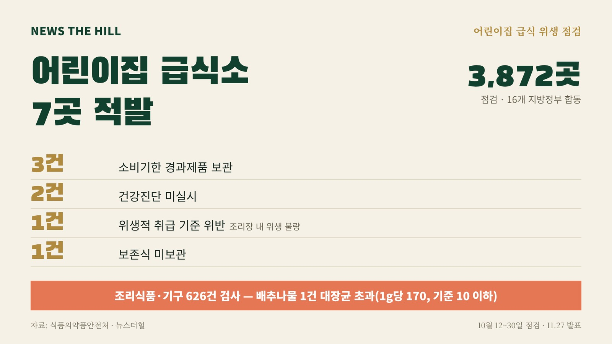

입력 2026-11-27

*그래픽=뉴스더힐(자료: 식품의약품안전처)*

전국 어린이집 집단급식소 3,872곳을 위생 점검한 결과 소비기한이 지난 제품을 보관하거나 건강진단을 하지 않은 곳 등 7곳이 「식품위생법」 위반으로 적발됐다. 조리식품 등을 수거해 검사한 626건 가운데 1건에서는 대장균이 기준을 넘었다.

식품의약품안전처는 영유아 급식시설의 식중독 예방을 위해 이같이 점검하고 적발된 곳에 대해 지방정부에 행정처분을 요청했다고 27일 보도자료에서 밝혔다.

## 점검 기간과 방법

이번 점검은 16개 지방정부와 함께 10월 12일(월)부터 10월 30일(금)까지 했다. 점검과 함께 식중독균 오염 여부를 확인하기 위해 조리식품 등을 수거해 검사했다.

## 주요 위반 내용

- 소비기한 경과제품 보관: 3건
- 건강진단 미실시: 2건
- 조리장 내 위생 불량으로 인한 위생적 취급 기준 위반: 1건
- 보존식 미보관: 1건

적발된 곳은 관할 관청이 과태료 부과 등 행정처분을 하고, 6개월 안에 다시 점검할 계획이다.

## 적발 어린이집 (가나다순)

- 브레인영재어린이집(경남 창원시): 식품의 위생적 취급기준 위반(조리장 내 위생불량)
- 사회복지법인 감곡어린이집(충북 음성군): 소비기한 경과제품 보관
- 사회복지법인 하나어린이집(충남 부여군): 건강진단 미실시
- 새나라어린이집(충북 음성군): 소비기한 경과제품 보관
- 생극어린이집(충북 음성군): 소비기한 경과제품 보관
- 초록별어린이집(충북 청주시): 건강진단 미실시
- 튼튼어린이집(서울 강서구): 보존식 미보관

## 수거·검사 부적합 1건

조리식품·기구 등 626건을 수거해 검사한 결과 하얀어린이집(충북 제천시)의 조리식품 배추나물에서 대장균이 1g당 170 검출됐다. 기준은 1g당 10 이하다. 식약처는 이 시설에 대해서도 행정처분을 요청했다.

식약처는 앞으로도 어린이집 등 집단급식소에 대한 위생점검을 계속할 계획이라고 밝혔다.

※ 이 기사는 식품의약품안전처 보도자료(정책브리핑 전재, 공공누리 제1유형·텍스트에 한함)를 바탕으로 작성했습니다.
