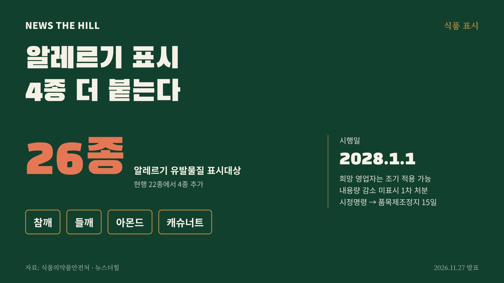

입력 2026-11-27

*그래픽=뉴스더힐(자료: 식품의약품안전처)*

앞으로 참깨·들깨·아몬드·캐슈너트가 들어간 식품에는 알레르기 유발물질 표시를 해야 한다. 표시대상은 메밀, 땅콩 등 현행 22종에서 26종으로 늘어난다. 시행일은 2028년 1월 1일이지만, 원하는 영업자는 그 전에 먼저 적용할 수 있다.

식품의약품안전처는 이런 내용을 담은 「식품표시광고법 시행규칙」이 11월 26일 개정·공포됐다고 27일 보도참고자료에서 밝혔다. 가격은 그대로 두고 내용량을 줄인 사실을 표시하지 않는 이른바 슈링크플레이션에 대한 행정처분도 강화됐다.

## 주요 개정 내용

- 참깨·들깨·아몬드·캐슈너트 4종을 알레르기 유발물질 표시대상에 추가
- 내용량 감소사실 미표시(슈링크플레이션)에 대한 행정처분 기준 강화
- 광고에 쓸 수 없는 "한방", "특수제법", "주문쇄도", "단체추천" 등의 표현에 대한 행정처분 기준 명확화
- AI로 만든 가상의 전문가를 활용한 부당광고에 대한 행정처분 기준 신설

## 알레르기 표시 4종 추가

알레르기 표시 확대는 '2026 식의약 안심 60대 과제'의 하나다. 식약처는 국내 식품 알레르기 유병률과 외국의 관련 규정 등을 고려해 4종을 추가했다고 설명했다.

포장지 제작·교체에 따른 영업자의 비용 부담을 줄이기 위해 시행일(2028년 1월 1일) 이전이라도 원하는 영업자는 조기에 적용할 수 있도록 했다.

## 용량 꼼수·부당광고 처분 강화

식품분야 용량꼼수 대응방안의 후속 조치로, 가격을 유지하면서 내용량을 줄이고도 그 사실을 표시하지 않은 경우의 처분이 무거워졌다. 식품제조가공업·유통전문판매업 기준으로 1차 위반 처분이 시정명령에서 품목제조정지 15일로 바뀐다.

AI 등 신기술을 활용한 허위·과장광고에 대응해 가상의 의·약사 등 전문가를 활용한 부당광고에 대한 처분 기준도 새로 생겼다. 식품제조가공업·유통전문판매업 기준으로 1차 영업정지 15일, 2차 1개월, 3차 2개월이다. 실제 전문가를 활용하는 광고에 대한 처분 기준도 1차 시정명령에서 1차 영업정지 15일로 맞춰 정비했다.

개정된 시행규칙은 국가법령정보센터(law.go.kr)나 식약처 대표 누리집(mfds.go.kr)의 법령 자료에서 확인할 수 있다.

※ 이 기사는 식품의약품안전처 보도참고자료(정책브리핑 전재, 공공누리 제1유형·텍스트에 한함)를 바탕으로 작성했습니다.
